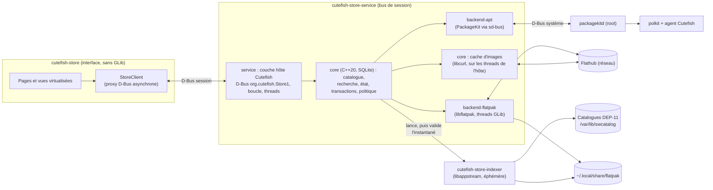
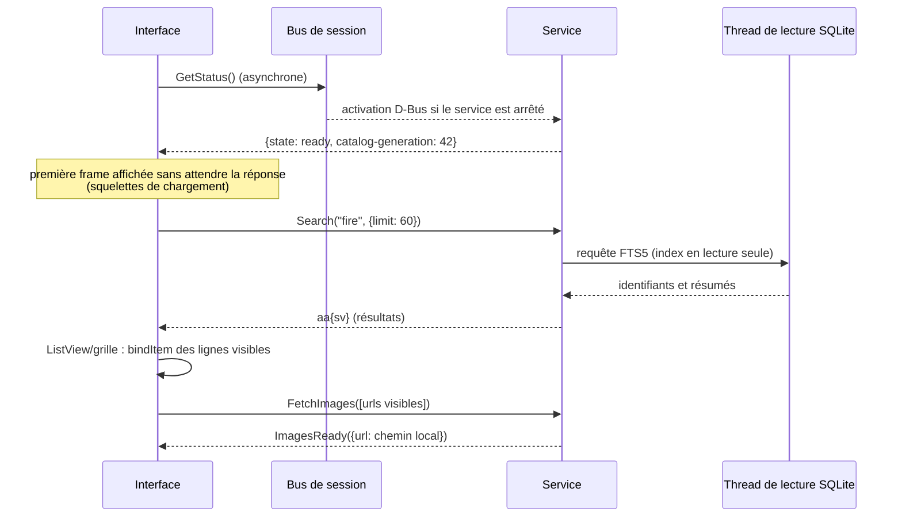
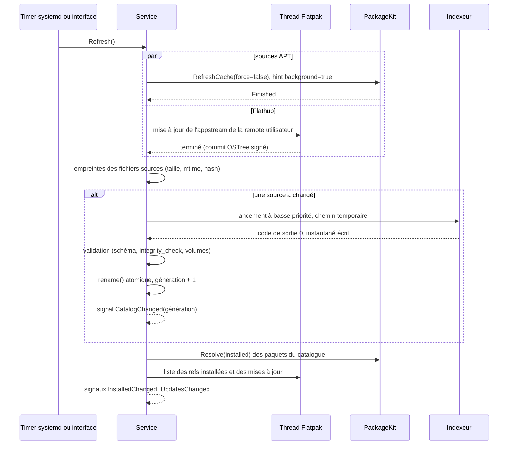
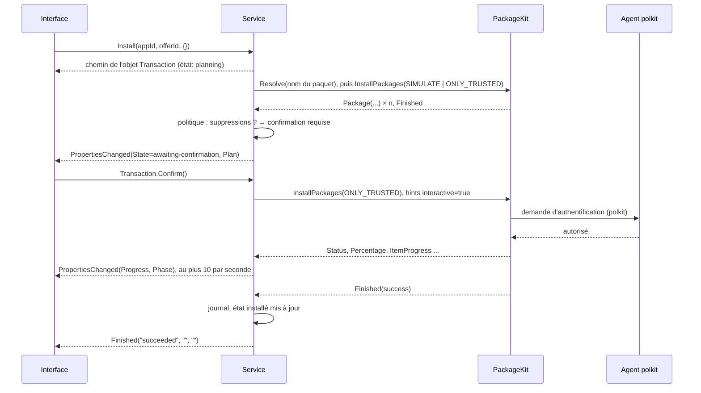
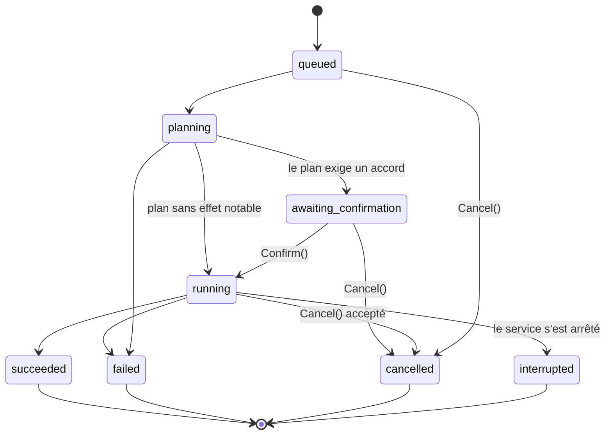

# Cutefish Store — Architecture technique

Statut : **référence de conception, phase 0.2**. Aucune ligne de code n'existe
encore. Ce document décrit ce qui sera construit. Les décisions qu'il applique,
et celles qui restent ouvertes, sont tenues à jour dans
[DECISIONS.md](DECISIONS.md) (identifiants `D-`, `P-`, `O-`).

Niveau de preuve, comme dans l'audit de la phase 0.1 :

- **[CODE]** : vérifié dans le code des dépôts CutefishOS ;
- **[DOC]** : documentation officielle ;
- **[MESURÉ]** : mesuré sur la machine d'audit (Debian 13, AppStream 1.0.5,
  PackageKit 1.3.1, libflatpak 1.16.6, SQLite 3.46.1) ;
- **[SYMBOLE]** : symbole présent dans la bibliothèque installée ; la
  signature et la sémantique restent à confirmer dans la documentation de
  l'API ;
- **[HYPOTHÈSE]** : non vérifié, à valider ;
- **[À VALIDER]** : point de conception à confirmer par un prototype ou une
  mesure avant de s'y engager.

## Sommaire

1. [Vision et principes](#1-vision-et-principes)
2. [Architecture globale](#2-architecture-globale)
3. [Diagrammes et flux de données](#3-diagrammes-et-flux-de-données)
4. [Responsabilités des composants](#4-responsabilités-des-composants)
5. [Spécification préliminaire de l'API D-Bus](#5-spécification-préliminaire-de-lapi-d-bus)
6. [Catalogue et index](#6-catalogue-et-index)
7. [Backends APT et Flatpak](#7-backends-apt-et-flatpak)
8. [Threads et GLib](#8-threads-et-glib)
9. [Modèle de sécurité](#9-modèle-de-sécurité)
10. [Performances et caches](#10-performances-et-caches)
11. [Arborescence du projet](#11-arborescence-du-projet)
12. [Dépendances et compilation](#12-dépendances-et-compilation)
13. [Stratégie de tests](#13-stratégie-de-tests)
14. [Limites, risques et évolutions](#14-limites-risques-et-évolutions)

---

## 1. Vision et principes

Cutefish Store est une boutique logicielle pour Linux. Elle est native dans
Cutefish en v1, et son cœur est conçu pour être réutilisé par d'autres
interfaces et sur d'autres environnements (D-001). La v1 gère APT/DEB et
Flatpak (D-003).

### Principes

1. **Le thread graphique ne fait que de l'interface.**
   - Aucun réseau, aucun parsing important, aucune requête SQL et aucun appel
     D-Bus synchrone sur ce thread.
   - L'interface ne parle qu'au service, de façon asynchrone.
2. **Une seule frontière : l'API D-Bus.**
   - L'interface ne connaît ni PackageKit, ni libflatpak, ni AppStream, ni le
     schéma SQLite (D-002, P-004).
   - Toute autre interface future utilise le même contrat.
3. **Un cœur indépendant de Cutefish** (P-006).
   - `store-core` ne dépend que de C++20, de SQLite et de libcurl : ni
     toolkit, ni `ToolkitBase`, ni GLib, ni D-Bus.
   - Il ne crée ni boucle d'événements ni thread. La couche hôte les fournit,
     et peut être remplacée sans réécrire le cœur.
4. **GLib reste là où elle est indispensable.**
   - libflatpak est confinée au service, sur des threads dédiés.
   - libappstream est confinée à l'indexeur, un processus éphémère (D-004,
     P-002).
   - L'interface ne charge jamais GLib.
5. **Aucun privilège propre.**
   - Les opérations système passent par PackageKit, qui applique polkit.
   - Flatpak s'installe dans l'espace utilisateur (D-005, P-007).
6. **Les différences entre backends restent visibles.**
   - L'abstraction commune couvre le cycle de vie (rechercher, planifier,
     exécuter, suivre, annuler).
   - Les détails propres à chaque format (paquets supprimés par APT,
     permissions Flatpak) restent dans le plan, sans être aplatis.
7. **Mesurer avant d'optimiser, mais concevoir pour la vitesse.** Les
   structures (index FTS5, vues virtualisées, caches) sont choisies d'après les
   mesures de la phase 0.1. Les objectifs chiffrés (§10) sont vérifiés en CI.
8. **Simplicité.**
   - Pas de plugins dynamiques, pas d'abstraction pour des formats
     hypothétiques (P-001).
   - Une seule couche entre le service et chaque gestionnaire.
9. **Conventions Cutefish.** C++20, CMake, conventions de nommage, GoogleTest,
   gettext, activation D-Bus et polkit comme dans cutefish-core (P-013).

### Hors périmètre v1

- Snap, AppImage, RPM, dépôts éditeurs.
- Notes et avis, comptes utilisateurs, paiements.
- Mises à jour hors ligne du système (O-005).
- Installation Flatpak système (D-005, O-006).
- Sessions X11.

---

## 2. Architecture globale

### Processus

| Processus | Rôle | Durée de vie | Privilèges | Dépendances notables |
|---|---|---|---|---|
| `cutefish-store` | Interface graphique | Tant que la fenêtre est ouverte | Utilisateur | `Cutefish::Toolkit` ; **pas** de GLib |
| `cutefish-store-service` | Héberge le cœur : catalogue, recherche, état, transactions, images, sources | Activé par D-Bus ou par timer ; s'arrête sur inactivité (P-010) | Utilisateur | `store-core` (SQLite, libcurl), libflatpak (GLib) ; couche hôte : `Cutefish::ToolkitBase` |
| `cutefish-store-indexer` | Lit les catalogues AppStream et produit un instantané du catalogue | Lancé par le service, se termine après l'écriture | Utilisateur | `store-core`, libappstream (GLib), SQLite ; **pas** de toolkit |

Composants extérieurs utilisés (aucun n'est modifié) :

| Composant | Utilisé pour | Bus ou mécanisme |
|---|---|---|
| PackageKit (`packagekitd`, root) + backend `apt` | Tout ce qui touche APT : état installé, plan, installation, suppression, mises à jour, rafraîchissement | Bus système, `org.freedesktop.PackageKit` |
| polkit et agent polkit de Cutefish (`cutefish-core/polkit-agent`) | Authentifications demandées par PackageKit | Bus système |
| libflatpak (dans le service) | Installation utilisateur : remotes, refs, transactions, métadonnées AppStream de Flathub | Bibliothèque ; aucun démon pour l'installation utilisateur |
| `flatpak-system-helper` | Seulement si l'installation système est activée plus tard (O-006) | Bus système, via libflatpak |
| `org.cutefish.AppRuntime` (cutefish-core) | Lancer une application installée | Bus de session [CODE] |
| `org.freedesktop.Notifications` | Notifier les mises à jour et la fin des transactions en arrière-plan | Bus de session ; serveur Cutefish non vérifié (O-010) |
| systemd utilisateur | Unité du service et timer de rafraîchissement | — |

### Emplacements des données

Tous les emplacements sont relatifs aux répertoires XDG de l'utilisateur. Rien
n'est écrit dans `/etc` ou `/var` par la boutique elle-même.

| Donnée | Emplacement | Nature |
|---|---|---|
| Instantané du catalogue | `$XDG_CACHE_HOME/cutefish-store/catalog.sqlite` | Régénérable (P-003) |
| Images téléchargées | `$XDG_CACHE_HOME/cutefish-store/images/` | Régénérable, borné en taille |
| État et journal des transactions | `$XDG_STATE_HOME/cutefish-store/state.sqlite` | Mutable, propriété du service |
| Préférences | `$XDG_CONFIG_HOME/cutefish-store/settings.ini` | INI au format de `base::Settings` [CODE] |
| Installation Flatpak utilisateur | `~/.local/share/flatpak` | Gérée par libflatpak |

### Pourquoi un service, plusieurs bibliothèques et un indexeur séparé

On aurait pu tout regrouper dans le service, ou découper en plusieurs
services. Le choix retenu (P-001, P-002) :

- **un seul service résident** : un seul nom de bus, un seul cycle de vie, une
  seule file de transactions ;
- **des bibliothèques statiques internes** (`common`, `core`, `backend-apt`,
  `backend-flatpak`, `service`), testables séparément, sans ABI de plugin,
  réparties en couches (ci-dessous) ;
- **un seul processus annexe, l'indexeur**, justifié par deux faits :
  1. [MESURÉ] parser tout Flathub avec libappstream monte à 459 Mo RSS de
     pic ; cette mémoire n'a rien à faire dans un processus résident ;
  2. le XML vient du réseau : un plantage de parseur ne doit pas emporter les
     transactions en cours.

  Les transactions et les backends restent dans le service : ils ont besoin
  d'un état partagé (file, verrous, journal) et d'une durée de vie longue.

### Couches et dépendance à Cutefish

| Couche | Bibliothèques | Dépend de | Ne dépend jamais de |
|---|---|---|---|
| **Cœur métier** | `core` | C++20, SQLite, libcurl | Cutefish (toolkit et `ToolkitBase`), GLib, D-Bus, boucle d'événements, threads |
| **Adaptateur Flatpak** | `backend-flatpak` | `core`, libflatpak (GLib), threads standard | Cutefish |
| **Logique PackageKit** | `backend-apt` (partie logique) | `core` | Cutefish, D-Bus |
| **Indexeur** | `indexer` | `core`, libappstream (GLib) | Cutefish, D-Bus |
| **Couche hôte Cutefish** | `service`, transport D-Bus de PackageKit | `core`, adaptateurs, `Cutefish::ToolkitBase` (D-Bus, boucle, threads, `FileWatch`, `Process`, `Settings`, `SessionLanguage`, journaux) | `Cutefish::Toolkit` |
| **Interface** | `ui` | `common`, `Cutefish::Toolkit` | `core`, adaptateurs, GLib, SQLite, libcurl |

**Contrat entre le cœur et l'hôte** :

- les objets du cœur ne sont pas partagés entre threads, sauf mention
  contraire ; l'hôte choisit sur quel thread il les utilise ;
- les opérations du cœur sont synchrones (requête SQLite, téléchargement d'une
  image, transition d'état d'une transaction). L'hôte décide si elles
  s'exécutent sur son thread principal ou sur un pool ;
- les adaptateurs asynchrones (Flatpak, transport PackageKit) livrent leurs
  résultats par une fonction `post(std::function<void()>)` donnée par l'hôte,
  qui les exécute sur son thread principal. C'est le **seul** point
  d'injection ;
- la journalisation passe par une fonction de rappel installée par l'hôte
  (sortie d'erreur par défaut) ; les réglages sont passés au cœur sous forme de
  valeurs.

**Remplacer la couche hôte** (autre environnement, client en ligne de
commande, banc de test) demande de fournir : une boucle exécutant `post`,
l'export de l'API (D-Bus ou autre), un pool pour les lectures SQLite et les
téléchargements, le lancement de l'indexeur, des timers, la surveillance des
fichiers de catalogue, un transport D-Bus vers PackageKit, le stockage des
réglages et la langue de session. Le cœur, l'indexeur et l'adaptateur Flatpak
sont repris tels quels.

---

## 3. Diagrammes et flux de données

### 3.1 Composants



### 3.2 Démarrage de l'interface et recherche



### 3.3 Rafraîchissement du catalogue



### 3.4 Installation d'un paquet APT



### 3.5 États d'une transaction



Pendant `running`, une **phase** plus fine est publiée : `waiting-for-auth`,
`waiting-for-lock`, `downloading`, `installing`, `removing`, `finishing`. Elle
est dérivée du `Status` de PackageKit ou des opérations de `FlatpakTransaction`.

---

## 4. Responsabilités des composants

### 4.1 `cutefish-store` (interface)

**Fait** :

- pages Accueil, Catégories, Recherche, Détails, Installées, Mises à jour,
  Sources, Préférences ;
- vues virtualisées : `ListView` du toolkit [CODE], grille virtualisée à
  écrire (§10) ;
- thème, mode sombre, couleur d'accent via `AppearanceWatcher` [CODE] ;
- affichage de la progression des transactions à partir des propriétés D-Bus ;
- confirmation des plans (suppressions, permissions) ;
- lancement d'une application installée via `org.cutefish.AppRuntime` [CODE].

**Ne fait pas** :

- accès réseau ;
- lecture de fichiers du service ;
- appels à PackageKit ou Flatpak ;
- décisions de sécurité. L'interface affiche les plans, mais la règle « cette
  transaction exige une confirmation » vient du service (P-008).

### 4.2 `common` (bibliothèque partagée par l'interface et le service)

- Noms D-Bus, noms d'erreurs, clés des dictionnaires `a{sv}`, valeurs des
  énumérations sérialisées (états, phases, types de backend).
- Conversions entre ces dictionnaires et des structures C++ simples
  (`AppSummary`, `TransactionInfo`, …).
- Aucune logique métier. Les constantes du contrat ne dépendent de rien ; les
  conversions utilisent `dbus::Variant` de `Cutefish::ToolkitBase`, ce qui
  place `common` du côté Cutefish (interface et couche hôte), jamais dans le
  cœur.

### 4.3 `core`

Contraintes (P-006) : C++20, SQLite et libcurl seulement ; aucune boucle
d'événements, aucun thread créé, aucun D-Bus, aucune bibliothèque Cutefish.
Les opérations sont synchrones ; l'hôte les exécute sur les threads de son
choix.

- **Modèle** : `App` (composant AppStream fusionné), `Offer` (une façon de
  l'installer : un paquet APT ou une ref Flatpak), `InstalledItem`,
  `UpdateItem`, `Plan`, `Transaction`.
- **Catalogue** : ouverture de l'instantané en lecture seule, requêtes de
  navigation et de détail, génération courante, remplacement atomique.
- **Recherche** : traduction de la saisie en requête FTS5, classement, filtres.
- **Dédoublonnage** : règles de fusion et de choix de l'offre par défaut. Elles
  sont appliquées par l'indexeur, mais définies dans `core` pour être testables
  et partagées.
- **État** : `state.sqlite` (installé, mises à jour, journal), réconciliation
  avec les backends.
- **Transactions** : file par backend, machine d'états (§3.5), politique de
  confirmation (P-008), journal, reprise après redémarrage.
- **Images** : politique de planification (priorité, déduplication,
  annulation), cache disque borné, et téléchargement synchrone d'une image
  (libcurl) que l'hôte exécute sur ses threads.
- **Sources** : liste unifiée des sources (dépôts APT en lecture, remotes
  Flatpak), activation de Flathub (P-011).
- **Erreurs** : taxonomie commune (§5.6) et traduction des erreurs des
  backends.
- **Interface `Backend`** (§7.1), avec deux implémentations.

### 4.4 `backend-apt`

- Deux parties :
  - une **logique** sans dépendance à Cutefish ni à D-Bus : traduction des
    énumérations, des `package_id` et des signaux en modèle commun,
    construction du plan ;
  - un **transport** D-Bus vers `org.freedesktop.PackageKit` sur le bus
    système, fourni par la couche hôte avec `base::dbus` [CODE] (D-007).
- Correspondance entre noms de paquets et `package_id`, état installé,
  simulation, installation, suppression, mises à jour, rafraîchissement,
  liste des dépôts.
- Traduction de `Status`, `Percentage`, `ItemProgress` et `ErrorCode` vers le
  modèle commun.
- Aucun thread propre : le transport vit sur la boucle principale de l'hôte.

### 4.5 `backend-flatpak`

- Deux threads GLib dédiés (requêtes et transactions), chacun avec son propre
  `GMainContext` et son propre `FlatpakInstallation` (§8).
- Remotes de l'installation utilisateur, refs installées, mises à jour,
  métadonnées de permissions, transactions, mise à jour de l'appstream de
  Flathub.
- Fournit à l'indexeur les chemins des catalogues AppStream des remotes.
- Indépendant de Cutefish : ses threads sont des threads standard, et ses
  résultats repartent vers l'hôte par la fonction `post`.

### 4.6 `service` (`cutefish-store-service`) : la couche hôte Cutefish

- Seule partie du service qui utilise `Cutefish::ToolkitBase` : boucle
  d'événements, connexions D-Bus, pools de threads, timers, `FileWatch`,
  `Process`, `Settings`, `SessionLanguage`, journaux.
- Fournit au cœur et aux adaptateurs la fonction `post` et le transport
  PackageKit.
- Exporte l'API `org.cutefish.Store1` (§5) avec `base::dbus::Object` [CODE].
- Valide toutes les entrées D-Bus avant de les transmettre à `core`.
- Gère le cycle de vie : activation, arrêt sur inactivité, rafraîchissement
  par timer, suivi des clients.
- Lance l'indexeur et met en place ses instantanés.
- Envoie les notifications de bureau.

### 4.7 `cutefish-store-indexer`

- Entrée : une option `--source` par source (backend, origine, scope, chemin,
  priorité) et la langue, passées en arguments par le service. Pas de format
  JSON, donc pas de bibliothèque JSON.
- Sans toolkit : `store-core` et libappstream seulement ; journaux sur la
  sortie d'erreur, recueillis par le service.
- Lecture avec libappstream (DEP-11 YAML, XML Flathub, métadonnées locales des
  applications installées).
- Normalisation, dédoublonnage, écriture de l'instantané SQLite avec l'index
  FTS5, puis sortie.
- N'accède pas au réseau et n'a aucune interface D-Bus.

---

## 5. Spécification préliminaire de l'API D-Bus

Cette spécification sert de contrat entre l'interface et le service. Elle sera
traduite en XML d'introspection (`data/org.cutefish.Store1.xml`) au début de
l'implémentation. Les signatures suivent la notation D-Bus.

> **Nom provisoire.** `org.cutefish.Store` suppose que le projet est adopté par
> CutefishOS. Sinon, il faudra un nom en DNS inverse contrôlé par le projet
> (O-002). Seul le préfixe changerait ; la structure reste la même.

### 5.1 Principes

- **Bus de session** uniquement. Le bus de session n'est accessible qu'à
  l'utilisateur qui en est propriétaire (politique par défaut de D-Bus) : le
  service ne gère aucune autorisation propre (§9).
- **Toute opération longue est une transaction.** La méthode qui la crée
  répond immédiatement avec le chemin d'un objet `Transaction`. Les autres
  méthodes répondent en quelques millisecondes ; celles qui lisent SQLite
  répondent de façon asynchrone depuis un thread de lecture (§8).
- **Dictionnaires extensibles.** Les structures sont des `a{sv}` (P-012).
  Un client ignore les clés qu'il ne connaît pas ; le service n'exige jamais
  une clé nouvelle d'un ancien client.
- **Identifiants opaques.**
  - `app-id` : identifiant AppStream du composant fusionné (§6.4).
  - `offer-id` : identifiant d'une offre, construit par le service, par
    exemple `apt:firefox-esr` ou
    `flatpak:user:flathub:app/org.mozilla.firefox/x86_64/stable`.
  - Le client ne doit jamais les construire ni les analyser. Le service ne
    les exécute jamais tels quels : il les **recherche** dans le catalogue ou
    l'état, et refuse tout identifiant inconnu (§9.4).
- **Génération du catalogue.** Toute réponse de lecture porte la
  `catalog-generation` utilisée. Le client invalide ses caches quand elle
  change.

### 5.2 Objet principal

Nom de bus `org.cutefish.Store`, objet `/org/cutefish/Store`, interface
`org.cutefish.Store1`.

#### Propriétés (lecture seule, avec `PropertiesChanged`)

| Propriété | Type | Description |
|---|---|---|
| `Version` | `s` | Version du service |
| `State` | `s` | `starting`, `indexing` (aucun catalogue encore disponible), `ready`, `degraded` (un backend indisponible) |
| `CatalogGeneration` | `t` | Génération de l'instantané en service ; 0 tant qu'il n'y en a pas |
| `Backends` | `aa{sv}` | Par backend : `id` (`apt`, `flatpak`), `available` (`b`), `reason` (`s`), `scopes` (`as`) |
| `Refreshing` | `b` | Un rafraîchissement est en cours |
| `LastRefresh` | `t` | Horodatage (secondes UNIX) du dernier rafraîchissement réussi |
| `UpdateCount` | `u` | Nombre de mises à jour disponibles |

#### Lecture du catalogue

| Méthode | Entrée | Sortie | Remarques |
|---|---|---|---|
| `Search` | `s text, a{sv} options` | `t generation, u total, aa{sv} results` | Options : `limit` (`u`, ≤ 200, défaut 60), `offset` (`u`), `category` (`s`), `backend` (`s`), `installed-only` (`b`). `text` : UTF-8 valide, ≤ 256 octets |
| `Browse` | `s category, a{sv} options` | `t generation, u total, aa{sv} results` | Mêmes options ; `category` vide pour l'ensemble |
| `ListCategories` | — | `t generation, aa{sv} categories` | `id`, `name` (traduit), `icon`, `count` |
| `GetSummaries` | `as app_ids` | `t generation, aa{sv} summaries` | ≤ 200 identifiants ; utilisé pour remplir les lignes visibles |
| `GetDetails` | `s app_id` | `t generation, a{sv} details` | Voir §5.4 |
| `GetInstalled` | `a{sv} options` | `aa{sv} items` | Options : `backend` |
| `GetUpdates` | — | `aa{sv} updates` | Voir §5.4 |
| `GetPermissions` | `s offer_id` | `a{sv} permissions` | Flatpak seulement ; `NotSupported` pour APT |
| `ListSources` | — | `aa{sv} sources` | Voir §5.4 |
| `ListTransactions` | — | `ao paths` | Transactions encore publiées sur le bus |
| `GetTransactionHistory` | `u limit` | `aa{sv} entries` | Lu dans le journal (`state.sqlite`) |

#### Actions (chacune crée une transaction)

| Méthode | Entrée | Sortie |
|---|---|---|
| `Install` | `s offer_id, a{sv} options` | `o transaction` |
| `Remove` | `s offer_id, a{sv} options` | `o transaction` |
| `Update` | `as offer_ids, a{sv} options` | `o transaction` |
| `UpdateAll` | `a{sv} options` | `o transaction` |
| `Refresh` | `a{sv} options` | `o transaction` (option `force`, `b`) |
| `EnableSource` | `s source_id` | `o transaction` |
| `DisableSource` | `s source_id` | `o transaction` |

Les `options` sont réservées en v1 (dictionnaire vide accepté, clés inconnues
refusées avec `InvalidArgs`, pour éviter qu'un client croie une option prise en
compte alors qu'elle ne l'est pas).

En v1, `EnableSource` et `DisableSource` ne concernent que la remote Flathub de
l'installation utilisateur (P-011). Les dépôts APT sont listés en lecture
seule (`can-toggle = false`).

#### Images

| Méthode ou signal | Signature | Description |
|---|---|---|
| `FetchImages` (méthode) | `as urls, s priority` → `a{ss} cached` | Répond tout de suite avec les URL déjà en cache (`url → chemin`). Les autres sont mises en file ; `priority` vaut `visible` (pile LIFO, servie en premier) ou `prefetch` |
| `CancelImages` (méthode) | `as urls` | Retire ces URL de la file ; les téléchargements déjà commencés vont à leur terme et restent en cache |
| `ImagesReady` (signal) | `a{ss}` | `url → chemin local`, regroupés (au plus un signal toutes les 50 ms) |
| `ImagesFailed` (signal) | `a{ss}` | `url → code d'erreur` |

Seules les URL **présentes dans le catalogue en service** sont acceptées
(captures d'écran, icônes distantes). Le service n'est pas un client HTTP
générique pour les autres processus de la session (§9.4).

#### Signaux

| Signal | Signature | Émis quand |
|---|---|---|
| `CatalogChanged` | `t generation` | Un nouvel instantané est en service |
| `InstalledChanged` | `as app_ids` | L'état installé de ces applications a changé (quelle qu'en soit la cause : la boutique, `apt` en ligne de commande, `flatpak`) |
| `UpdatesChanged` | `u count` | La liste des mises à jour a changé |
| `TransactionAdded` | `o path` | Une transaction est créée, par n'importe quel client |
| `TransactionRemoved` | `o path` | Une transaction terminée quitte le bus |

### 5.3 Objet `Transaction`

Chemin `/org/cutefish/Store/Transactions/<n>`, où `<n>` est un compteur propre
à l'instance du service. Interface `org.cutefish.Store1.Transaction`.

| Propriété | Type | Description |
|---|---|---|
| `Id` | `s` | UUID stable, conservé dans le journal (le chemin, lui, ne survit pas à un redémarrage) |
| `Kind` | `s` | `install`, `remove`, `update`, `update-all`, `refresh`, `enable-source`, `disable-source` |
| `Backend` | `s` | `apt`, `flatpak`, ou `multiple` pour `update-all` et `refresh` |
| `AppIds` | `as` | Applications concernées (peut être vide pour des paquets système) |
| `OfferIds` | `as` | Offres concernées |
| `State` | `s` | `queued`, `planning`, `awaiting-confirmation`, `running`, `succeeded`, `failed`, `cancelled`, `interrupted` (§3.5) |
| `Phase` | `s` | Pendant `running` : `waiting-for-auth`, `waiting-for-lock`, `downloading`, `installing`, `removing`, `finishing` ; vide sinon |
| `Progress` | `d` | De 0 à 1, ou −1 si indéterminé |
| `DownloadedBytes`, `TotalBytes` | `t`, `t` | 0 si inconnu |
| `Cancellable` | `b` | Une annulation est possible maintenant (PackageKit expose `AllowCancel` [MESURÉ]) |
| `Plan` | `a{sv}` | Rempli à la fin de `planning` (§5.4) |
| `Error` | `a{sv}` | `code` (§5.6), `message` (traduit), `details` (texte brut du backend, pour le diagnostic) |
| `Created`, `Finished` | `t`, `t` | Horodatages |

| Méthode ou signal | Signature | Description |
|---|---|---|
| `Confirm` | — | Seulement en `awaiting-confirmation` ; sinon `NotAllowed` |
| `Cancel` | — | En `queued`, `planning` ou `awaiting-confirmation` : immédiat. En `running` : transmis au backend si `Cancellable`, sinon `NotAllowed` |
| `Finished` (signal) | `s state, s error_code, s message` | Une seule fois, à l'état terminal |

Règles de publication :

- `Progress`, `Phase`, `DownloadedBytes` sont regroupés : au plus **10
  `PropertiesChanged` par seconde** et par transaction.
- Une transaction terminée reste sur le bus 5 minutes, puis
  `TransactionRemoved` est émis. Son résultat reste consultable avec
  `GetTransactionHistory`.

### 5.4 Structures

**Résumé d'application** (`Search`, `Browse`, `GetSummaries`) :
`id` `s`, `name` `s`, `summary` `s`, `icon` `s` (chemin local, peut être
vide), `icon-url` `s` (si l'icône n'est que distante), `backends` `as`,
`installed` `b`, `has-update` `b`, `verified` `b`, `developer` `s`.

**Détails** (`GetDetails`) : les clés du résumé, plus :

- `description` `a(ss)` : blocs `(type, texte)` avec `type` ∈ `p`, `li`,
  `oli`. Le service convertit le balisage AppStream en blocs simples ;
  l'interface n'analyse jamais de HTML ;
- `screenshots` `aa{sv}` : `caption`, `thumbnail-url`, `url`, `width`,
  `height`, `default` ;
- `releases` `aa{sv}` : `version`, `date` (`t`), `description` (`a(ss)`) ;
- `urls` `a{ss}` (homepage, bugtracker, help, donation, vcs-browser) ;
- `categories` `as`, `license` `s`, `content-rating` `a{ss}` ;
- `launchable` `s` : identifiant du fichier desktop, pour
  `org.cutefish.AppRuntime.launchApplication` [CODE] ;
- `offers` `aa{sv}` : `id`, `backend`, `origin` (dépôt ou remote), `scope`
  (`system`, `user`), `version`, `installed` `b`, `installed-version`,
  `download-size` `t`, `installed-size` `t`, `sandboxed` `b`, `verified` `b`,
  `default` `b`.

**Mise à jour** (`GetUpdates`) : `offer-id`, `app-id` (vide pour un paquet
système sans AppStream), `name`, `from-version`, `to-version`,
`download-size`, `kind` (`app`, `runtime`, `system`).

**Source** (`ListSources`) : `id`, `backend`, `name`, `url`, `scope`,
`enabled` `b`, `kind` (`distribution`, `flathub`, `third-party`),
`can-toggle` `b`, `suggested` `b` (source connue mais pas encore configurée,
comme Flathub au premier lancement).

**Plan** (propriété `Plan` d'une transaction) :

- communs : `requires-confirmation` `b`, `reasons` `as` (`removes-packages`,
  `new-permissions`, `new-source`, `rebase`, `untrusted`),
  `download-size` `t`, `installed-size-change` `x` ;
- `apt` `a{sv}` : `install`, `remove`, `upgrade`, `downgrade` (chacun `as`
  de noms de paquets avec version) ;
- `flatpak` `a{sv}` : `operations` `aa{sv}` (`ref`, `type` = install, update
  ou uninstall, `remote`, `download-size`, `permissions` `a{sv}`,
  `old-permissions` `a{sv}`).

**Permissions Flatpak** (`GetPermissions`, plans) : la section `[Context]`
des métadonnées du ref (`shared`, `sockets`, `devices`, `filesystems`,
`features`, `persistent`), les règles `[Session Bus Policy]` et
`[System Bus Policy]`, plus un résumé `risk` (`as` : `network`,
`home-access`, `host-access`, `devices`, `x11`, …) calculé par le service
pour un affichage cohérent.

### 5.5 Annulation, concurrence et ordre

- Une seule transaction modificatrice active par backend (P-009). Les
  suivantes restent en `queued`.
- Une demande qui porte sur une offre déjà concernée par une transaction non
  terminée est refusée avec `Busy`, et l'erreur indique le chemin de la
  transaction existante.
- `Cancel` est accepté depuis n'importe quel client de la session : tous les
  clients appartiennent au même utilisateur.
- `Confirm` n'a pas de délai : une transaction en `awaiting-confirmation`
  n'occupe pas la file de son backend. Elle y rentre au moment de la
  confirmation, et son plan est **recalculé** si le catalogue ou l'état ont
  changé entre-temps. Si le nouveau plan exige une confirmation différente,
  elle revient en `awaiting-confirmation`.

### 5.6 Erreurs

Erreurs D-Bus des méthodes (réponse immédiate) :

| Nom | Cas |
|---|---|
| `org.freedesktop.DBus.Error.InvalidArgs` | Argument mal formé, trop long, clé d'option inconnue |
| `org.cutefish.Store1.Error.NotFound` | Identifiant inconnu dans la génération en service |
| `org.cutefish.Store1.Error.NotSupported` | Opération sans objet pour ce backend |
| `org.cutefish.Store1.Error.NotReady` | Aucun catalogue n'est encore disponible (premier lancement) |
| `org.cutefish.Store1.Error.Busy` | L'offre est déjà dans une transaction en cours |
| `org.cutefish.Store1.Error.NotAllowed` | Méthode de transaction appelée dans un état qui ne la permet pas |
| `org.cutefish.Store1.Error.BackendUnavailable` | PackageKit absent, installation Flatpak inaccessible |

Codes d'erreur d'une transaction (`Error.code`, `Finished.error_code`) :
`auth-denied`, `auth-cancelled`, `network`, `no-space`, `untrusted`,
`dependency`, `conflict`, `not-found`, `locked`, `cancelled`, `interrupted`,
`backend-unavailable`, `internal`.

Chaque backend traduit ses propres erreurs (`ErrorCode` de PackageKit,
`GError` de libflatpak) vers ces codes (§7). Le texte d'origine est conservé
dans `details`.

### 5.7 Reconnexion et redémarrage du service

**Côté client** :

- Le client suit le propriétaire du nom `org.cutefish.Store`
  (`Connection::watchName` dans `base::dbus` [CODE]).
- Si le nom disparaît, il considère tous ses proxys de transaction comme
  périmés et affiche un état « service indisponible » sans bloquer.
- Il se reconnecte au prochain appel ; l'activation D-Bus relance le service.
- Après reconnexion, il relit les propriétés, `ListTransactions`, et relance la
  requête affichée. Ses caches sont indexés par `CatalogGeneration`.
- Aucun appel synchrone : toutes les méthodes sont appelées avec
  `Connection::callAsync` [CODE].

**Côté service** :

- Chaque transaction est écrite dans le journal (`state.sqlite`) à chaque
  changement d'état. L'écriture se fait sur le thread de la boucle principale,
  en mode WAL ; les écritures sont rares et courtes.
- Au démarrage, toute transaction du journal qui n'est pas dans un état
  terminal est traitée selon son backend :
  - **APT** : la transaction PackageKit vit dans `packagekitd`, pas dans le
    service. Le journal conserve son chemin (`tid`). Si
    `GetTransactionList()` le contient encore, le service s'y rattache
    (abonnement aux signaux, lecture des propriétés) [À VALIDER : rattachement
    à une transaction créée par une autre connexion]. Sinon, elle passe en
    `interrupted` et l'état installé est réconcilié.
  - **Flatpak** : la transaction tournait dans le service et s'est arrêtée
    avec lui. Elle passe en `interrupted`, puis l'état installé est
    réconcilié avec libflatpak. Une reprise automatique n'est pas tentée en
    v1 ; l'utilisateur relance l'action.
- Le service ne s'arrête jamais sur inactivité tant qu'une transaction n'est
  pas terminale.

---

## 6. Catalogue et index

### 6.1 Sources du catalogue v1

| Source | Fichiers | Mis à jour par | Volume mesuré |
|---|---|---|---|
| Debian (DEP-11) | `/var/lib/swcatalog/yaml/*_dep11_Components-<arch>.yml.gz`, icônes dans `/var/lib/swcatalog/icons/<origine>/<taille>/` [MESURÉ] | `apt update`, donc `RefreshCache` de PackageKit. Les cibles DEP-11 sont déclarées dans `/etc/apt/apt.conf.d/50appstream` [MESURÉ] | 2 045 `desktop-application` dans `main` ; 2 515 composants au total ; 1 843 noms de paquets distincts [MESURÉ] |
| Flathub, installation utilisateur | `appstream.xml.gz` et `icons/64x64`, `icons/128x128` dans le dossier appstream de la remote, obtenu par `flatpak_remote_get_appstream_dir` [SYMBOLE] (`~/.local/share/flatpak/appstream/flathub/<arch>/active/` [MESURÉ]) | `flatpak_installation_update_appstream_full_sync` [SYMBOLE], exécuté par le service | 4 827 composants, 3 345 applications de bureau, XML de 50 Mo (11 Mo compressé), 14 460 captures d'écran, 4 826 `<bundle type="flatpak">` [MESURÉ] |

Ce qui n'est **pas** indexé en v1 :

- les `console-application`, runtimes et extensions, sauf pour décrire les
  dépendances d'un plan ;
- le catalogue Flathub de l'installation système (voir O-006 : elle ne sert
  qu'à détecter les applications déjà installées) ;
- les métadonnées locales (`/usr/share/metainfo`) d'applications installées
  hors de tout catalogue. Elles pourraient compléter la page « Installées »
  [À VALIDER : intérêt réel, coût].

Ce qu'AppStream ne fournit pas et qui vient des backends, dans
`state.sqlite` : état installé, versions installées, mises à jour, tailles
exactes, permissions Flatpak.

### 6.2 Chaîne d'indexation

1. **Détection d'un changement.** Le service calcule une empreinte de chaque
   fichier source (chemin, taille, `mtime`, puis SHA-256 si les deux premiers
   ont changé). Il la compare à celle enregistrée dans l'instantané en
   service. Rien ne change ⇒ pas d'indexation.
   - Déclencheurs (gérés par la couche hôte) : fin d'un `Refresh`, signal
     `RepoListChanged` de PackageKit, `base::FileWatch` (inotify) [CODE] sur les dossiers des catalogues
     (pour un `apt update` lancé en ligne de commande), changement de langue
     de session.
   - Les déclencheurs sont regroupés sur 30 s.
2. **Lancement de l'indexeur** par la couche hôte (`base::Process` [CODE]) :
   - arguments : chemin de sortie temporaire dans le même dossier que
     `catalog.sqlite` (pour que le renommage soit atomique), langues
     (O-009), et une option `--source` par source (backend, origine, scope,
     chemin, priorité, empreinte).
   - Une seule indexation à la fois. Une nouvelle demande pendant
     l'indexation est mémorisée et relancée une fois à la fin.
3. **Dans l'indexeur** :
   - abaisser sa propre priorité (`setpriority`, classe d'E/S idle) ;
   - lire les sources **une par une** avec `AsMetadata`
     (`as_metadata_parse_file` [SYMBOLE]) et libérer chaque source après
     l'avoir écrite, pour limiter le pic mémoire. On n'utilise pas `AsPool`,
     qui fusionne les origines et masquerait la provenance de chaque
     composant ;
   - normaliser chaque composant (§6.4) et écrire toutes les lignes dans une
     seule transaction SQLite (`journal_mode=OFF`, `synchronous=OFF` : le
     fichier est temporaire) ;
   - construire l'index FTS5 (§6.3), `ANALYZE`, `PRAGMA optimize`, fermer ;
   - code de sortie 0 seulement si tout a réussi.
4. **Validation par le service** :
   - ouverture en lecture seule ;
   - `user_version` égal à la version de schéma attendue ;
   - `PRAGMA quick_check` ;
   - volumes plausibles : chaque source présente dans l'instantané précédent
     doit garder au moins 50 % de ses composants, sauf si elle a été retirée.
     Cela évite de remplacer un bon catalogue par un catalogue tronqué (fichier
     en cours de téléchargement, par exemple).
5. **Mise en service** :
   - `rename()` atomique vers `catalog.sqlite`, génération + 1, signal
     `CatalogChanged` ;
   - les threads de lecture ouvrent de nouvelles connexions ;
   - les requêtes en cours finissent sur l'ancien fichier, qui reste lisible
     tant qu'il est ouvert (sémantique POSIX).
6. **Échec** : l'instantané précédent reste en service. L'erreur est
   journalisée, `State` passe à `degraded` seulement s'il n'existe aucun
   catalogue.

[À MESURER] durée et pic mémoire de l'indexeur sur Debian + Flathub
(objectif initial : < 10 s, < 300 Mo, sur la machine d'audit).

### 6.3 Schéma (préliminaire)

**`catalog.sqlite`** (lecture seule une fois en service) :

| Table | Contenu |
|---|---|
| `meta` | Version de schéma (aussi dans `PRAGMA user_version`), génération, date, langues, empreintes des sources |
| `sources` | `id`, `backend`, `origin` (suite Debian ou nom de remote), `scope`, `label`, `priority` |
| `apps` | Une ligne par application fusionnée : `rowid`, `app_id` (unique), `name`, `summary`, `developer`, `icon_path`, `icon_url`, `verified`, `license`, `flags`. Volontairement étroite : c'est la table lue pour remplir les listes |
| `app_details` | `app_id`, puis description (blocs), captures, versions, URL, classification du contenu. Lue seulement par `GetDetails`. Format : tables annexes ou JSON produit et lu par les fonctions JSON intégrées à SQLite, pour ne pas ajouter de bibliothèque JSON au cœur [À VALIDER] |
| `app_categories` | `(app_id, category)`, indexée par catégorie |
| `offers` | `offer_id`, `app_id`, `backend`, `source_id`, `ref` (nom de paquet, ou ref Flatpak `app/ID/arch/branche`), `is_default` |
| `aliases` | Identifiants alternatifs (`<provides><id>`, ancien identifiant en `.desktop`) vers `app_id` |
| `search` | Table virtuelle FTS5, `content=''` (sans contenu, liée par `rowid` à `apps`) |

**Index de recherche** :

- colonnes FTS5 : `name`, `keywords`, `summary`, `developer`, `categories`
  (noms traduits), `description` (texte brut tronqué à 2 000 caractères
  [À VALIDER]) ;
- tokenizer `unicode61 remove_diacritics 2`, préfixes indexés `prefix='2 3'`
  [MESURÉ : FTS5 disponible dans le SQLite 3.46.1 de Debian 13] ;
- classement : `bm25` pondéré (nom 10, mots-clés 5, résumé 2, développeur 1,
  catégories 1, description 0,5), puis bonus pour une correspondance exacte ou
  un préfixe du nom, pour une application vérifiée et pour une application
  installée. Les poids sont à régler sur un jeu de requêtes de référence
  (§13) ;
- construction de la requête : la saisie est découpée avec les mêmes règles
  que le tokenizer, limitée à 8 termes, et chaque terme devient `"terme"*`.
  **La saisie n'est jamais transmise telle quelle comme syntaxe FTS5**
  (opérateurs `NEAR`, `OR`, filtres de colonnes, guillemets) : c'est une
  question d'exactitude autant que de robustesse ;
- un second index `trigram` sur `name` seul servira aux sous-chaînes et aux
  fautes légères si la mesure montre un besoin [À VALIDER ; tokenizer
  `trigram` disponible, MESURÉ].

**`state.sqlite`** (mode WAL ; seul écrivain : le thread principal du
service) :

| Table | Contenu |
|---|---|
| `installed` | `offer_id`, `app_id` (peut être vide), `backend`, `scope`, `version`, `origin` |
| `updates` | `offer_id`, `app_id`, `from_version`, `to_version`, `download_size`, `kind` |
| `transactions` | Journal : `id` (UUID), type, backend, offres, état, plan, erreur, `pk_tid`, horodatages |
| `images` | `url`, `path`, `bytes`, `etag`, `last_modified`, `last_used`, `status` |
| `source_state` | Consentements (Flathub), dernier rafraîchissement par source |

Les connexions de lecture attachent `state.sqlite` en lecture seule
(`ATTACH … ?mode=ro`) pour fournir `installed` et `has-update` dans les
résultats de recherche sans aller-retour supplémentaire.

### 6.4 Identifiants, correspondances et dédoublonnage

**Correspondance entre composant AppStream et gestionnaire** :

- APT : champ `Package:` du DEP-11 (`as_component_get_pkgname` [SYMBOLE]),
  et donc offre `apt:<paquet>`. L'architecture native est résolue par
  PackageKit au moment du plan.
- Flatpak : `<bundle type="flatpak">app/ID/arch/branche</bundle>`
  (`as_component_get_bundle` [SYMBOLE]) et nom de la remote, donc offre
  `flatpak:user:<remote>:<ref>`.

**Normalisation des identifiants** [MESURÉ] :

- 1 364 des 2 515 identifiants Debian (`main`) et 511 identifiants Flathub se
  terminent encore par `.desktop` (forme héritée) ;
- `app_id` = identifiant sans le suffixe `.desktop` ; la forme d'origine est
  conservée dans `aliases`.

**Fusion** :

1. Même `app_id` normalisé : une seule application, plusieurs offres.
   [MESURÉ] 419 applications communes à Debian `main` et Flathub sans
   normalisation, **444** avec : le catalogue fusionné compte environ 4 950
   applications de bureau.
2. Alias explicites : si un composant déclare l'identifiant d'un autre dans
   `<provides><id>`, ils sont fusionnés. Si deux applications distinctes
   revendiquent le même alias, rien n'est fusionné et un avertissement est
   journalisé.
3. **Jamais de fusion sur le nom seul** : trop de faux positifs.

**Métadonnées affichées** pour une application fusionnée :

- chaque champ vient de la source de l'**offre par défaut** ;
- un champ vide est complété par les autres sources, dans l'ordre de
  priorité des sources ;
- la règle de choix de l'offre par défaut est une fonction de `core`, testée
  isolément. Sa politique reste à décider (O-004) ; en attendant, la règle
  provisoire est : offre installée, sinon préférence de l'utilisateur, sinon
  la source de priorité la plus haute.

### 6.5 Langues

- Noms, résumés, mots-clés et descriptions sont indexés dans la langue de
  session, avec repli sur la forme non traduite. Langues supplémentaires :
  O-009.
- Le choix de la langue passe par l'API de libappstream
  (`as_component_set_context_locale` [SYMBOLE] ou le réglage de langue
  d'`AsMetadata`) [À VALIDER : sélection effective des traductions en
  YAML DEP-11 et en XML Flathub].
- Un changement de langue de session déclenche une nouvelle indexation ;
  l'ancien instantané reste servi en attendant. Le suivi de la langue
  appartient à la couche hôte : sous Cutefish, `base::SessionLanguage` [CODE],
  qui dépend de cutefish-services ; une autre couche hôte peut se contenter de
  lire la langue au démarrage.

---

## 7. Backends APT et Flatpak

### 7.1 Interface commune

Une classe abstraite C++ dans `core`, implémentée deux fois. Tous les rappels
arrivent sur le thread principal de la couche hôte, par la fonction `post`
qu'elle fournit, quel que soit le thread qui a fait le travail.

| Opération | Rôle | APT | Flatpak |
|---|---|---|---|
| `availability()` | Backend utilisable, et sinon pourquoi | Nom `org.freedesktop.PackageKit` activable et `BackendName` connu | Installation utilisateur ouvrable |
| `catalogSources()` | Fichiers à donner à l'indexeur | Fichiers DEP-11 | Dossier appstream de chaque remote activée |
| `refresh(cancel)` | Rafraîchir les métadonnées | `RefreshCache` | Mise à jour de l'appstream des remotes |
| `queryInstalled()` | Ce qui est installé | `Resolve(installed)` sur les paquets du catalogue | Refs d'applications installées |
| `queryUpdates()` | Mises à jour disponibles | `GetUpdates` | `list_installed_refs_for_update` |
| `permissions(offer)` | Permissions d'une offre | `NotSupported` | Métadonnées du ref |
| `sources()` | Sources configurées | `GetRepoList` (lecture) | Remotes de l'installation |
| `plan(request)` | Calculer le plan | Simulation PackageKit | Préparation jusqu'au signal `ready` |
| `execute(plan, sink)` | Exécuter un plan confirmé | Transaction PackageKit | `FlatpakTransaction` |
| `cancel(handle)` | Annuler | `Cancel` si `AllowCancel` | `GCancellable` |
| signal `changed` | État installé, mises à jour ou sources modifiés hors de la boutique | Signaux du démon PackageKit | Surveillance de l'installation (`flatpak_installation_create_monitor` [SYMBOLE]) |

Le `sink` reçoit des événements normalisés (phase, progression, octets,
élément courant), traduits ensuite en propriétés D-Bus.

**Différences volontairement visibles** (pas cachées par l'abstraction) :

| Sujet | APT | Flatpak (utilisateur) |
|---|---|---|
| Authentification | polkit via PackageKit (`package-install` : `auth_admin_keep`, `package-remove` : `auth_admin`, `system-update` : `auth_admin_keep` [MESURÉ]) | Aucune |
| Contenu du plan | Paquets installés, supprimés, mis à jour | Refs, runtimes, permissions anciennes et nouvelles |
| Annulation | Possible seulement quand PackageKit l'autorise (`AllowCancel`) | Possible à tout moment ; effet à la prochaine étape interruptible |
| Isolation | Aucune (`sandboxed = false`) | Bac à sable, permissions affichées |
| Vérification | Signature des dépôts par APT (`sqv` sur Debian 13 [MESURÉ]) | Signature GPG des commits OSTree |

### 7.2 Backend APT (PackageKit)

**Connexion** : bus système, objet `/org/freedesktop/PackageKit`, via
`base::dbus` [CODE]. Au démarrage, lecture de `BackendName`, `Roles`,
`Filters`, `DistroId`, `Locked` [MESURÉ : propriétés présentes]. Si les rôles
nécessaires manquent, le backend se déclare indisponible.

**Déroulement d'un appel** :

1. `CreateTransaction()` renvoie un chemin d'objet ;
2. abonnement aux signaux de cet objet **avant** l'appel de la méthode, pour
   ne rien manquer ;
3. `SetHints` avec `locale=<langue>`, `interactive=true|false`,
   `background=true|false`, `cache-age=<s>` [MESURÉ : clés documentées dans
   l'interface installée] ;
4. appel de la méthode, avec `transaction_flags` contenant toujours
   `ONLY_TRUSTED` pour les opérations qui modifient le système ;
5. réception de `Package`/`Packages`, `ItemProgress`, `ErrorCode`, puis
   `Finished` ; `Destroy` libère l'abonnement [MESURÉ : noms des signaux].

**Opérations** :

| Besoin | Appel PackageKit | Remarques |
|---|---|---|
| État installé | `Resolve(filter=installed, noms)` par lots de 500 | [MESURÉ] 1 843 noms en 0,52 s avec `pkcon`. `package_id` = `nom;version;arch;données`, les données indiquant `installed` ou `manual:<origine>` |
| Plan d'installation | `Resolve(newest, arch native)`, puis `InstallPackages(ONLY_TRUSTED \| SIMULATE)` | Les signaux `Package` donnent l'action par paquet (installation, suppression, mise à jour, rétrogradation) |
| Tailles | `GetDetails(package_ids)` | Taille de téléchargement |
| Installation | `InstallPackages(ONLY_TRUSTED)`, hint `interactive=true` | |
| Plan de suppression | `RemovePackages(ONLY_TRUSTED \| SIMULATE, ids, allow_deps=true, autoremove=false)` | Toute suppression d'un autre paquet ⇒ confirmation (P-008) |
| Suppression | Même appel sans `SIMULATE` | Simulation refaite juste avant (§5.5). Une petite fenêtre de concurrence subsiste : PackageKit n'offre pas de « exécuter exactement ce plan ». Elle est acceptée et documentée |
| Mises à jour | `GetUpdates`, puis `UpdatePackages(ONLY_TRUSTED, ids)` | Les paquets sans offre dans le catalogue sont de type `system` (périmètre : O-005) |
| Rafraîchissement | `RefreshCache(force=false)`, hint `background=true` | polkit `system-sources-refresh` : `yes` pour l'utilisateur actif [MESURÉ] |
| Sources | `GetRepoList` puis signaux `RepoDetail` | Lecture seule en v1 |

**Suivi des changements faits hors de la boutique** :

- signaux du démon : `InstalledChanged`, `UpdatesChanged`, `RepoListChanged`,
  `TransactionListChanged` [MESURÉ : signaux présents] ;
- le hook APT `DPkg::Post-Invoke` de PackageKit appelle `StateHasChanged`
  après chaque exécution de dpkg [MESURÉ : fichier présent], donc un `apt
  install` en ligne de commande devrait produire ces signaux [À VALIDER :
  signaux effectivement émis] ;
- les signaux sont regroupés sur 2 s avant de relancer `Resolve` et
  `GetUpdates`.

**Phases** (`Status` de PackageKit vers `Phase`) :

| Phase | Statuts PackageKit |
|---|---|
| `waiting-for-auth` | attente d'autorisation |
| `waiting-for-lock` | attente du verrou |
| `downloading` | téléchargement, téléchargement des listes |
| `installing` | installation, mise à jour |
| `removing` | suppression |
| `finishing` | nettoyage, validation |

Le tableau de correspondance exact sera établi à partir de l'énumération
`PkStatusEnum` [À VALIDER]. Une valeur inconnue est conservée telle quelle dans
les journaux et affichée sous une phase générique.

**Erreurs** (`ErrorCode` vers §5.6) :

| Code commun | Familles d'erreurs PackageKit (noms exacts à confirmer [À VALIDER]) |
|---|---|
| `auth-denied` | not-authorized |
| `locked` | cannot-get-lock |
| `network` | no-network, connexion échouée |
| `untrusted` | signatures GPG manquantes ou invalides |
| `dependency` | échec de résolution des dépendances |
| `conflict` | conflits de fichiers ou de paquets |
| `no-space` | plus de place sur le disque |
| `not-found` | paquet introuvable |
| `cancelled` | transaction annulée |

**Ce que le backend APT ne fait jamais en v1** :

- `InstallFiles` (fichiers `.deb` locaux) ;
- transactions sans `ONLY_TRUSTED` ;
- import de clés (`RepoSignatureRequired` fait échouer la transaction avec
  `untrusted`) ;
- acceptation de licences (`EulaRequired` fait échouer la transaction) ;
- ajout de dépôts.

**Paquets protégés** : la suppression d'un paquet indispensable au bureau
(méta-paquet `cutefish-desktop`, la boutique elle-même) est refusée par une
liste de protection dans `core`, en plus des protections d'APT
[À VALIDER : comportement du backend apt de PackageKit face aux paquets
`Essential` et `Priority: required`].

### 7.3 Backend Flatpak (libflatpak)

**Installation** : `flatpak_installation_new_user` [SYMBOLE]. Une installation
système (`flatpak_installation_new_system` [SYMBOLE]) s'ajoutera comme une
seconde instance du même backend, avec `scope = system` (D-005, O-006). Toutes
les offres portent leur scope, donc ce changement n'affecte ni l'API ni le
modèle.

**Remotes** :

- liste : `flatpak_installation_list_remotes` [SYMBOLE] ;
- création de Flathub après consentement : `flatpak_remote_new_from_file`
  sur le `flathub.flatpakrepo` livré avec la boutique, puis
  `flatpak_installation_add_remote` [SYMBOLE] (P-011) ;
- activation et désactivation : `flatpak_remote_set_disabled` puis
  `flatpak_installation_modify_remote` [SYMBOLE] ;
- les remotes déjà configurées par l'utilisateur sont affichées et
  utilisées. Elles sont marquées `third-party` sauf Flathub, reconnue par
  son URL et sa clé.

**Résolution d'une offre** :

- la ref vient de l'AppStream (`bundle`), la remote de l'origine de la
  source ;
- avant le plan : `flatpak_installation_fetch_remote_ref_sync_full`
  [SYMBOLE], qui donne `get_download_size`, `get_installed_size`, `get_eol`,
  `get_eol_rebase` et `get_metadata` (permissions) [SYMBOLE].

**État** :

- installées : `flatpak_installation_list_installed_refs_by_kind(APP)`
  [SYMBOLE], mises en correspondance avec le catalogue par la ref ;
- mises à jour : `flatpak_installation_list_installed_refs_for_update`
  [SYMBOLE]. Cet appel interroge le réseau : il s'exécute sur le thread de
  requêtes et son résultat est mis en cache dans `state.sqlite` ;
- runtimes devenus inutiles : `flatpak_installation_list_unused_refs`
  [SYMBOLE]. Les proposer au nettoyage est hors v1.

**Transactions** :

- `flatpak_transaction_new_for_installation`, `add_install`, `add_update`,
  `add_uninstall`, `add_default_dependency_sources`,
  `set_no_interaction(TRUE)`, puis `flatpak_transaction_run` [SYMBOLE] ;
- `run` est **bloquant** : il s'exécute sur le thread des transactions
  Flatpak (§8).

**Plan en deux passes** (P-008) :

1. *Passe de planification* : la transaction est lancée. Dans le signal
   `ready` [SYMBOLE : chaîne présente dans la bibliothèque], le backend
   recopie les opérations dans une structure C++ (type, ref, remote,
   `get_download_size`, `get_metadata`, `get_old_metadata` [SYMBOLE]), puis
   **retourne `FALSE` pour interrompre** la transaction. Aucun thread ne reste
   bloqué en attendant l'utilisateur.
2. *Passe d'exécution*, après `Confirm()` ou si aucune confirmation n'est
   requise : une nouvelle transaction identique est lancée. Dans `ready`, le
   backend vérifie que les opérations et les permissions sont **identiques**
   au plan confirmé. Si elles diffèrent (une mise à jour a été publiée
   entre-temps), il interrompt la transaction et la remet en
   `awaiting-confirmation` avec le nouveau plan.

[À VALIDER] le coût de cette double résolution (métadonnées distantes
interrogées deux fois) et le comportement exact de `ready` quand le gestionnaire
retourne `FALSE` (interruption propre, sans effet de bord).

**Autres signaux de `FlatpakTransaction`** [SYMBOLE : noms présents] :

| Signal | Traitement v1 |
|---|---|
| `new-operation` | Suivi de la progression de l'opération (`flatpak_transaction_progress_get_progress` et son signal `changed`) |
| `operation-done` | Opération suivante ; état installé mis à jour |
| `operation-error` | Erreur fatale, la transaction s'arrête. Une erreur non fatale (opération ignorée) est conservée dans les journaux |
| `add-new-remote` | Refusé : la boutique n'ajoute pas de remote implicitement |
| `choose-remote-for-ref` | La remote de l'offre, rien d'autre |
| `end-of-lifed-with-rebase` | Ajoute la raison `rebase` au plan, donc une confirmation |
| `webflow-start`, `basic-auth-start`, `install-authenticator` | Non pris en charge en v1 (remotes authentifiées) : la transaction échoue |

**Permissions** : la section `[Context]` et les politiques de bus des
métadonnées (un `GKeyFile`) sont lues sur le thread Flatpak et converties en
`a{sv}`, avec le résumé `risk` (§5.4). Pour une mise à jour, la comparaison
entre l'ancien et le nouveau jeu de permissions détermine la raison
`new-permissions`.

**Annulation** : un `GCancellable` par transaction. `g_cancellable_cancel` est
appelé depuis la boucle principale ; il est sûr entre threads [DOC GLib].
L'erreur d'annulation qui en résulte est traduite en `cancelled`.

**Erreurs** : les `GError` des domaines `FLATPAK_ERROR` et `G_IO_ERROR` sont
traduits vers §5.6 (`ALREADY_INSTALLED` et `NOT_INSTALLED` vers une
réconciliation silencieuse, `OUT_OF_SPACE` vers `no-space`, `UNTRUSTED` vers
`untrusted`, erreurs réseau vers `network`, `ABORTED` vers `cancelled`, …)
[À VALIDER : liste exacte des codes de `FlatpakError` dans la version
minimale retenue].

---

## 8. Threads et GLib

Le cœur ne crée aucun thread (P-006). Les threads ci-dessous appartiennent à
la couche hôte (lecteurs SQLite, téléchargements) ou à l'adaptateur Flatpak
(threads GLib).

### 8.1 Interface (`cutefish-store`)

| Contexte | Rôle |
|---|---|
| Thread principal (boucle du toolkit) | Événements, mise en page, rendu, D-Bus via la connexion de session de l'application (`Application::sessionBus()` [CODE]). **Tous les appels sont asynchrones** (`callAsync`). |
| Pool global du toolkit | Décodage des images par `ImageView` [CODE], et rien d'autre |

Il n'y a ni autre thread, ni GLib, ni réseau, ni SQLite. Le temps passé dans
chaque gestionnaire d'événement est mesuré en build de développement (§10.5).

### 8.2 Service (`cutefish-store-service`)

| Contexte | Nombre | Rôle | Possède |
|---|---|---|---|
| Thread principal de l'hôte (`base::EventLoop`) | 1 | API D-Bus de session, client PackageKit sur le bus système, gestionnaire de transactions, planification des images, écritures dans `state.sqlite`, timers, lancement de l'indexeur | Connexions sd-bus, état des transactions, connexion d'écriture SQLite |
| Lecteurs SQLite (`base::ThreadPool` de l'hôte) | 2 | Recherche, navigation, détails, par les fonctions synchrones du cœur | Une connexion en lecture seule par thread (`catalog.sqlite` avec `state.sqlite` attachée), jamais partagée |
| Thread GLib « requêtes Flatpak » | 1 | Liste des installées, mises à jour, métadonnées des refs, mise à jour de l'appstream, remotes | Son `GMainContext`, son `FlatpakInstallation` |
| Thread GLib « transactions Flatpak » | 1 | Une `FlatpakTransaction` à la fois (P-009) | Son `GMainContext`, son `FlatpakInstallation`, la transaction en cours |
| Téléchargements d'images (pool de l'hôte) | jusqu'à 4 | Fonction de téléchargement synchrone du cœur (libcurl en mode bloquant, comme `calendar/src/download.cpp` [CODE]) | Un handle curl par téléchargement |
| Indexeur | 0 ou 1 processus | §6.2 | — |

**Règles** :

1. **Aucun objet GLib ne traverse de frontière entre threads.** Chaque objet
   libflatpak est créé, utilisé et détruit sur son thread GLib. Seules des
   structures C++ simples (chaînes, vecteurs, entiers) en sortent.
2. **Pont unique vers GLib** : un petit composant `GlibWorker` dans
   `backend-flatpak` :
   - démarre un thread, crée un `GMainContext`, le rend
     *thread-default* (`g_main_context_push_thread_default`) et y fait
     tourner un `GMainLoop` ;
   - reçoit les tâches par `g_main_context_invoke_full` (sûr entre threads
     [DOC GLib]) ;
   - renvoie les résultats par la fonction `post` de l'hôte. Sous Cutefish,
     elle s'appuie sur `base::LoopHandle::post` [CODE], qui abandonne le
     résultat si la boucle n'existe plus ;
   - à l'arrêt : annule les `GCancellable`, quitte la boucle, attend le thread.

   C'est la seule abstraction autour de GLib, et elle est privée au backend.
3. **Les signaux de `FlatpakTransaction`** sont reçus sur le thread qui
   exécute `run` [HYPOTHÈSE : émission sur le thread appelant, à confirmer].
   Les gestionnaires copient les données et les postent vers la boucle
   principale. Ils ne prennent aucune décision qui demande l'utilisateur ; la
   seule décision synchrone (retourner `FALSE` dans `ready`) compare des
   données déjà présentes dans le thread.
4. **Le thread principal ne bloque jamais** :
   - aucune lecture du catalogue sur ce thread ;
   - les écritures dans `state.sqlite` sont petites (une ligne de journal ou
     un lot d'état installé), en WAL avec `synchronous=NORMAL` ;
   - en build de développement, tout gestionnaire qui dépasse 5 ms est
     journalisé.
5. **PackageKit ne demande pas de thread** : tout est asynchrone sur sd-bus.
6. **L'indexeur est mono-thread** et utilise GLib de façon synchrone, sans
   boucle principale.

### 8.3 Limites de concurrence

| Ressource | Limite | Au-delà |
|---|---|---|
| Transaction APT modificatrice | 1 active | File `queued` |
| `FlatpakTransaction` | 1 active | File `queued` |
| Requêtes de lecture SQLite | 2 en parallèle | File du pool |
| Requêtes Flatpak (hors transactions) | 1 à la fois | File du `GlibWorker` |
| Téléchargements d'images | 4 au total | Pile LIFO pour `visible`, file FIFO pour `prefetch` ; annulables tant qu'ils n'ont pas commencé |
| Indexeur | 1 processus | Demande mémorisée, relancée une fois |
| Signaux de progression | 10 par seconde et par transaction | Regroupés |

### 8.4 Accès SQLite

| Base | Écrivain | Lecteurs | Mode |
|---|---|---|---|
| Fichier temporaire de l'indexeur | L'indexeur seul | Le service (validation) | `journal_mode=OFF` pendant la construction |
| `catalog.sqlite` | Personne : remplacé en bloc par `rename()` | Les threads de lecture | Lecture seule, `immutable` envisageable [À VALIDER] |
| `state.sqlite` | Le thread principal du service | Les threads de lecture (`ATTACH` en lecture seule) | WAL, `synchronous=NORMAL`, `busy_timeout` court |

Chaque connexion appartient à un seul thread (ouverture avec
`SQLITE_OPEN_NOMUTEX`) ; aucune connexion n'est partagée.

---

## 9. Modèle de sécurité

### 9.1 Frontières de confiance

| Élément | Niveau de confiance | Contrôle appliqué |
|---|---|---|
| Interface, autres clients de la session | Même utilisateur que le service | Validation de toutes les entrées (§9.4) ; aucune autorisation propre |
| Service, indexeur | Utilisateur, sans privilège | Aucun accès en écriture hors des dossiers XDG de l'utilisateur et de l'installation Flatpak utilisateur |
| `packagekitd` | root | polkit, appliqué par PackageKit lui-même |
| Catalogues DEP-11 | Écrits par APT après vérification de signature des dépôts | Traités malgré tout comme des données non fiables (parsing isolé) |
| Catalogue Flathub | Commit OSTree signé, vérifié par libflatpak | Idem |
| Captures d'écran, icônes distantes | Non fiables (serveurs tiers, URL issues des métadonnées) | HTTPS, tailles bornées, décodage avec plafond (§9.5) |

### 9.2 Privilèges

- **Aucun binaire privilégié, aucune règle polkit propre en v1** (P-007).
- Les opérations APT demandent l'autorisation à polkit **par l'intermédiaire
  de PackageKit**. Le dialogue est affiché par l'agent polkit de Cutefish
  (`cutefish-core/polkit-agent` [CODE]). Le service passe `interactive=true`
  seulement pour une action déclenchée par l'utilisateur ; un rafraîchissement
  en arrière-plan passe `interactive=false` et ne peut donc pas faire
  apparaître de dialogue.
- Le service ne conserve aucune autorisation. Remarque : la politique
  `auth_admin_keep` de PackageKit [MESURÉ] fait que polkit garde une
  autorisation quelques minutes pour la session. C'est un comportement de
  polkit et de la politique de la distribution, pas de la boutique ; il est
  documenté et non contourné.
- Flatpak utilisateur : aucune élévation. Conséquence assumée : un autre
  processus de la même session peut demander une installation Flatpak au
  service sans dialogue. Il pourrait faire la même chose avec `flatpak
  --user` directement, donc le service n'élargit pas ce qu'un processus de
  l'utilisateur peut déjà faire.
- Durcissement de l'unité systemd utilisateur : `NoNewPrivileges=yes`,
  `LockPersonality=yes`, `RestrictSUIDSGID=yes`, `SystemCallFilter=@system-service`
  [À VALIDER : options effectives dans une unité utilisateur, et
  compatibilité avec libflatpak].

### 9.3 Signatures et sources

- APT :
  - `ONLY_TRUSTED` est **toujours** présent dans les transactions qui
    modifient le système ;
  - la vérification des dépôts reste celle d'APT (`sqv` sur Debian 13
    [MESURÉ]) ;
  - pas de fichiers `.deb` locaux, pas d'import de clés en v1 (§7.2).
- Flatpak :
  - la remote Flathub est créée depuis un fichier embarqué contenant la clé
    (P-011) ;
  - une remote dont la vérification GPG est désactivée
    (`flatpak_remote_get_gpg_verify` [SYMBOLE]) n'est pas utilisée pour
    installer en v1 : ses offres sont marquées et refusées avec `untrusted`.
- Les sources sont classées `distribution`, `flathub` ou `third-party`.
  L'interface affiche la provenance de chaque offre et le badge vérifié
  (`flathub::verification::verified`, 2 548 applications [MESURÉ en 0.1]).
- Ajouter une source exige un consentement explicite, passe par une
  transaction (raison `new-source` dans le plan) et peut être annulé avec
  `DisableSource`.

### 9.4 Validation des entrées D-Bus

| Entrée | Règle |
|---|---|
| Chaînes | UTF-8 valide (vérifié avant tout usage), longueur bornée (texte de recherche ≤ 256 octets, identifiants ≤ 255) |
| Tableaux | ≤ 200 éléments |
| `app_id`, `offer_id`, `source_id` | Recherchés dans le catalogue ou l'état ; inconnu ⇒ `NotFound`. Jamais transformés en commande ou en chemin |
| URL d'images | Acceptées seulement si elles figurent dans le catalogue en service, et en `https` |
| Options | Dictionnaire typé ; clé inconnue ou type inattendu ⇒ `InvalidArgs` |
| Charge | File de lecture bornée (64 requêtes en attente) ; au-delà ⇒ `Busy` |

### 9.5 Données non fiables

- **Parsing AppStream** : uniquement dans l'indexeur, un processus séparé et
  éphémère, sans connexion D-Bus. Le service ne fait confiance à son résultat
  qu'après validation (§6.2).
- **Texte** :
  - noms et résumés sont affichés comme du texte brut ;
  - les descriptions sont converties en blocs simples par l'indexeur (§5.4) :
    l'interface ne reçoit jamais de HTML ;
  - les URL des métadonnées ne sont ouvertes que si elles sont en `http` ou
    `https`, et uniquement sur action de l'utilisateur.
- **Images** :
  - taille maximale téléchargée (5 Mo pour une capture, 1 Mo pour une icône
    [À VALIDER]) ;
  - redirections limitées à `https` ;
  - le nom du fichier en cache est un hachage SHA-256 de l'URL, jamais dérivé
    du chemin de l'URL ;
  - le décodage par le toolkit refuse les images de plus de 256 Mio de pixels
    [CODE].
- **Requêtes FTS5** construites par le service, jamais à partir de la syntaxe
  brute de l'utilisateur (§6.3).
- **Métadonnées Flatpak** (`GKeyFile`) : lues par libflatpak et GLib ; seules
  les clés connues sont exposées.

### 9.6 Opérations concurrentes

- **Une seule instance du service** : demande du nom de bus sans file
  d'attente (`requestName`, sans mise en file [CODE]). Une seconde instance
  se termine immédiatement.
- File par backend (P-009), refus `Busy` sur une offre déjà engagée (§5.5).
- Verrous APT : laissés à PackageKit, qui attend le verrou dpkg et le signale
  (phase `waiting-for-lock`). La boutique n'ouvre ni ne supprime jamais de
  fichier de verrou.
- Base `state.sqlite` : un seul écrivain. Instantané du catalogue : jamais
  modifié en place.

### 9.7 Erreurs et journaux

- Journaux via `base::logging` [CODE], vers le journal systemd de
  l'utilisateur.
- Ni identifiants, ni contenu de fichiers personnels, ni URL avec paramètres
  d'authentification dans les journaux.
- Les messages montrés à l'utilisateur sont traduits et compréhensibles ; le
  texte brut du backend reste disponible dans `details` pour le diagnostic.

---

## 10. Performances et caches

### 10.1 Objectifs initiaux

Repris de l'audit 0.1 et précisés. Machine de référence : la machine d'audit,
puis une machine modeste à définir [À DÉFINIR] avant d'en faire des seuils
bloquants en CI.

| Objectif | Valeur initiale | Statut |
|---|---|---|
| Lancement à froid jusqu'à la première frame utile | < 400 ms | À mesurer (`FrameStatistics.firstPresentedNs` [CODE]) |
| Lancement à chaud | < 200 ms | À mesurer |
| Service : activation jusqu'à `ready` avec un catalogue existant | < 300 ms | Nouvel objectif, à mesurer |
| Recherche : frappe jusqu'à l'affichage des résultats | p95 < 50 ms | À mesurer ; la requête SQL elle-même vise < 5 ms [HYPOTHÈSE] |
| Défilement des listes et grilles | 0 frame abandonnée, p99 < 16,7 ms | À mesurer (`FrameStatistics.discarded`) |
| Page de détails depuis le cache | < 100 ms, images ensuite | À mesurer |
| Pendant une installation | aucune frame > 50 ms | À mesurer |
| RSS de l'interface au repos | < 100 Mo | À mesurer |
| RSS du service au repos | < 60 Mo | **Révisé** (150 Mo dans l'audit) : le catalogue n'est plus chargé en mémoire par le service (P-002). À mesurer |
| Indexation Debian + Flathub | < 10 s, pic < 300 Mo, en arrière-plan | Nouvel objectif. Référence : 1,7 s et 459 Mo pour `appstreamcli convert` sur Flathub seul [MESURÉ] |

Références mesurées en 0.1 et 0.2, à ne pas reproduire sur le chemin
interactif : `appstreamcli search` ≈ 330 ms, `pkcon search` ≈ 530 ms,
`pkcon get-updates` ≈ 890 ms [MESURÉ].

### 10.2 Démarrage rapide

**Interface** :

- la fenêtre et des squelettes de chargement s'affichent sans attendre le
  service ;
- l'appel `GetStatus`/`GetAll` part en parallèle (activation D-Bus du service
  si besoin) ;
- le toolkit attend déjà les réglages d'apparence avant la première frame
  (`waitForSettings` [CODE]) : rien d'autre ne doit s'ajouter sur ce chemin.

**Service** :

- ouverture de SQLite (aucun parsing), publication du nom de bus, puis état
  `ready` ;
- l'état installé est servi immédiatement depuis `state.sqlite` et réconcilié
  ensuite avec PackageKit et libflatpak, en arrière-plan ;
- les backends s'initialisent à la première utilisation.

### 10.3 Recherche instantanée

- Index FTS5 local (§6.3). Aucun gestionnaire n'est interrogé pendant la
  saisie.
- Côté interface, la règle est « la dernière requête gagne » : une nouvelle
  saisie remplace la requête en attente, sans délai artificiel, et une
  réponse d'une requête périmée est ignorée.
- 60 résultats par page, pagination au défilement. Les résultats contiennent
  tout ce qu'il faut pour une ligne : pas de second aller-retour.

### 10.4 Images

- **Icônes : aucune requête réseau** dans le cas courant. Debian et Flathub
  fournissent des icônes en cache local (`/var/lib/swcatalog/icons`, dossiers
  `icons/64x64` et `icons/128x128` de l'appstream Flathub [MESURÉ]).
- Captures d'écran : Flathub fournit des miniatures pré-redimensionnées (par
  exemple 112, 224, 624, 752, 1 248 et 1 504 px de large [MESURÉ]).
  L'interface demande la plus petite miniature qui couvre la taille
  d'affichage multipliée par l'échelle.
- Téléchargements : priorité aux images visibles (LIFO), annulation des
  images sorties de l'écran (`CancelImages`), quatre téléchargements
  simultanés (§8.3), revalidation par `ETag`/`If-Modified-Since` (comme
  `calendar` [CODE]).
- Cache disque : LRU borné à 200 Mo par défaut [À VALIDER], nettoyé par le
  service.
- Décodage : à la taille d'affichage, sur un thread, avec le cache partagé
  d'`ImageView` [CODE].

### 10.5 Rendu de l'interface

- Listes : `ListView` du toolkit, virtualisée, à hauteur de ligne fixe [CODE].
- Grilles : une grille virtualisée à écrire sur le même principe que la
  `GridView` du gestionnaire de fichiers [CODE] (seules les rangées visibles
  ont des vues, réutilisées au défilement). Si elle se révèle générique, la
  proposer au toolkit en amont.
- Cartes de taille fixe, donc pas de relayout pendant le défilement.
  Animations sur des vues `setLayered()` (opacité et transformation sans
  repeindre) [CODE].
- En build de développement, tout gestionnaire d'événement de plus de 5 ms est
  journalisé.

### 10.6 Caches

| Cache | Où | Clé | Taille ou durée | Invalidation |
|---|---|---|---|---|
| Résumés d'applications | Interface (`base::LruCache` [CODE]) | `(génération, app_id)` | 2 000 entrées | Changement de génération |
| Détails | Interface | `(génération, app_id)` | 50 entrées | Génération, `InstalledChanged` |
| Instantané du catalogue | Service (fichier) | — | ≈ quelques dizaines de Mo [À MESURER] | Nouvel instantané |
| Cache de pages SQLite | Service | — | `cache_size` borné par connexion | — |
| Requêtes préparées | Service, par connexion | Texte SQL | Toutes | Reconnexion |
| État installé, mises à jour | `state.sqlite` | Offre | — | Signaux des backends |
| Mises à jour Flatpak | `state.sqlite` | Offre | 1 h (appel réseau) [À VALIDER] | `Refresh`, fin de transaction |
| Images | Disque | SHA-256 de l'URL | 200 Mo, LRU | `ETag` |

### 10.7 Travail en arrière-plan

- Rafraîchissement par timer systemd utilisateur avec délai aléatoire
  (`RandomizedDelaySec`), fréquence et comportement sur connexion limitée à
  décider (O-012).
- `cache-age` transmis à PackageKit pour éviter les rafraîchissements
  rapprochés.
- L'indexeur tourne à priorité réduite, CPU et E/S.
- Rien en arrière-plan ne bloque une action de l'utilisateur : une
  installation passe avant une indexation (la file de l'indexeur ne touche pas
  les files de transactions).

### 10.8 Mesure

- Interface : `Window::FrameStatistics` (rendues, présentées, abandonnées,
  horodatages) [CODE], exportées par l'outil de capture headless et par une
  option de diagnostic.
- Service : durée de chaque méthode D-Bus et de chaque étape (indexation,
  réconciliation), journalisée en mode diagnostic ; méthode D-Bus de
  diagnostic `GetDiagnostics() → a{sv}` réservée aux builds de développement
  [À VALIDER : utile ou non en production].
- Jeux de données de référence : copies figées des catalogues Debian et
  Flathub pour les benchmarks (§13).
- Tests de coût sur le modèle du toolkit (`frame_cost_test`,
  `layout_cost_test` [CODE]).

---

## 11. Arborescence du projet

Organisation inspirée de `calculator`, `settings` et `cutefish-installer`
[CODE] : bibliothèques statiques par couche, `main.cpp` minimal, `data/` pour
les fichiers installés, `po/` pour gettext, tests GoogleTest dans `tests/`.

```text
cutefish-store/
├── CMakeLists.txt
├── README.md
├── LICENSE                         (O-001)
├── cmake/                          (modules CMake propres, s'il en faut)
├── data/
│   ├── cutefish-store.desktop
│   ├── org.cutefish.Store.metainfo.xml
│   ├── org.cutefish.Store1.xml     (introspection : le contrat D-Bus)
│   ├── org.cutefish.Store.service.in   (activation D-Bus de session)
│   ├── cutefish-store.service.in       (unité systemd utilisateur)
│   ├── cutefish-store-refresh.timer    (démarre l'unité ci-dessus)
│   └── flathub.flatpakrepo             (P-011)
├── icons/                          (glyphes SVG embarqués, comme calculator)
├── po/
├── docs/
│   ├── ARCHITECTURE.md
│   └── DECISIONS.md
├── src/
│   ├── common/                     (contrat D-Bus partagé : noms, clés, erreurs, conversions)
│   ├── core/
│   │   ├── backend.h               (interface commune, §7.1)
│   │   ├── catalog/                (schéma, écriture et lecture, recherche, classement, dédoublonnage)
│   │   ├── state/                  (state.sqlite : installé, mises à jour, journal)
│   │   ├── transactions/           (transaction, gestionnaire, politique de confirmation)
│   │   ├── images/                 (planification, cache disque, téléchargement)
│   │   └── sources/
│   ├── backends/
│   │   ├── apt/                    (client PackageKit, backend APT)
│   │   └── flatpak/                (GlibWorker, backend Flatpak, permissions)
│   ├── indexer/                    (main.cpp, lecture AppStream)
│   ├── service/                    (couche hôte Cutefish : main.cpp, D-Bus, objets Transaction,
│   │                                cycle de vie, pools, transport PackageKit)
│   └── ui/
│       ├── main.cpp
│       ├── client/                 (proxy D-Bus asynchrone, modèles, caches)
│       ├── window/                 (fenêtre, barre latérale, navigation)
│       ├── pages/                  (accueil, catégorie, recherche, détails, installées,
│       │                            mises à jour, sources, préférences)
│       └── widgets/                (carte d'application, grille virtualisée, carrousel,
│                                    description, permissions, ligne de transaction)
└── tests/
    ├── core/
    ├── indexer/
    ├── backends/
    ├── dbus/
    ├── ui/                         (tests headless et outil de capture)
    ├── perf/
    ├── security/                   (fuzzing, tests de validation)
    └── fixtures/                   (catalogues réduits, faux PackageKit, dépôt Flatpak de test)
```

Règles de dépendance entre dossiers, vérifiées par CMake (aucun
`target_link_libraries` contraire) :

| Cible | Peut dépendre de | Ne dépend jamais de |
|---|---|---|
| `ui` | `common`, `Cutefish::Toolkit` | `core`, backends, GLib, SQLite, libcurl |
| `common` | `Cutefish::ToolkitBase` | `core`, adaptateurs, GLib, SQLite |
| `core` | SQLite, libcurl | `common`, `Cutefish::ToolkitBase`, `Cutefish::Toolkit`, GLib, D-Bus |
| `backends/apt` (logique) | `core` | GLib, `Cutefish::ToolkitBase` |
| `backends/flatpak` | `core`, libflatpak (GLib) | `Cutefish::ToolkitBase` |
| `indexer` | `core` (schéma et écriture du catalogue, dédoublonnage), libappstream (GLib) | backends, D-Bus, `Cutefish::ToolkitBase` |
| `service` (couche hôte) | `core`, adaptateurs, `common`, `Cutefish::ToolkitBase` | `Cutefish::Toolkit`, libappstream |

L'écriture du catalogue (schéma, insertion, construction FTS5) est dans `core`
et n'utilise que SQLite : l'indexeur l'appelle, et les tests de `core` peuvent
produire un catalogue sans libappstream.

Packaging : pas de dossier `debian/` dans ce dépôt tant que O-003 n'est pas
tranchée ; Cutefish garde tout son packaging dans `cutefishos/packaging`
[CODE].

---

## 12. Dépendances et compilation

### 12.1 Dépendances

Les versions « mesurées » sont celles de la machine d'audit (Debian 13).

**Obligatoires à la compilation** :

| Dépendance | Utilisée par | Utilité | Contrainte de version | Mesuré |
|---|---|---|---|---|
| CMake, Ninja ou Make, pkg-config | Tout | Build | CMake ≥ 3.22, comme le toolkit [CODE] | — |
| Compilateur C++20 (GCC ou Clang) | Tout | — | C++20 complet | — |
| `Cutefish::ToolkitBase` | Couche hôte (`service`, transport PackageKit), `common`, interface. **Pas** le cœur, l'indexeur ni l'adaptateur Flatpak (P-006) | Boucle d'événements, pool de threads, sd-bus, journaux, réglages, `FileWatch`, `Process`, langue de session | 1.x (`SameMajorVersion` [CODE]) | 1.0 |
| `Cutefish::Toolkit` | `ui` | Interface | 1.x | 1.0 |
| libsystemd (sd-bus) | Indirecte, via `ToolkitBase` (couche hôte) | D-Bus | Celle exigée par le toolkit | systemd 257 |
| SQLite 3 avec FTS5 | `core` | Catalogue, état, recherche | ≥ 3.34 si l'index `trigram` est adopté, sinon FTS5 suffit. FTS5 doit être compilé (vérifié au démarrage par `PRAGMA compile_options`) | 3.46.1, FTS5 et trigram disponibles |
| libcurl | `core` (images) | HTTPS | ≥ 7.85 pour `CURLOPT_PROTOCOLS_STR`, déjà utilisé par `calendar` [CODE] | 8.14.1 |
| libflatpak | `backends/flatpak` | Backend Flatpak | Version minimale à fixer après revue de l'API utilisée ; ≥ 1.14 visé [HYPOTHÈSE] | 1.16.6 |
| GLib / GIO | Indirecte (libflatpak, libappstream) | — | Celle des deux bibliothèques | 2.84 |
| libappstream | `indexer` | Lecture AppStream | **≥ 1.0** : l'API 1.0 diffère de la série 0.16 | 1.0.5 |

**Facultatives** :

| Dépendance | Utilité | Sans elle |
|---|---|---|
| GoogleTest | Tests (`BUILD_TESTING=ON`) | Pas de tests |
| gettext (`msgfmt`) | Traductions, via `cutefish_add_translations` [CODE] | Anglais seulement |
| `dbus-daemon` (outil `dbus-run-session`) | Tests D-Bus sur bus privé | Tests D-Bus ignorés |
| Clang avec libFuzzer | Fuzzing (§13) | Pas de fuzzing |

**Spécifiques à Cutefish** : `cutefish-toolkit` (les deux bibliothèques), et à
l'exécution `cutefish-core` pour l'agent polkit, `org.cutefish.AppRuntime` et
`Services.Appearance` [CODE]. Hors Cutefish, l'interface n'est pas visée
(D-001). Le cœur, l'indexeur et l'adaptateur Flatpak se construisent sans
aucune bibliothèque Cutefish ; seule la couche hôte actuelle a besoin de
`ToolkitBase` (P-006, O-008).

**À l'exécution seulement** :

| Composant | Pourquoi |
|---|---|
| `packagekit` et son backend `apt` | Backend APT (1.3.1 mesuré) |
| `polkitd` et un agent polkit | Autorisations des opérations APT |
| `appstream` | Hook APT qui télécharge les catalogues DEP-11 (`50appstream` [MESURÉ]) |
| `flatpak` | Exécution des applications Flatpak installées ; `flatpak-system-helper` pour un éventuel scope système |
| Bus de session D-Bus, systemd utilisateur | Activation du service, timer |
| `ca-certificates` | HTTPS |
| Serveur `org.freedesktop.Notifications` | Notifications (facultatif, O-010) |

**Volontairement absents** : Qt, packagekit-glib2, libsoup, bibliothèque JSON
(le cœur s'en passe : arguments en ligne de commande pour l'indexeur, fonctions
JSON de SQLite si besoin), Boost, moteur de recherche externe.

### 12.2 Organisation CMake

- Projet `cutefish-store`, `LANGUAGES CXX`, `CMAKE_CXX_STANDARD 20`,
  `GNUInstallDirs`, comme les autres projets Cutefish [CODE].
- Options :

| Option | Défaut | Effet |
|---|---|---|
| `BUILD_TESTING` | `OFF` | Tests GoogleTest (convention Cutefish [CODE]) |
| `CUTEFISH_STORE_BUILD_UI` | `ON` | Interface ; `OFF` pour construire seulement le service et l'indexeur |
| `CUTEFISH_STORE_BUILD_SERVICE` | `ON` | Couche hôte Cutefish ; `OFF` pour construire seulement le cœur, l'indexeur et les adaptateurs, **sans aucune bibliothèque Cutefish** (portage, tests du cœur) |
| `CUTEFISH_STORE_APT` | `ON` | Backend APT |
| `CUTEFISH_STORE_FLATPAK` | `ON` | Backend Flatpak (sans libflatpak si `OFF`) |
| `CUTEFISH_STORE_SANITIZERS` | `OFF` | ASan et UBSan pour les tests |

- Cibles :

| Cible | Type | Installée dans |
|---|---|---|
| `store-common`, `store-core`, `store-backend-apt`, `store-backend-flatpak`, `store-ui` | `STATIC` | — |
| `cutefish-store` | exécutable | `bin/` |
| `cutefish-store-service` | exécutable | `libexec/` |
| `cutefish-store-indexer` | exécutable | `libexec/` |

- Fichiers générés par `configure_file` avec
  `CMAKE_INSTALL_FULL_LIBEXECDIR`, comme les services de l'installeur [CODE] :
  - `share/dbus-1/services/org.cutefish.Store.service` ;
  - `lib/systemd/user/cutefish-store.service` et le timer.
- Autres fichiers installés : `.desktop`, metainfo, `flathub.flatpakrepo`
  dans `share/cutefish-store/`, traductions.
- Préfixe `/usr`, comme l'exige Cutefish pour ses composants [CODE :
  getting-started].
- Avertissements `-Wall -Wextra` ; `-Werror` en CI seulement.
- Un test vérifie que `cutefish-store` ne dépend pas de `libglib-2.0`
  (lecture des entrées `NEEDED` de l'ELF), pour faire respecter D-004.

---

## 13. Stratégie de tests

GoogleTest et `gtest_discover_tests`, comme dans l'écosystème [CODE].

| Domaine | Ce qui est testé | Comment | Session Cutefish ? |
|---|---|---|---|
| Cœur (sans boucle d'événements ni bibliothèque Cutefish) | Normalisation des identifiants, fusion et alias, offre par défaut, construction des requêtes FTS5 (échappement), classement, politique de confirmation, machine d'états, file par backend, journal et reprise, planification des images (LIFO, annulation), traduction des erreurs | Tests unitaires purs ; catalogues produits par l'écriture de `core` | Non |
| Indexeur | Lecture DEP-11 et XML Flathub, conversion des descriptions en blocs, langues, entrées malformées (code de sortie non nul, pas d'instantané) | Catalogues réduits en fixtures ; comparaison avec un résultat attendu | Non |
| Catalogue et recherche | Jeu de requêtes de référence (« firefox », « éditeur », « photo », accents, préfixes, fautes légères) avec premiers résultats attendus | Instantané construit à partir des fixtures, puis à partir de copies complètes des catalogues | Non |
| Backend APT | Résolution, plan, installation, suppression, mises à jour, erreurs, verrou, annulation, **présence d'`ONLY_TRUSTED`** | Faux `org.freedesktop.PackageKit` sur un bus système privé (`dbus-run-session`), écrit avec `base::dbus::Object` [CODE], qui rejoue des scénarios. Puis `packagekitd` réel avec ses backends de test dans un conteneur [À VALIDER : `libpk_backend_test_*` présents, MESURÉ en 0.1] | Non |
| Backend Flatpak | Plans, double passe, permissions et leurs différences, annulation, erreurs | Installation utilisateur temporaire et dépôt OSTree local construit par les tests, sans réseau [À VALIDER : redirection de l'installation utilisateur par variable d'environnement] ; parsing des permissions sur fixtures | Non |
| API D-Bus | Méthodes, validation des entrées, erreurs, signaux, regroupement de la progression, `Busy`, reconnexion (arrêt et relance du service), journal `interrupted` | Service lancé sur un bus de session privé avec un **backend de test compilé** (un double de test, pas un plugin) | Non |
| Transactions | Toutes les transitions de §3.5, annulation dans chaque état, plan modifié entre plan et confirmation, parallélisme APT et Flatpak | Backends de test | Non |
| Interface headless | Mise en page des pages, liaison des modèles, états vides et d'erreur, mode sombre, échelles | `Application::Platform::Headless` [CODE], faux service sur bus privé, outil de capture comme `calculator-capture` [CODE] | Non |
| Performances | Recherche (p50, p95) sur le catalogue complet, durée et pic mémoire de l'indexeur, aller-retour D-Bus, coût de liaison des lignes de grille, frames pendant le défilement | Benchmarks dédiés, tests de coût à la manière du toolkit [CODE] ; seuils larges et machine fixe pour éviter les faux positifs | Non (headless), oui pour les mesures de frames réelles |
| Sécurité | Fuzzing du constructeur de requêtes, du convertisseur de descriptions, de la lecture des permissions et de la validation D-Bus ; catalogues malveillants ; refus des URL hors catalogue ; noms de cache ; absence de GLib dans l'interface ; `ONLY_TRUSTED` toujours présent | libFuzzer, tests dédiés | Non |

**Ce qui exige une vraie session Cutefish** (liste de vérification manuelle
avant chaque version, puis automatisation éventuelle avec
`cutefish-computer-use`) :

- rendu réel (flou, menu global, changement de thème en direct via
  `Services.Appearance`) ;
- dialogue de l'agent polkit de Cutefish ;
- lancement par `AppRuntime` ;
- notifications ;
- installation et suppression réelles sur une machine de test jetable.

**Intégration continue** :

- le workflow réutilisable `cutefishos/.github/.github/workflows/build.yml`
  accepte des dépendances Cutefish et des paquets supplémentaires (entrées
  `dependencies` et `packages`) [CODE] ;
- il est probablement appelable depuis ce dépôt public [HYPOTHÈSE], avec
  `dependencies: cutefish-toolkit` et les paquets de développement de
  libflatpak, libappstream, SQLite et libcurl.

---

## 14. Limites, risques et évolutions

### 14.1 Limites assumées de la v1

- APT et Flatpak utilisateur seulement ; pas de fichiers `.deb` locaux, de
  `.flatpakref`, de remotes authentifiées ni de dépôts éditeurs.
- Pas de mises à jour hors ligne ; le périmètre des mises à jour système est
  à décider (O-005).
- Interface Wayland uniquement, liée à Cutefish ; seul le service vise la
  portabilité.
- Dédoublonnage par identifiant et alias seulement : deux paquets de la même
  application avec des identifiants AppStream différents restent séparés.

### 14.2 Risques techniques

| Risque | Impact | Atténuation |
|---|---|---|
| API de cutefish-toolkit jeune, un seul mainteneur visible [CODE] | Ruptures à absorber | Épingler la révision du toolkit en CI, dépendre de peu d'API, contribuer en amont (grille virtualisée) |
| `ToolkitBase` livrée et construite avec le toolkit graphique | Seule la couche hôte est concernée (P-006) : un portage réécrit ou reconstruit cette couche, pas le cœur | O-008 : demande d'option « base seule » en amont |
| Comportement de `ready` retournant `FALSE`, et threads d'émission des signaux de libflatpak | La double passe (§7.3) pourrait ne pas fonctionner comme prévu | Prototype en phase 0.3, avant tout le reste ; repli : attendre la confirmation dans `ready` en bloquant le thread des transactions Flatpak |
| Rattachement à une transaction PackageKit après redémarrage du service | Progression perdue après un plantage | Repli simple déjà prévu : `interrupted` puis réconciliation |
| Mémoire et durée de l'indexeur | Objectifs §10 manqués | Mesure dès le prototype ; lecture source par source |
| Erreurs de fusion des applications | Mauvaise offre proposée | Règles conservatrices (§6.4), tests sur les 444 applications communes |
| Mises à jour système via la boutique | Système cassé par une mise à jour partielle | O-005 ; `ONLY_TRUSTED` ; simulation et confirmation |
| Politique `auth_admin_keep` de PackageKit | Fenêtre où d'autres processus de la session profitent d'une autorisation récente | Hors du contrôle de la boutique ; documenté |
| Nom de bus `org.cutefish.Store` (O-002) | Changement de nom tardif | Trancher avant la phase 0.3 |
| Croissance du catalogue Flathub (50 Mo de XML aujourd'hui) | Indexation plus longue | Indexation en arrière-plan ; réindexation seulement si une empreinte change |

### 14.3 Évolutions prévues par la conception

- **Flatpak système** : seconde instance du backend Flatpak, `scope =
  system` ; l'API et le modèle ne changent pas.
- **Dépôts éditeurs** : un helper root activé par D-Bus avec contrôle polkit,
  sur le modèle de `cutefish-installer-service` [CODE], et un manifeste signé
  (audit 0.1, §5).
- **Snap, AppImage, RPM** : de nouvelles implémentations de l'interface
  `Backend`. Elles l'étendront si nécessaire ; elles ne sont pas anticipées
  aujourd'hui.
- **Autre couche hôte** : pour un autre environnement, une nouvelle couche
  hôte réutilise le cœur, l'indexeur et l'adaptateur Flatpak sans les
  modifier (§2).
- **Autres interfaces** : un client en ligne de commande sur l'API D-Bus
  serait la preuve la moins coûteuse de l'ambition hybride (D-001), et un bon
  outil de test.
- **Optimisations** : index `trigram`, téléchargements via l'interface multi
  de libcurl sur un seul thread, `immutable=1` pour le catalogue.

### 14.4 Vérifications à faire avant l'implémentation (phase 0.3)

1. Prototype libflatpak : double passe avec `ready`, threads d'émission des
   signaux, annulation, installation utilisateur temporaire pour les tests.
2. Prototype PackageKit sur sd-bus : `Resolve` par lots, simulation,
   correspondance des `Status` et `ErrorCode`, signaux après un `apt` en ligne
   de commande, rattachement à une transaction existante.
3. Prototype d'indexeur : durée, pic mémoire, taille de l'instantané,
   sélection des langues, conversion des descriptions.
4. Mesure d'un aller-retour D-Bus avec une recherche FTS5 sur le catalogue
   complet (P-004).
5. Options de durcissement systemd utilisables dans une unité utilisateur.
6. Décisions O-001 (licence) et O-002 (nom de bus) avant le premier fichier
   source.
