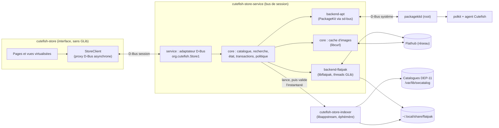
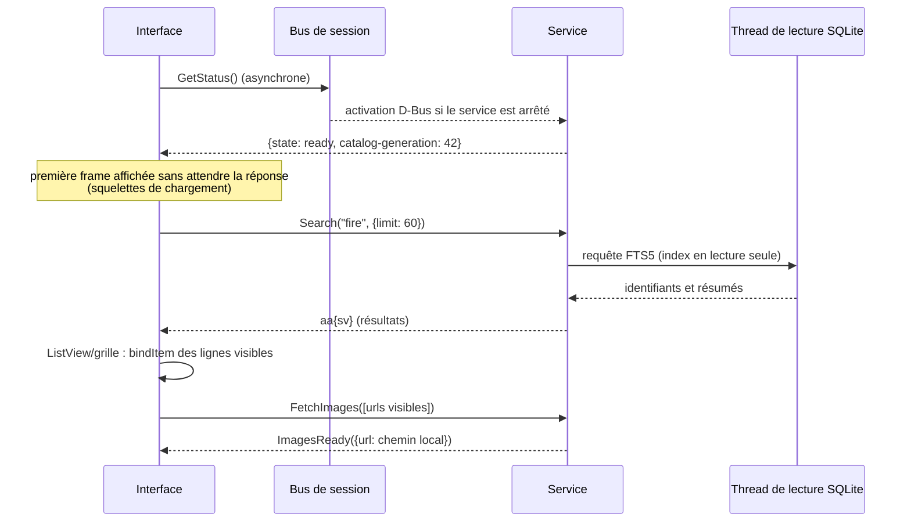
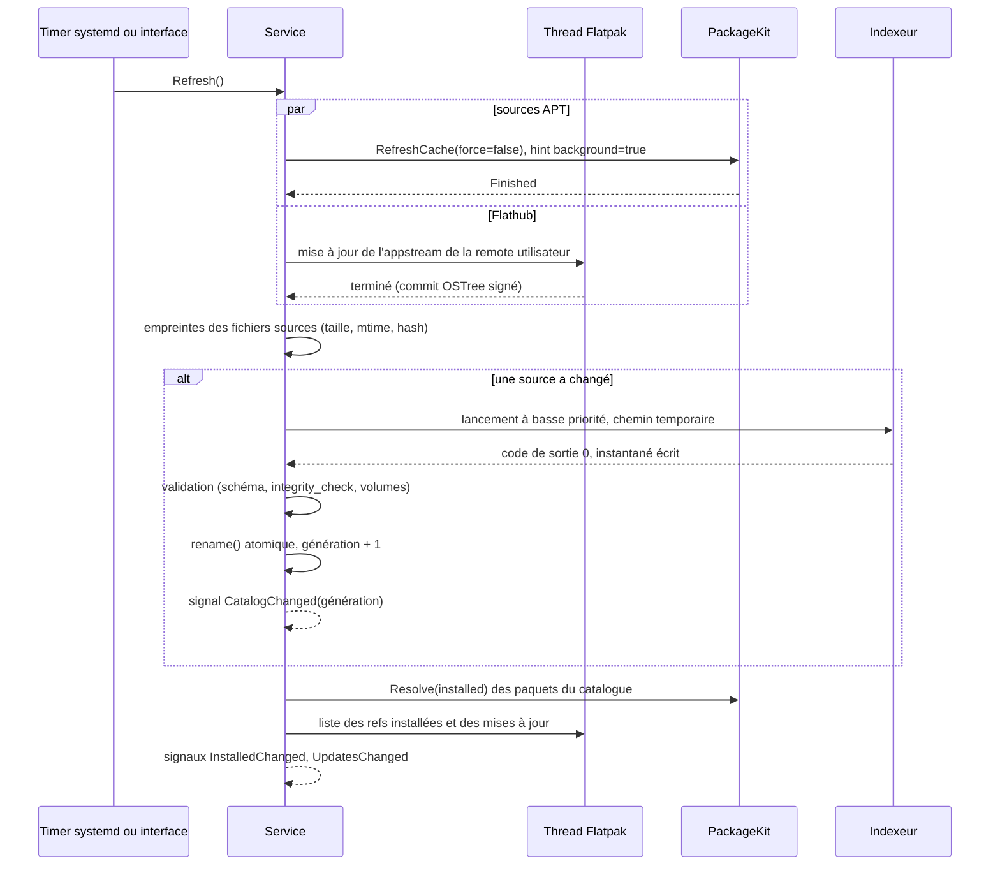
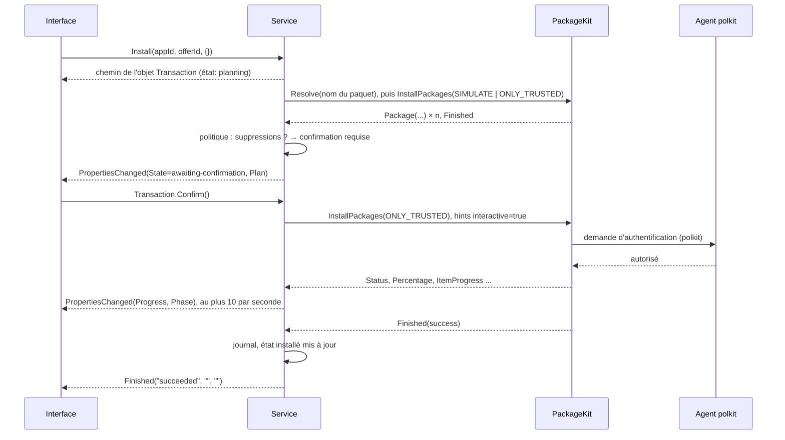
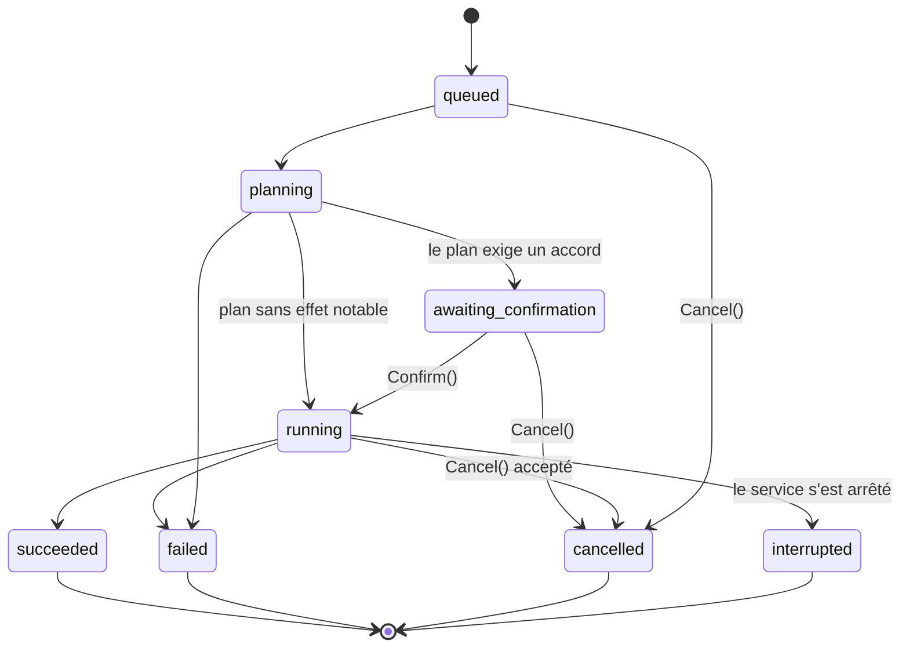

# Cutefish Store — Architecture technique

Statut : **référence de conception, phase 0.2**. Aucune ligne de code n'existe
encore. Ce document décrit ce qui sera construit. Les décisions qu'il applique,
et celles qui restent ouvertes, sont tenues à jour dans
[DECISIONS.md](DECISIONS.md) (identifiants `D-`, `P-`, `O-`).

Niveau de preuve, comme dans l'audit de la phase 0.1 :

- **[CODE]** : vérifié dans le code des dépôts CutefishOS ;
- **[DOC]** : documentation officielle ;
- **[MESURÉ]** : mesuré sur la machine d'audit (Debian 13, AppStream 1.0.5,
  PackageKit 1.3.1, libflatpak 1.16.6, SQLite 3.46.1) ;
- **[SYMBOLE]** : symbole présent dans la bibliothèque installée ; la
  signature et la sémantique restent à confirmer dans la documentation de
  l'API ;
- **[HYPOTHÈSE]** : non vérifié, à valider ;
- **[À VALIDER]** : point de conception à confirmer par un prototype ou une
  mesure avant de s'y engager.

## Sommaire

1. [Vision et principes](#1-vision-et-principes)
2. [Architecture globale](#2-architecture-globale)
3. [Diagrammes et flux de données](#3-diagrammes-et-flux-de-données)
4. [Responsabilités des composants](#4-responsabilités-des-composants)
5. [Spécification préliminaire de l'API D-Bus](#5-spécification-préliminaire-de-lapi-d-bus)
6. Catalogue et index (à rédiger)
7. Backends APT et Flatpak (à rédiger)
8. Threads et GLib (à rédiger)
9. Modèle de sécurité (à rédiger)
10. Performances et caches (à rédiger)
11. Arborescence du projet (à rédiger)
12. Dépendances et compilation (à rédiger)
13. Stratégie de tests (à rédiger)
14. Limites, risques et évolutions (à rédiger)

---

## 1. Vision et principes

Cutefish Store est une boutique logicielle pour Linux. Elle est native dans
Cutefish en v1, et son cœur est conçu pour être réutilisé par d'autres
interfaces et sur d'autres environnements (D-001). La v1 gère APT/DEB et
Flatpak (D-003).

### Principes

1. **Le thread graphique ne fait que de l'interface.**
   - Aucun réseau, aucun parsing important, aucune requête SQL et aucun appel
     D-Bus synchrone sur ce thread.
   - L'interface ne parle qu'au service, de façon asynchrone.
2. **Une seule frontière : l'API D-Bus.**
   - L'interface ne connaît ni PackageKit, ni libflatpak, ni AppStream, ni le
     schéma SQLite (D-002, P-004).
   - Toute autre interface future utilise le même contrat.
3. **GLib reste là où elle est indispensable.**
   - libflatpak est confinée au service, sur des threads dédiés.
   - libappstream est confinée à l'indexeur, un processus éphémère (D-004,
     P-002).
   - L'interface ne charge jamais GLib.
4. **Aucun privilège propre.**
   - Les opérations système passent par PackageKit, qui applique polkit.
   - Flatpak s'installe dans l'espace utilisateur (D-005, P-007).
5. **Les différences entre backends restent visibles.**
   - L'abstraction commune couvre le cycle de vie (rechercher, planifier,
     exécuter, suivre, annuler).
   - Les détails propres à chaque format (paquets supprimés par APT,
     permissions Flatpak) restent dans le plan, sans être aplatis.
6. **Mesurer avant d'optimiser, mais concevoir pour la vitesse.** Les
   structures (index FTS5, vues virtualisées, caches) sont choisies d'après les
   mesures de la phase 0.1. Les objectifs chiffrés (§10) sont vérifiés en CI.
7. **Simplicité.**
   - Pas de plugins dynamiques, pas d'abstraction pour des formats
     hypothétiques (P-001).
   - Une seule couche entre le service et chaque gestionnaire.
8. **Conventions Cutefish.** C++20, CMake, conventions de nommage, GoogleTest,
   gettext, activation D-Bus et polkit comme dans cutefish-core (P-013).

### Hors périmètre v1

- Snap, AppImage, RPM, dépôts éditeurs.
- Notes et avis, comptes utilisateurs, paiements.
- Mises à jour hors ligne du système (O-005).
- Installation Flatpak système (D-005, O-006).
- Sessions X11.

---

## 2. Architecture globale

### Processus

| Processus | Rôle | Durée de vie | Privilèges | Dépendances notables |
|---|---|---|---|---|
| `cutefish-store` | Interface graphique | Tant que la fenêtre est ouverte | Utilisateur | `Cutefish::Toolkit` ; **pas** de GLib |
| `cutefish-store-service` | Cœur : catalogue, recherche, état, transactions, images, sources | Activé par D-Bus ou par timer ; s'arrête sur inactivité (P-010) | Utilisateur | `Cutefish::ToolkitBase`, SQLite, libcurl, libflatpak (GLib) |
| `cutefish-store-indexer` | Lit les catalogues AppStream et produit un instantané du catalogue | Lancé par le service, se termine après l'écriture | Utilisateur | libappstream (GLib), SQLite |

Composants extérieurs utilisés (aucun n'est modifié) :

| Composant | Utilisé pour | Bus ou mécanisme |
|---|---|---|
| PackageKit (`packagekitd`, root) + backend `apt` | Tout ce qui touche APT : état installé, plan, installation, suppression, mises à jour, rafraîchissement | Bus système, `org.freedesktop.PackageKit` |
| polkit et agent polkit de Cutefish (`cutefish-core/polkit-agent`) | Authentifications demandées par PackageKit | Bus système |
| libflatpak (dans le service) | Installation utilisateur : remotes, refs, transactions, métadonnées AppStream de Flathub | Bibliothèque ; aucun démon pour l'installation utilisateur |
| `flatpak-system-helper` | Seulement si l'installation système est activée plus tard (O-006) | Bus système, via libflatpak |
| `org.cutefish.AppRuntime` (cutefish-core) | Lancer une application installée | Bus de session [CODE] |
| `org.freedesktop.Notifications` | Notifier les mises à jour et la fin des transactions en arrière-plan | Bus de session ; serveur Cutefish non vérifié (O-010) |
| systemd utilisateur | Unité du service et timer de rafraîchissement | — |

### Emplacements des données

Tous les emplacements sont relatifs aux répertoires XDG de l'utilisateur. Rien
n'est écrit dans `/etc` ou `/var` par la boutique elle-même.

| Donnée | Emplacement | Nature |
|---|---|---|
| Instantané du catalogue | `$XDG_CACHE_HOME/cutefish-store/catalog.sqlite` | Régénérable (P-003) |
| Images téléchargées | `$XDG_CACHE_HOME/cutefish-store/images/` | Régénérable, borné en taille |
| État et journal des transactions | `$XDG_STATE_HOME/cutefish-store/state.sqlite` | Mutable, propriété du service |
| Préférences | `$XDG_CONFIG_HOME/cutefish-store/settings.ini` | INI au format de `base::Settings` [CODE] |
| Installation Flatpak utilisateur | `~/.local/share/flatpak` | Gérée par libflatpak |

### Pourquoi un service, plusieurs bibliothèques et un indexeur séparé

On aurait pu tout regrouper dans le service, ou découper en plusieurs
services. Le choix retenu (P-001, P-002) :

- **un seul service résident** : un seul nom de bus, un seul cycle de vie, une
  seule file de transactions ;
- **des bibliothèques statiques internes** (`common`, `core`, `backend-apt`,
  `backend-flatpak`, `service`), testables séparément, sans ABI de plugin ;
- **un seul processus annexe, l'indexeur**, justifié par deux faits :
  1. [MESURÉ] parser tout Flathub avec libappstream monte à 459 Mo RSS de
     pic ; cette mémoire n'a rien à faire dans un processus résident ;
  2. le XML vient du réseau : un plantage de parseur ne doit pas emporter les
     transactions en cours.

  Les transactions et les backends restent dans le service : ils ont besoin
  d'un état partagé (file, verrous, journal) et d'une durée de vie longue.

---

## 3. Diagrammes et flux de données

### 3.1 Composants

### 3.2 Démarrage de l'interface et recherche

### 3.3 Rafraîchissement du catalogue

### 3.4 Installation d'un paquet APT

### 3.5 États d'une transaction

Pendant `running`, une **phase** plus fine est publiée : `waiting-for-auth`,
`waiting-for-lock`, `downloading`, `installing`, `removing`, `finishing`. Elle
est dérivée du `Status` de PackageKit ou des opérations de `FlatpakTransaction`.

---

## 4. Responsabilités des composants

### 4.1 `cutefish-store` (interface)

**Fait** :

- pages Accueil, Catégories, Recherche, Détails, Installées, Mises à jour,
  Sources, Préférences ;
- vues virtualisées : `ListView` du toolkit [CODE], grille virtualisée à
  écrire (§10) ;
- thème, mode sombre, couleur d'accent via `AppearanceWatcher` [CODE] ;
- affichage de la progression des transactions à partir des propriétés D-Bus ;
- confirmation des plans (suppressions, permissions) ;
- lancement d'une application installée via `org.cutefish.AppRuntime` [CODE].

**Ne fait pas** :

- accès réseau ;
- lecture de fichiers du service ;
- appels à PackageKit ou Flatpak ;
- décisions de sécurité. L'interface affiche les plans, mais la règle « cette
  transaction exige une confirmation » vient du service (P-008).

### 4.2 `common` (bibliothèque partagée par l'interface et le service)

- Noms D-Bus, noms d'erreurs, clés des dictionnaires `a{sv}`, valeurs des
  énumérations sérialisées (états, phases, types de backend).
- Conversions entre ces dictionnaires et des structures C++ simples
  (`AppSummary`, `TransactionInfo`, …).
- Aucune logique métier et aucune dépendance au-delà de `Cutefish::ToolkitBase`
  (pour `dbus::Variant`).

### 4.3 `core`

- **Modèle** : `App` (composant AppStream fusionné), `Offer` (une façon de
  l'installer : un paquet APT ou une ref Flatpak), `InstalledItem`,
  `UpdateItem`, `Plan`, `Transaction`.
- **Catalogue** : ouverture de l'instantané en lecture seule, requêtes de
  navigation et de détail, génération courante, remplacement atomique.
- **Recherche** : traduction de la saisie en requête FTS5, classement, filtres.
- **Dédoublonnage** : règles de fusion et de choix de l'offre par défaut. Elles
  sont appliquées par l'indexeur, mais définies dans `core` pour être testables
  et partagées.
- **État** : `state.sqlite` (installé, mises à jour, journal), réconciliation
  avec les backends.
- **Transactions** : file par backend, machine d'états (§3.5), politique de
  confirmation (P-008), journal, reprise après redémarrage.
- **Images** : planification des téléchargements (priorité, déduplication,
  annulation), cache disque borné.
- **Sources** : liste unifiée des sources (dépôts APT en lecture, remotes
  Flatpak), activation de Flathub (P-011).
- **Erreurs** : taxonomie commune (§5.6) et traduction des erreurs des
  backends.
- **Interface `Backend`** (§7.1), avec deux implémentations.

### 4.4 `backend-apt`

- Client asynchrone de `org.freedesktop.PackageKit` sur le bus système, via
  `base::dbus` [CODE].
- Correspondance entre noms de paquets et `package_id`, état installé,
  simulation, installation, suppression, mises à jour, rafraîchissement,
  liste des dépôts.
- Traduction de `Status`, `Percentage`, `ItemProgress` et `ErrorCode` vers le
  modèle commun.
- Aucun thread propre : tout passe par la boucle principale du service.

### 4.5 `backend-flatpak`

- Deux threads GLib dédiés (requêtes et transactions), chacun avec son propre
  `GMainContext` et son propre `FlatpakInstallation` (§8).
- Remotes de l'installation utilisateur, refs installées, mises à jour,
  métadonnées de permissions, transactions, mise à jour de l'appstream de
  Flathub.
- Fournit à l'indexeur les chemins des catalogues AppStream des remotes.

### 4.6 `service` (`cutefish-store-service`)

- Exporte l'API `org.cutefish.Store1` (§5) avec `base::dbus::Object` [CODE].
- Valide toutes les entrées D-Bus avant de les transmettre à `core`.
- Gère le cycle de vie : activation, arrêt sur inactivité, rafraîchissement
  par timer, suivi des clients.
- Lance l'indexeur et met en place ses instantanés.
- Envoie les notifications de bureau.

### 4.7 `cutefish-store-indexer`

- Entrée : la liste des sources (chemins des catalogues, origine, priorité,
  langue) passée par le service en arguments ou sur l'entrée standard.
- Lecture avec libappstream (DEP-11 YAML, XML Flathub, métadonnées locales des
  applications installées).
- Normalisation, dédoublonnage, écriture de l'instantané SQLite avec l'index
  FTS5, puis sortie.
- N'accède pas au réseau et n'a aucune interface D-Bus.

---

## 5. Spécification préliminaire de l'API D-Bus

Cette spécification sert de contrat entre l'interface et le service. Elle sera
traduite en XML d'introspection (`data/org.cutefish.Store1.xml`) au début de
l'implémentation. Les signatures suivent la notation D-Bus.

> **Nom provisoire.** `org.cutefish.Store` suppose que le projet est adopté par
> CutefishOS. Sinon, il faudra un nom en DNS inverse contrôlé par le projet
> (O-002). Seul le préfixe changerait ; la structure reste la même.

### 5.1 Principes

- **Bus de session** uniquement. Le bus de session n'est accessible qu'à
  l'utilisateur qui en est propriétaire (politique par défaut de D-Bus) : le
  service ne gère aucune autorisation propre (§9).
- **Toute opération longue est une transaction.** La méthode qui la crée
  répond immédiatement avec le chemin d'un objet `Transaction`. Les autres
  méthodes répondent en quelques millisecondes ; celles qui lisent SQLite
  répondent de façon asynchrone depuis un thread de lecture (§8).
- **Dictionnaires extensibles.** Les structures sont des `a{sv}` (P-012).
  Un client ignore les clés qu'il ne connaît pas ; le service n'exige jamais
  une clé nouvelle d'un ancien client.
- **Identifiants opaques.**
  - `app-id` : identifiant AppStream du composant fusionné (§6.4).
  - `offer-id` : identifiant d'une offre, construit par le service, par
    exemple `apt:firefox-esr` ou
    `flatpak:user:flathub:app/org.mozilla.firefox/x86_64/stable`.
  - Le client ne doit jamais les construire ni les analyser. Le service ne
    les exécute jamais tels quels : il les **recherche** dans le catalogue ou
    l'état, et refuse tout identifiant inconnu (§9.4).
- **Génération du catalogue.** Toute réponse de lecture porte la
  `catalog-generation` utilisée. Le client invalide ses caches quand elle
  change.

### 5.2 Objet principal

Nom de bus `org.cutefish.Store`, objet `/org/cutefish/Store`, interface
`org.cutefish.Store1`.

#### Propriétés (lecture seule, avec `PropertiesChanged`)

| Propriété | Type | Description |
|---|---|---|
| `Version` | `s` | Version du service |
| `State` | `s` | `starting`, `indexing` (aucun catalogue encore disponible), `ready`, `degraded` (un backend indisponible) |
| `CatalogGeneration` | `t` | Génération de l'instantané en service ; 0 tant qu'il n'y en a pas |
| `Backends` | `aa{sv}` | Par backend : `id` (`apt`, `flatpak`), `available` (`b`), `reason` (`s`), `scopes` (`as`) |
| `Refreshing` | `b` | Un rafraîchissement est en cours |
| `LastRefresh` | `t` | Horodatage (secondes UNIX) du dernier rafraîchissement réussi |
| `UpdateCount` | `u` | Nombre de mises à jour disponibles |

#### Lecture du catalogue

| Méthode | Entrée | Sortie | Remarques |
|---|---|---|---|
| `Search` | `s text, a{sv} options` | `t generation, u total, aa{sv} results` | Options : `limit` (`u`, ≤ 200, défaut 60), `offset` (`u`), `category` (`s`), `backend` (`s`), `installed-only` (`b`). `text` : UTF-8 valide, ≤ 256 octets |
| `Browse` | `s category, a{sv} options` | `t generation, u total, aa{sv} results` | Mêmes options ; `category` vide pour l'ensemble |
| `ListCategories` | — | `t generation, aa{sv} categories` | `id`, `name` (traduit), `icon`, `count` |
| `GetSummaries` | `as app_ids` | `t generation, aa{sv} summaries` | ≤ 200 identifiants ; utilisé pour remplir les lignes visibles |
| `GetDetails` | `s app_id` | `t generation, a{sv} details` | Voir §5.4 |
| `GetInstalled` | `a{sv} options` | `aa{sv} items` | Options : `backend` |
| `GetUpdates` | — | `aa{sv} updates` | Voir §5.4 |
| `GetPermissions` | `s offer_id` | `a{sv} permissions` | Flatpak seulement ; `NotSupported` pour APT |
| `ListSources` | — | `aa{sv} sources` | Voir §5.4 |
| `ListTransactions` | — | `ao paths` | Transactions encore publiées sur le bus |
| `GetTransactionHistory` | `u limit` | `aa{sv} entries` | Lu dans le journal (`state.sqlite`) |

#### Actions (chacune crée une transaction)

| Méthode | Entrée | Sortie |
|---|---|---|
| `Install` | `s offer_id, a{sv} options` | `o transaction` |
| `Remove` | `s offer_id, a{sv} options` | `o transaction` |
| `Update` | `as offer_ids, a{sv} options` | `o transaction` |
| `UpdateAll` | `a{sv} options` | `o transaction` |
| `Refresh` | `a{sv} options` | `o transaction` (option `force`, `b`) |
| `EnableSource` | `s source_id` | `o transaction` |
| `DisableSource` | `s source_id` | `o transaction` |

Les `options` sont réservées en v1 (dictionnaire vide accepté, clés inconnues
refusées avec `InvalidArgs`, pour éviter qu'un client croie une option prise en
compte alors qu'elle ne l'est pas).

En v1, `EnableSource` et `DisableSource` ne concernent que la remote Flathub de
l'installation utilisateur (P-011). Les dépôts APT sont listés en lecture
seule (`can-toggle = false`).

#### Images

| Méthode ou signal | Signature | Description |
|---|---|---|
| `FetchImages` (méthode) | `as urls, s priority` → `a{ss} cached` | Répond tout de suite avec les URL déjà en cache (`url → chemin`). Les autres sont mises en file ; `priority` vaut `visible` (pile LIFO, servie en premier) ou `prefetch` |
| `CancelImages` (méthode) | `as urls` | Retire ces URL de la file ; les téléchargements déjà commencés vont à leur terme et restent en cache |
| `ImagesReady` (signal) | `a{ss}` | `url → chemin local`, regroupés (au plus un signal toutes les 50 ms) |
| `ImagesFailed` (signal) | `a{ss}` | `url → code d'erreur` |

Seules les URL **présentes dans le catalogue en service** sont acceptées
(captures d'écran, icônes distantes). Le service n'est pas un client HTTP
générique pour les autres processus de la session (§9.4).

#### Signaux

| Signal | Signature | Émis quand |
|---|---|---|
| `CatalogChanged` | `t generation` | Un nouvel instantané est en service |
| `InstalledChanged` | `as app_ids` | L'état installé de ces applications a changé (quelle qu'en soit la cause : la boutique, `apt` en ligne de commande, `flatpak`) |
| `UpdatesChanged` | `u count` | La liste des mises à jour a changé |
| `TransactionAdded` | `o path` | Une transaction est créée, par n'importe quel client |
| `TransactionRemoved` | `o path` | Une transaction terminée quitte le bus |

### 5.3 Objet `Transaction`

Chemin `/org/cutefish/Store/Transactions/<n>`, où `<n>` est un compteur propre
à l'instance du service. Interface `org.cutefish.Store1.Transaction`.

| Propriété | Type | Description |
|---|---|---|
| `Id` | `s` | UUID stable, conservé dans le journal (le chemin, lui, ne survit pas à un redémarrage) |
| `Kind` | `s` | `install`, `remove`, `update`, `update-all`, `refresh`, `enable-source`, `disable-source` |
| `Backend` | `s` | `apt`, `flatpak`, ou `multiple` pour `update-all` et `refresh` |
| `AppIds` | `as` | Applications concernées (peut être vide pour des paquets système) |
| `OfferIds` | `as` | Offres concernées |
| `State` | `s` | `queued`, `planning`, `awaiting-confirmation`, `running`, `succeeded`, `failed`, `cancelled`, `interrupted` (§3.5) |
| `Phase` | `s` | Pendant `running` : `waiting-for-auth`, `waiting-for-lock`, `downloading`, `installing`, `removing`, `finishing` ; vide sinon |
| `Progress` | `d` | De 0 à 1, ou −1 si indéterminé |
| `DownloadedBytes`, `TotalBytes` | `t`, `t` | 0 si inconnu |
| `Cancellable` | `b` | Une annulation est possible maintenant (PackageKit expose `AllowCancel` [MESURÉ]) |
| `Plan` | `a{sv}` | Rempli à la fin de `planning` (§5.4) |
| `Error` | `a{sv}` | `code` (§5.6), `message` (traduit), `details` (texte brut du backend, pour le diagnostic) |
| `Created`, `Finished` | `t`, `t` | Horodatages |

| Méthode ou signal | Signature | Description |
|---|---|---|
| `Confirm` | — | Seulement en `awaiting-confirmation` ; sinon `NotAllowed` |
| `Cancel` | — | En `queued`, `planning` ou `awaiting-confirmation` : immédiat. En `running` : transmis au backend si `Cancellable`, sinon `NotAllowed` |
| `Finished` (signal) | `s state, s error_code, s message` | Une seule fois, à l'état terminal |

Règles de publication :

- `Progress`, `Phase`, `DownloadedBytes` sont regroupés : au plus **10
  `PropertiesChanged` par seconde** et par transaction.
- Une transaction terminée reste sur le bus 5 minutes, puis
  `TransactionRemoved` est émis. Son résultat reste consultable avec
  `GetTransactionHistory`.

### 5.4 Structures

**Résumé d'application** (`Search`, `Browse`, `GetSummaries`) :
`id` `s`, `name` `s`, `summary` `s`, `icon` `s` (chemin local, peut être
vide), `icon-url` `s` (si l'icône n'est que distante), `backends` `as`,
`installed` `b`, `has-update` `b`, `verified` `b`, `developer` `s`.

**Détails** (`GetDetails`) : les clés du résumé, plus :

- `description` `a(ss)` : blocs `(type, texte)` avec `type` ∈ `p`, `li`,
  `oli`. Le service convertit le balisage AppStream en blocs simples ;
  l'interface n'analyse jamais de HTML ;
- `screenshots` `aa{sv}` : `caption`, `thumbnail-url`, `url`, `width`,
  `height`, `default` ;
- `releases` `aa{sv}` : `version`, `date` (`t`), `description` (`a(ss)`) ;
- `urls` `a{ss}` (homepage, bugtracker, help, donation, vcs-browser) ;
- `categories` `as`, `license` `s`, `content-rating` `a{ss}` ;
- `launchable` `s` : identifiant du fichier desktop, pour
  `org.cutefish.AppRuntime.launchApplication` [CODE] ;
- `offers` `aa{sv}` : `id`, `backend`, `origin` (dépôt ou remote), `scope`
  (`system`, `user`), `version`, `installed` `b`, `installed-version`,
  `download-size` `t`, `installed-size` `t`, `sandboxed` `b`, `verified` `b`,
  `default` `b`.

**Mise à jour** (`GetUpdates`) : `offer-id`, `app-id` (vide pour un paquet
système sans AppStream), `name`, `from-version`, `to-version`,
`download-size`, `kind` (`app`, `runtime`, `system`).

**Source** (`ListSources`) : `id`, `backend`, `name`, `url`, `scope`,
`enabled` `b`, `kind` (`distribution`, `flathub`, `third-party`),
`can-toggle` `b`, `suggested` `b` (source connue mais pas encore configurée,
comme Flathub au premier lancement).

**Plan** (propriété `Plan` d'une transaction) :

- communs : `requires-confirmation` `b`, `reasons` `as` (`removes-packages`,
  `new-permissions`, `new-source`, `rebase`, `untrusted`),
  `download-size` `t`, `installed-size-change` `x` ;
- `apt` `a{sv}` : `install`, `remove`, `upgrade`, `downgrade` (chacun `as`
  de noms de paquets avec version) ;
- `flatpak` `a{sv}` : `operations` `aa{sv}` (`ref`, `type` = install, update
  ou uninstall, `remote`, `download-size`, `permissions` `a{sv}`,
  `old-permissions` `a{sv}`).

**Permissions Flatpak** (`GetPermissions`, plans) : la section `[Context]`
des métadonnées du ref (`shared`, `sockets`, `devices`, `filesystems`,
`features`, `persistent`), les règles `[Session Bus Policy]` et
`[System Bus Policy]`, plus un résumé `risk` (`as` : `network`,
`home-access`, `host-access`, `devices`, `x11`, …) calculé par le service
pour un affichage cohérent.

### 5.5 Annulation, concurrence et ordre

- Une seule transaction modificatrice active par backend (P-009). Les
  suivantes restent en `queued`.
- Une demande qui porte sur une offre déjà concernée par une transaction non
  terminée est refusée avec `Busy`, et l'erreur indique le chemin de la
  transaction existante.
- `Cancel` est accepté depuis n'importe quel client de la session : tous les
  clients appartiennent au même utilisateur.
- `Confirm` n'a pas de délai : une transaction en `awaiting-confirmation`
  n'occupe pas la file de son backend. Elle y rentre au moment de la
  confirmation, et son plan est **recalculé** si le catalogue ou l'état ont
  changé entre-temps. Si le nouveau plan exige une confirmation différente,
  elle revient en `awaiting-confirmation`.

### 5.6 Erreurs

Erreurs D-Bus des méthodes (réponse immédiate) :

| Nom | Cas |
|---|---|
| `org.freedesktop.DBus.Error.InvalidArgs` | Argument mal formé, trop long, clé d'option inconnue |
| `org.cutefish.Store1.Error.NotFound` | Identifiant inconnu dans la génération en service |
| `org.cutefish.Store1.Error.NotSupported` | Opération sans objet pour ce backend |
| `org.cutefish.Store1.Error.NotReady` | Aucun catalogue n'est encore disponible (premier lancement) |
| `org.cutefish.Store1.Error.Busy` | L'offre est déjà dans une transaction en cours |
| `org.cutefish.Store1.Error.NotAllowed` | Méthode de transaction appelée dans un état qui ne la permet pas |
| `org.cutefish.Store1.Error.BackendUnavailable` | PackageKit absent, installation Flatpak inaccessible |

Codes d'erreur d'une transaction (`Error.code`, `Finished.error_code`) :
`auth-denied`, `auth-cancelled`, `network`, `no-space`, `untrusted`,
`dependency`, `conflict`, `not-found`, `locked`, `cancelled`, `interrupted`,
`backend-unavailable`, `internal`.

Chaque backend traduit ses propres erreurs (`ErrorCode` de PackageKit,
`GError` de libflatpak) vers ces codes (§7). Le texte d'origine est conservé
dans `details`.

### 5.7 Reconnexion et redémarrage du service

**Côté client** :

- Le client suit le propriétaire du nom `org.cutefish.Store`
  (`Connection::watchName` dans `base::dbus` [CODE]).
- Si le nom disparaît, il considère tous ses proxys de transaction comme
  périmés et affiche un état « service indisponible » sans bloquer.
- Il se reconnecte au prochain appel ; l'activation D-Bus relance le service.
- Après reconnexion, il relit les propriétés, `ListTransactions`, et relance la
  requête affichée. Ses caches sont indexés par `CatalogGeneration`.
- Aucun appel synchrone : toutes les méthodes sont appelées avec
  `Connection::callAsync` [CODE].

**Côté service** :

- Chaque transaction est écrite dans le journal (`state.sqlite`) à chaque
  changement d'état. L'écriture se fait sur le thread de la boucle principale,
  en mode WAL ; les écritures sont rares et courtes.
- Au démarrage, toute transaction du journal qui n'est pas dans un état
  terminal est traitée selon son backend :
  - **APT** : la transaction PackageKit vit dans `packagekitd`, pas dans le
    service. Le journal conserve son chemin (`tid`). Si
    `GetTransactionList()` le contient encore, le service s'y rattache
    (abonnement aux signaux, lecture des propriétés) [À VALIDER : rattachement
    à une transaction créée par une autre connexion]. Sinon, elle passe en
    `interrupted` et l'état installé est réconcilié.
  - **Flatpak** : la transaction tournait dans le service et s'est arrêtée
    avec lui. Elle passe en `interrupted`, puis l'état installé est
    réconcilié avec libflatpak. Une reprise automatique n'est pas tentée en
    v1 ; l'utilisateur relance l'action.
- Le service ne s'arrête jamais sur inactivité tant qu'une transaction n'est
  pas terminale.
