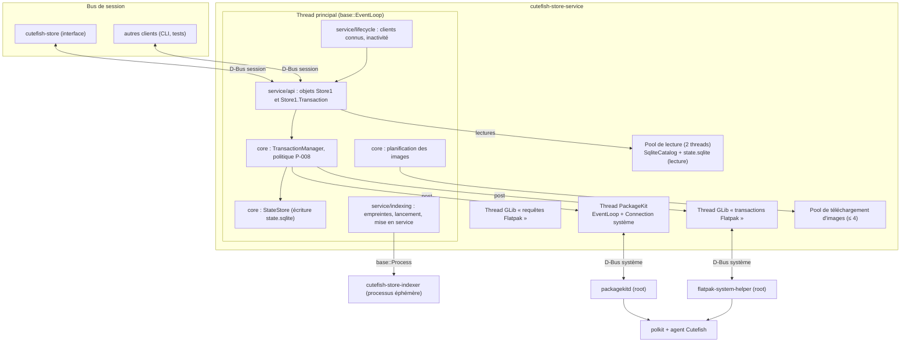
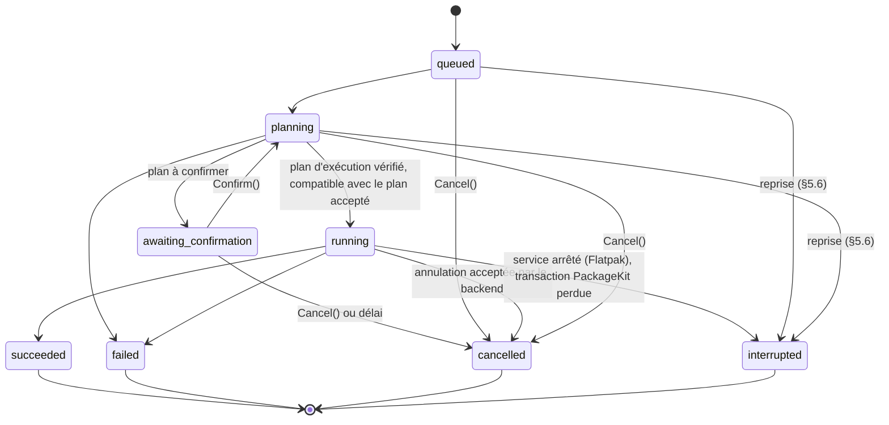
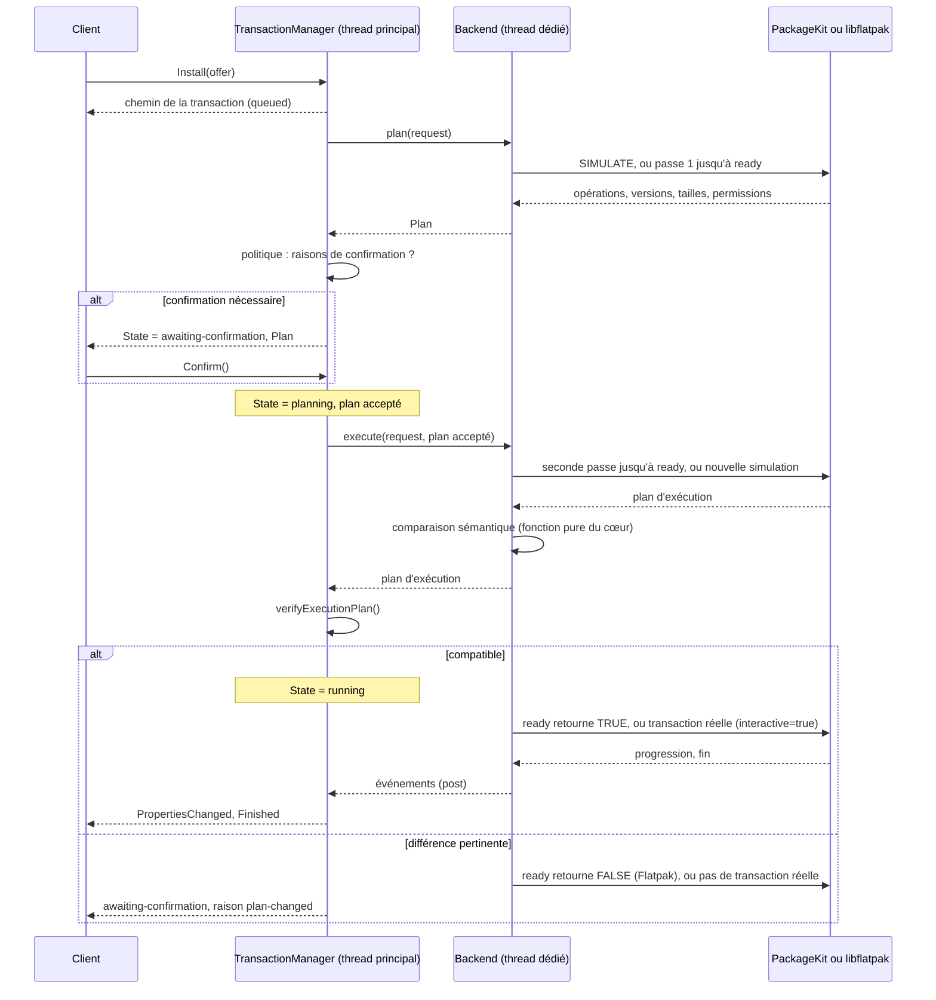

# Cutefish Store — Conception du service D-Bus (phase 0.4)

Statut : **orientation validée par le propriétaire** (phase 0.4), décisions
Q-1 à Q-6 prises et enregistrées (DECISIONS : D-009 précisée, D-013 à D-016,
P-002, P-003, P-004, P-005, P-007, P-010, P-012 validées). Aucune ligne du
service n'est écrite ; les points marqués [PROPOSITION] restent à confirmer
à l'implémentation. Ce document précise, pour l'implémentation, ce que
[ARCHITECTURE.md](ARCHITECTURE.md) (§3 à §10) décrit déjà : il ne remplace
ni ce document ni [DECISIONS.md](DECISIONS.md), qui font foi pour les
décisions. Il s'appuie sur le code existant ([CORE.md](CORE.md),
[CATALOG.md](CATALOG.md)) et sur les prototypes 1, 2 et 4 de la phase 0.3.

Niveaux de preuve :

- **[MESURÉ]** : observé sur la machine d'audit, par un prototype ou un test ;
- **[CODE]** : lu dans le code de ce dépôt, dans les en-têtes installés de
  `cutefish-toolkit` 1.0, ou dans les sources de PackageKit 1.3.1 et Flatpak
  1.16.6 étudiées par les prototypes ;
- **[DOC]** : documentation officielle ;
- **[HYPOTHÈSE]** : non vérifié ;
- **[PROPOSITION]** : choix de conception proposé ici, à valider.

Renvois : « A §x.y » désigne une section d'[ARCHITECTURE.md](ARCHITECTURE.md),
« §x.y » seul une section de ce document.

## Sommaire

1. [Audit](#1-audit)
2. [Architecture du service](#2-architecture-du-service)
3. [Cycle de vie](#3-cycle-de-vie)
4. [API D-Bus `Store1`](#4-api-d-bus-store1)
5. [Modèle des transactions](#5-modèle-des-transactions)
6. [Backend PackageKit](#6-backend-packagekit)
7. [Backend Flatpak](#7-backend-flatpak)
8. [Bases de données et `state.sqlite`](#8-bases-de-données-et-statesqlite)
9. [Permissions](#9-permissions)
10. [Erreurs](#10-erreurs)
11. [Performance et fiabilité](#11-performance-et-fiabilité)
12. [Risques et limites](#12-risques-et-limites)
13. [Décisions](#13-décisions)
14. [Écarts avec le cœur actuel](#14-écarts-avec-le-cœur-actuel)
15. [Plan d'implémentation](#15-plan-dimplémentation)

---

## 1. Audit

### 1.1 État du dépôt [MESURÉ, 7 novembre 2026]

- Branche `main`, propre, dernier commit `d130382` ; 138 tests réussis (GCC,
  Clang strict, ASan/UBSan).
- Existent : `store-core` (modèles, interfaces `Catalog`, `InstalledState`,
  `Backend`, catalogue SQLite), `store-indexer` et `cutefish-store-indexer`.
- N'existent pas : `common`, `service`, les backends, l'interface, le modèle
  des transactions, `state.sqlite`, le cache d'images.

### 1.2 Dépendances disponibles

| Dépendance | Rôle dans le service | État sur la machine d'audit |
|---|---|---|
| `cutefish-toolkit` 1.0 (`Cutefish::ToolkitBase`) | Couche hôte : boucle, D-Bus, threads, processus, fichiers, réglages, langue | Installé, avec ses en-têtes et sa configuration CMake (`CutefishToolkit`) [MESURÉ] |
| libsystemd 257 (sd-bus) | Indirecte, par `base::dbus` | Installé avec en-têtes [MESURÉ] |
| SQLite 3.46.1, libappstream 1.0.5, libxml2 | Catalogue, indexeur | Installés avec en-têtes [MESURÉ] |
| libflatpak 1.16.6 | Backend Flatpak | Bibliothèque installée, **`libflatpak-dev` absent** [MESURÉ] ; retenu (D-016), installé par le propriétaire |
| libcurl | Cache d'images (P-005) | Bibliothèque installée, **aucun paquet de développement** [MESURÉ] ; `libcurl4-openssl-dev` retenu (D-016), installé par le propriétaire |
| PackageKit 1.3.1, polkit 126, flatpak 1.16.6 | Exécution | Installés [MESURÉ] |

Le backend Flatpak et le cache d'images ne pourront pas être compilés tant
que ces deux paquets de développement ne sont pas installés (D-016).

### 1.3 Ce que fournit `Cutefish::ToolkitBase` [CODE, en-têtes installés `/usr/include/cutefish-toolkit/base/`]

| Besoin du service | API | Remarque |
|---|---|---|
| Boucle d'événements par thread | `EventLoop` (`run`, `quit`, timers, descripteurs) ; `LoopHandle::post` depuis un autre thread, abandonné si la boucle n'existe plus | Base de la fonction `post` de P-006 |
| Connexion à un bus sur **n'importe quelle** boucle | `Connection::open(Bus::System \| Bus::Session, EventLoop*)` | Permet le thread dédié de PackageKit |
| Exporter des objets | `Object` : méthodes (réponse immédiate ou différée par `MethodCall`), propriétés, signaux, `emitPropertiesChanged` | Réponse différée : nécessaire aux lectures sur un thread de lecture |
| Appelant d'une méthode | `Message::sender()` | Suivi des clients connus (P-010) |
| Suivre un nom | `Connection::watchName` (`NameWatch`) | Disparition d'un client, présence de PackageKit |
| Nom du service | `requestName(name)`, sans file d'attente | Instance unique (A §9.6) |
| Descripteurs de fichiers | `UnixFd` (type `h`) | Lève le point [À VALIDER] d'ARCHITECTURE §5.8 |
| Pool de threads | `ThreadPool::run(work, done)` : `done` revient sur la boucle appelante | Lecteurs SQLite, téléchargements |
| Processus fils | `Process` | Indexeur |
| Surveillance de fichiers | `FileWatch` (inotify) | Catalogues DEP-11, dossiers appstream Flatpak |
| Langue de session | `SessionLanguage` (signal `changed`) | Réindexation au changement de langue |
| Réglages, journaux, minuteries | `Settings`, `logging`, `Timer` | |

Ces API ont été lues dans les en-têtes, **pas exercées** : leur comportement
sous charge reste à vérifier par les premiers tests du service.

### 1.4 Écarts entre documentation et code

| Point | Documentation | Code ou fait | Traitement |
|---|---|---|---|
| `base::dbus` sur une boucle distincte (A §4.4, A §7.2) | [À VALIDER] | `Connection::open(bus, loop)` existe [CODE] | Correction factuelle dans ARCHITECTURE |
| Type `h` dans `base::dbus` (A §5.8) | [À VALIDER] | `UnixFd` existe [CODE] | Correction factuelle dans ARCHITECTURE |
| Résumé d'application (A §5.4) : `icon` (chemin) et `icon-url` | Deux clés | `AppSummary::icon` est un `IconRef` (chemin, URL ou nom) | Proposé §4.6 : `icon` + `icon-kind` |
| Détails (A §5.4) : captures, versions, URL, licence, classification, lanceur | Prévus | Absents du catalogue (`app_details` non créée, CATALOG §10) | `GetDetails` v1 réduit (§4.6) ou extension du catalogue (Q-7) |
| Offres (A §5.4) : `download-size`, `installed-size`, `default` | Prévus | Absents du catalogue | Tailles par le plan ; `default` calculé à la lecture (D-009, §4.8) |
| Empreintes des sources (A §6.2, étape 1) | « Enregistrées dans l'instantané en service » | Non écrites par `CatalogWriter` | À ajouter à `meta` (étape C, §15) |
| Lecteurs avec `state.sqlite` attachée (A §6.3, A §8.2) | `ATTACH … mode=ro` | `SqliteCatalog` n'attache rien | À ajouter avec `state.sqlite` (§8.4) |
| `Backend` (A §7.1) | 11 opérations | 3 en Core v0.1 (`availability`, `queryInstalled`, `sources`) | Extension proposée §5.4 |
| Préférences | `settings.ini` (A §2) | — | La demande de phase cite `state.sqlite` ; ce document garde `settings.ini` (§8.1) |
| Nom du catalogue | `catalog.sqlite` | Idem | La demande de phase écrit `catalogue.db` ; le nom existant est conservé |

---

## 2. Architecture du service

### 2.1 Composants



| Couche (P-006) | Bibliothèque | Contenu |
|---|---|---|
| Cœur | `store-core` | Modèles, catalogue, **état** (`StateStore`), **transactions** (`TransactionManager`, plans, comparaison, politique), images (planification) ; aucune boucle, aucun thread |
| Logique PackageKit | `store-backend-packagekit` | Traduction des `package_id`, signaux, `ErrorCode`, construction des plans ; profil Debian ; **pas** de D-Bus |
| Adaptateur Flatpak | `store-backend-flatpak` | libflatpak sur deux threads GLib (`GlibWorker`) |
| Couche hôte | `service` | `main`, D-Bus de session et système (`base::dbus`), transport PackageKit, cycle de vie, pools, indexation, notifications |
| Contrat | `common` | Noms D-Bus, clés `a{sv}`, codes d'erreur, conversions |

### 2.2 Règles de threads [PROPOSITION, conforme à ARCHITECTURE §8]

1. **Le thread principal ne bloque jamais** : aucune requête SQLite de
   lecture, aucun appel D-Bus synchrone, aucun travail libflatpak. Il porte
   l'API, le gestionnaire de transactions et les écritures dans
   `state.sqlite` (petites, en WAL).
2. **Lectures** : `ThreadPool` de 2 threads, une connexion `SqliteCatalog` et
   une connexion `state.sqlite` en lecture par thread (§8.4). La méthode
   D-Bus répond plus tard depuis le thread principal (`MethodCall` copié).
3. **PackageKit** : un thread avec sa propre `EventLoop` et sa connexion au
   bus système (`Connection::open(Bus::System, &loop)`) ; tout est
   asynchrone ; les résultats reviennent par `post` [validé par le
   prototype 4 avec sd-bus brut : thread appelant jamais bloqué plus de
   6 ms, MESURÉ].
4. **Flatpak** : deux threads GLib, chacun son `GMainContext` (A §8.2, P-009).
5. **Aucun objet ne traverse les threads**, sauf des structures C++ simples ;
   chaque connexion SQLite appartient à un thread.
6. **Indexeur** : processus séparé, lancé par `base::Process`, jamais
   attendu de façon bloquante.

---

## 3. Cycle de vie

### 3.1 Activation et nom [PROPOSITION]

- Fichier `org.cutefish.Store.service` (activation D-Bus de session) avec
  `SystemdService=cutefish-store.service` ; unité systemd utilisateur
  `Type=dbus`, `BusName=org.cutefish.Store` (P-010).
- Au démarrage : ouverture de `state.sqlite` (migrations, §8.6), puis
  `requestName("org.cutefish.Store")` **sans file d'attente** : si le nom est
  pris, le processus se termine aussitôt (A §9.6). Ensuite seulement les objets
  sont publiés et `State` passe à `ready` (ou `indexing` s'il n'y a pas de
  catalogue).
- `ready` n'attend **aucune** requête PackageKit ni Flatpak : l'état installé
  est servi depuis `state.sqlite`, puis réconcilié en arrière-plan
  (ARCHITECTURE §10.2 ; un `Resolve` coûte ≈ 0,5 s [MESURÉ, prototype 4]).

### 3.2 Clients et inactivité (P-010, délai de 5 minutes validé)

- **Client connu** : nom unique qui a appelé au moins une méthode, lecture de
  propriété comprise (`Message::sender()`). Le service suit sa disparition
  par `watchName` sur ce nom unique.
- Le service reste actif tant que :
  - au moins un client connu est connecté ;
  - ou une transaction n'est pas terminale (`queued`, `planning`,
    `awaiting-confirmation`, `running`) ;
  - ou une indexation, un rafraîchissement ou une réconciliation est en
    cours.
- Sinon une minuterie de **5 minutes** démarre ; toute nouvelle activité
  l'annule. À l'échéance : les téléchargements d'images sont abandonnés
  (fichiers temporaires supprimés), les connexions fermées, `state.sqlite`
  synchronisée, le nom libéré, sortie.
- Un démarrage par le minuteur systemd (rafraîchissement) suit la même règle
  une fois le travail terminé.

### 3.3 Déconnexion d'un client

| Situation | Comportement proposé |
|---|---|
| Lecture en cours (recherche, détails) | Le travail du thread de lecture se termine ; la réponse est abandonnée (le bus la refuserait) |
| Transaction créée par ce client | **Continue** (D-002 : les transactions survivent à la fermeture de l'interface). Le journal la garde ; un autre client la retrouve par `ListTransactions` |
| Transaction en `awaiting-confirmation` | Reste en attente jusqu'au délai de confirmation (§5.3) ; un autre client de la session peut la confirmer ou l'annuler |
| Téléchargements d'images demandés par ce client seulement | Retirés de la file (non commencés) |
| Dernier client parti | Démarre la minuterie d'inactivité si rien n'est en cours |

### 3.4 Arrêt et reprise

- Arrêt normal : jamais pendant une transaction non terminale (§3.2).
- Arrêt brutal (plantage, `kill`) : au redémarrage, chaque transaction non
  terminale du journal est traitée selon son backend (§5.6). Une transaction
  PackageKit **continue** dans `packagekitd` sans le service [MESURÉ,
  prototype 4] ; une transaction Flatpak s'est arrêtée avec le service.

### 3.5 Actualisation des catalogues (D-015)

Les sept règles sont décidées (D-015) ; leur mise en œuvre ci-dessous est une
[PROPOSITION].

**Date de référence.** `LastRefresh` est la date du dernier rafraîchissement
**réussi et mis en service** (catalogue remplacé). Elle est gardée dans
`state.sqlite` : `source_state.last_refresh` par source, et une clé `meta`
`last_refresh` pour l'ensemble (§8.2). Un échec ne la modifie pas.

**Déclencheurs.**

| Déclencheur | Condition | Réseau |
|---|---|---|
| Import initial | Démarrage sans catalogue valide (`State` = `indexing`) | Aucun : l'indexeur lit les métadonnées déjà présentes (`/var/lib/swcatalog`, appstream des remotes configurées) |
| Démarrage du service | `LastRefresh` absente ou plus vieille que 24 h, connexion non limitée | Oui |
| Nouveau client connu (ouverture de l'interface) | Même condition ; couvre le cas où le service tournait déjà | Oui |
| Minuterie interne | Service actif au moment où `LastRefresh` atteint 24 h ; même condition | Oui |
| Minuterie systemd utilisateur | Démarre le service, qui applique la condition de démarrage | Oui |
| `Refresh` (client) | Toujours accepté, **même sur connexion limitée** ; `force` ignore le délai de 24 h | Oui |

- Minuterie systemd : `cutefish-store-refresh.timer`, `OnCalendar=daily`,
  `Persistent=true` (rattrape un réveil manqué pendant l'extinction),
  `RandomizedDelaySec=1h` ; elle démarre `cutefish-store.service`, sans
  méthode D-Bus dédiée [DOC systemd.timer ; à vérifier à l'implémentation].
  Le service ne reçoit aucune information sur la cause de son démarrage : la
  condition (24 h, connexion) est toujours évaluée par lui, jamais par
  systemd.
- Après l'import initial, l'actualisation automatique suit les mêmes règles :
  sur connexion limitée, l'utilisateur voit le catalogue local et peut
  demander `Refresh`.
- La remote Flathub utilisateur n'est jamais créée par une actualisation :
  elle relève de P-011, encore proposée.

**Connexion limitée.** Propriété `Metered` (`u`) de
`org.freedesktop.NetworkManager` sur le bus système, avec `PropertiesChanged`
[MESURÉ : propriété présente, `emits-change`, valeur 4 sur la machine
d'audit]. Valeurs : 0 inconnue, 1 oui, 2 non, 3 oui (estimé), 4 non (estimé)
[DOC NetworkManager]. 1 et 3 sont traitées comme limitées. NetworkManager
absent ou valeur 0 : **traitée comme non limitée** [PROPOSITION, Q-12]. Une
actualisation automatique en cours est annulée si la connexion devient
limitée ; une actualisation manuelle continue [PROPOSITION].

**Déroulement.** `Backend::refresh` pour chaque backend disponible
(PackageKit `RefreshCache`, appstream des remotes Flatpak), puis l'indexeur
écrit un candidat (`--locale fr`, D-013), validé et mis en service par
`replaceCatalog` ; `CatalogGeneration` augmente, `LastRefresh` est écrite.

**Échec.** Erreur d'un backend, indexeur en code 1 ou 3, candidat refusé :
le catalogue précédent reste en service (CATALOG §7), `LastRefresh` est
inchangée, la transaction `refresh` se termine en `failed` avec son code
(§10). Aucune nouvelle tentative automatique avant une heure [PROPOSITION],
pour ne pas boucler à chaque nouveau client.

**Une seule à la fois.** `Refreshing` vaut vrai pendant l'actualisation. Un
`Refresh` reçu pendant ce temps rend le chemin de la transaction en cours ;
un déclencheur automatique est ignoré. Une demande manuelle reçue pendant
une actualisation automatique la rend non annulable par le passage en
connexion limitée.

---

## 4. API D-Bus `Store1`

### 4.1 Principes

ARCHITECTURE §5 reste la référence (P-012, `a{sv}` extensibles,
identifiants opaques, génération du catalogue). Cette section la précise
pour l'implémentation, en signalant chaque écart avec A §5.

- Nom de bus `org.cutefish.Store`, objet `/org/cutefish/Store`, interface
  `org.cutefish.Store1` ; transactions `/org/cutefish/Store/Transactions/<n>`,
  interface `org.cutefish.Store1.Transaction` (D-008).
- Toutes les méthodes répondent sans bloquer le thread principal ; celles qui
  lisent SQLite répondent depuis le pool de lecture.
- Les méthodes d'action créent une transaction et répondent **aussitôt** avec
  son chemin ; tout le reste passe par la transaction.
- Entrées validées avant tout usage (ARCHITECTURE §9.4) : UTF-8, longueurs,
  tableaux ≤ 200, identifiants recherchés dans le catalogue ou l'état.

### 4.2 Propriétés de `Store1` (inchangées, A §5.2)

`Version` `s`, `State` `s` (`starting`, `indexing`, `ready`, `degraded`),
`CatalogGeneration` `t`, `Backends` `aa{sv}`, `Refreshing` `b`,
`LastRefresh` `t`, `UpdateCount` `u`. Toutes émettent `PropertiesChanged`.

### 4.3 Lecture

Autorisation : aucune (bus de session, même utilisateur, §9). Déconnexion :
réponse abandonnée, aucun effet.

| Méthode | Entrée → sortie | Erreurs | Signaux liés | Source des données |
|---|---|---|---|---|
| `Search` | `s text, a{sv} options` → `t generation, u total, aa{sv} results` | `InvalidArgs` (texte > 256 octets, UTF-8 invalide, option inconnue, `limit` hors 1-200), `NotReady`, `NotSupported` (`installed-only` tant que l'état n'est pas branché) | `CatalogChanged` invalide les résultats | `SqliteCatalog::search` (5 rangs, CATALOG §6), état installé par `state.sqlite` attachée |
| `Browse` | `s category, a{sv} options` → `t, u, aa{sv}` | `InvalidArgs`, `NotReady` | `CatalogChanged` | **Nouvelle fonction du catalogue** (navigation sans texte, à ajouter à `Catalog`) |
| `ListCategories` | — → `t, aa{sv}` | `NotReady` | `CatalogChanged` | **Nouvelle fonction** (comptage par catégorie) |
| `GetSummaries` | `as app_ids` → `t, aa{sv}` | `InvalidArgs` (> 200) | `CatalogChanged`, `InstalledChanged` | `Catalog::summaries` |
| `GetDetails` | `s app_id` → `t, a{sv}` | `NotFound`, `InvalidArgs` | `CatalogChanged`, `InstalledChanged`, `UpdatesChanged` | `Catalog::application` + état installé + mises à jour |
| `GetInstalled` | `a{sv} options` → `aa{sv}` | `InvalidArgs` | `InstalledChanged` | `InstalledState` |
| `GetUpdates` | — → `aa{sv}` | — | `UpdatesChanged` | Table `updates` (§8.2) |
| `GetPermissions` | `s offer_id` → `a{sv}` | `NotFound`, `NotSupported` (PackageKit), `BackendUnavailable` | — | Thread de requêtes Flatpak (métadonnées du ref) |
| `ListSources` | — → `aa{sv}` | — | `SourcesChanged` (**ajout**) | Catalogue (`sources`) + `source_state` |
| `ListTransactions` | — → `ao` | — | `TransactionAdded`, `TransactionRemoved` | Gestionnaire |
| `GetTransactionHistory` | `u limit` → `aa{sv}` | `InvalidArgs` | — | Journal (§8.2) |

`GetOffers` n'est **pas** proposée : les offres font partie de `GetDetails`,
avec leur état installé et leur version installée. Une méthode distincte ne
servirait qu'à éviter de relire les textes [PROPOSITION ; à reconsidérer si
la mesure l'exige].

### 4.4 Actions (chacune crée une transaction)

| Méthode | Entrée → sortie | Erreurs immédiates | Autorisation déclenchée plus tard (§9) | Déconnexion du client |
|---|---|---|---|---|
| `Install` | `s offer_id, a{sv} options` → `o` | `NotFound`, `Busy` (offre déjà engagée), `NotReady`, `BackendUnavailable`, `InvalidArgs` | PackageKit : `package-install` (avec `ONLY_TRUSTED`) ; Flatpak utilisateur : aucune ; Flatpak système : nouvelles installations hors v1 (O-013) | La transaction continue |
| `Remove` | `s offer_id, a{sv} options` → `o` | Idem, plus `NotAllowed` (paquet protégé, A §7.2) | PackageKit : `package-remove` ; Flatpak système : `app-uninstall` (et `runtime-uninstall` si un runtime part) | Idem |
| `Update` | `as offer_ids, a{sv} options` → `o` | Idem ; `InvalidArgs` si les offres relèvent de plusieurs backends ou périmètres | PackageKit : `system-update` [MESURÉ] ; Flatpak système : `app-update`, et **`app-install`** si un nouveau runtime est nécessaire [CODE, prototype 2] ; ce runtime est montré dans le plan et confirmé (D-014, §7.3) | Idem |
| `UpdateAll` | `a{sv} options` → `o` | `NotReady` | Celles des mises à jour concernées | Idem |
| `Refresh` | `a{sv} options` (`force` `b`) → `o` | — | PackageKit : `system-sources-refresh` (`yes` pour l'utilisateur actif [MESURÉ]) ; Flatpak système : `appstream-update` (`yes`) | Idem |
| `EnableSource`, `DisableSource` | `s source_id` → `o` | `NotFound`, `NotAllowed` (sources en lecture seule) | Aucune (remote Flathub utilisateur, P-011) | Idem |

Écart avec A §5.2 : `UpdateAll` crée **une transaction par backend et par
périmètre**, regroupées sous une transaction parente de type `update-all`
dont `Backend` vaut `multiple` [PROPOSITION]. Raison : PackageKit et chaque
installation Flatpak ont leurs propres files (P-009) et leurs propres
autorisations ; une seule transaction mélangeant tout empêcherait de
confirmer, d'annuler ou d'échouer séparément.

### 4.5 Objet `Store1.Transaction`

Propriétés de A §5.3, inchangées : `Id`, `Kind`, `Backend`, `AppIds`,
`OfferIds`, `State`, `Phase`, `Progress`, `DownloadedBytes`, `TotalBytes`,
`Cancellable`, `Plan`, `Error`, `Created`, `Finished`. Ajouts proposés :

| Ajout | Type | Raison |
|---|---|---|
| `ConfirmationDeadline` | `t` | Horodatage où une attente de confirmation expire (§5.3) |
| `Parent` | `o` | Pour les sous-transactions d'`UpdateAll` ; `/` sinon |

| Méthode ou signal | Comportement | Erreurs |
|---|---|---|
| `Confirm()` | Seulement en `awaiting-confirmation` ; repasse par `planning` (seconde passe Flatpak ou nouvelle simulation PackageKit, §5.2) | `NotAllowed` dans un autre état |
| `Cancel()` | `queued`, `planning`, `awaiting-confirmation` : immédiat. `running` : transmis au backend si `Cancellable` ; **jamais promis comme immédiat** (§6.5, §7.6) | `NotAllowed` si non annulable maintenant |
| `Finished(s state, s error_code, s message)` | Une fois, à l'état terminal | — |

Règles de publication (A §5.3) : au plus 10 `PropertiesChanged` par seconde et
par transaction ; une transaction terminée reste 5 minutes sur le bus, puis
`TransactionRemoved` ; elle reste lisible par `GetTransactionHistory`.

### 4.6 Structures `a{sv}` : écarts avec A §5.4 [PROPOSITION]

- **Résumé** : `icon` `s` et `icon-kind` `s` (`none`, `local`, `remote`,
  `stock`) au lieu du couple `icon`/`icon-url`, pour suivre `IconRef`.
  `installed` et `has-update` viennent de `state.sqlite`.
- **Détails v1** : ce que le catalogue contient aujourd'hui — `description`
  (`a(ss)`, blocs), `categories`, `offers`. Captures, versions publiées, URL,
  licence, classification du contenu et lanceur demandent d'étendre le
  catalogue (`app_details`, Q-7). Les clés manquantes sont absentes, jamais
  vides par défaut (un client ignore les clés inconnues, A §5.1).
- **Offre** : `id`, `backend`, `format`, `origin`, `source-kind`, `scope`,
  `package`, `architecture`, `version` (vide pour une offre deb : la version
  installable vient de PackageKit, CATALOG §2), `version-scheme`,
  `installed` `b`, `installed-version`, `default` `b` (une seule offre vraie
  par application, D-009, §4.8). Pas de tailles avant le plan (`GetDetails`
  ne lance pas de simulation).
- **Plan** (A §5.4, inchangé dans son principe) : `requires-confirmation`,
  `reasons`, `download-size`, `installed-size-change`, puis par backend la
  liste des opérations avec **version et origine** (prototype 4 : la version
  d'un `package_id` n'est pas une garantie, elle doit être lisible dans le
  plan).

### 4.7 Signaux de `Store1`

`CatalogChanged(t)`, `InstalledChanged(as app_ids)`, `UpdatesChanged(u)`,
`TransactionAdded(o)`, `TransactionRemoved(o)`, `ImagesReady(a{ss})`,
`ImagesFailed(a{ss})` (A §5.2), plus **`SourcesChanged()`** [PROPOSITION] :
les sources changent par `EnableSource`, par la configuration de la
distribution ou par un `flatpak remote-add` extérieur.

### 4.8 Offre par défaut et priorité éditoriale

Deux règles indépendantes (D-009, ARCHITECTURE §6.4), à ne jamais dériver
l'une de l'autre :

| | Priorité éditoriale | Priorité d'installation |
|---|---|---|
| Choisit | Les **textes** affichés : nom, résumé, description, icône | L'**offre** marquée `default` |
| Fondée sur | `Source::priority` de chaque source, et la langue | L'état installé, puis la **nature** de la source (`SourceKind`) et le backend |
| Ordre | Priorité éditoriale décroissante, puis identifiant d'offre | Offre installée ; Flathub (utilisateur avant système) ; dépôt officiel de la distribution ; remote Flatpak tierce |
| Où | `SqliteCatalog` (Core v0.2) | Fonction pure du cœur, appliquée par le service à la lecture (Core v0.3) |
| Stockée dans le catalogue | Non (calculée à la lecture) | Non (dépend de `state.sqlite`) |

Conséquences :

- l'ordre des offres rendu par `Catalog::application` suit la priorité
  éditoriale ; le client ne doit **jamais** en déduire l'offre par défaut :
  seule la clé `default` le dit ;
- la priorité éditoriale des sources est un réglage du service (arguments
  de l'indexeur), indépendant de D-009 : modifier l'une ne change pas
  l'autre ;
- un `Install` porte toujours une offre désignée ; `default` n'est qu'une
  indication pour l'interface ;
- un paquet d'un dépôt APT tiers n'a pas de rang (D-009, cas non couvert) :
  la fonction le met après toutes les offres classées et le signale dans les
  journaux [PROPOSITION ; il n'existe pas dans le catalogue v1].

---

## 5. Modèle des transactions

### 5.1 Machine d'états (ARCHITECTURE §3.5, D-017)



La transaction reste en `planning` jusqu'à `verifyExecutionPlan()` : le plan
que le backend va réellement exécuter est comparé au plan accepté (accepté
par l'utilisateur, ou d'office s'il n'exigeait aucune confirmation). `running`
signifie que le backend peut modifier le système ; il n'y a pas de retour de
`running` vers `awaiting-confirmation` (D-017).

### 5.2 Planifier, confirmer, exécuter (P-008)



Différence essentielle entre les deux backends, à ne jamais masquer :

- **Flatpak** : la seconde passe compare le plan **de la transaction qui va
  s'exécuter**, dans son signal `ready` ; elle n'exécute rien d'autre.
- **PackageKit** : la nouvelle simulation est une transaction **distincte**
  de l'exécution, qui recalcule tout ; rien ne garantit que l'exécution suive
  ce plan [CODE et MESURÉ, prototype 4]. La fenêtre est réduite, pas fermée.

### 5.3 Paramètres

| Paramètre | Valeur | Origine |
|---|---|---|
| Délai d'attente de confirmation | 10 minutes, minuterie du service, sans thread ni verrou | **D-019** |
| Conservation d'une transaction terminée sur le bus | 5 minutes | A §5.3 |
| Conservation dans le journal | Au plus 200 transactions terminées **et** au plus 90 jours (la plus stricte) ; non terminées jamais supprimées ; plans JSON gardés | **D-018** |
| Délai maximal côté service d'un appel PackageKit sans `Finished` | 30 minutes pour une transaction réelle, 2 minutes pour une requête | **Nouveau** : PackageKit peut répondre par une erreur D-Bus sans `Finished` [MESURÉ, prototype 4] |

### 5.4 Interface `Backend` étendue [PROPOSITION]

Extension de `backend.h` (Core v0.1), sans changer les trois opérations
existantes ni le contrat de complétion (une fois, par `post`, jamais dans
l'appel) :

| Opération | Rôle | PackageKit | Flatpak |
|---|---|---|---|
| `queryUpdates(done)` | Mises à jour d'applications | `GetUpdates`, filtré (D-010) | `list_installed_refs_for_update` |
| `catalogSources()` | Fichiers à donner à l'indexeur | Profil Debian : `/var/lib/swcatalog/yaml/*` | Dossier appstream de chaque remote |
| `refresh(sink, done)` | Rafraîchir les métadonnées | `RefreshCache` | appstream des remotes |
| `plan(request, done)` | Calculer un `Plan` | `SIMULATE` | passe 1 |
| `execute(request, confirmedPlan, sink, done)` | Exécuter | Nouvelle simulation, comparaison, transaction réelle | Passe 2 avec comparaison dans `ready` |
| `cancel(handle)` | Demander l'annulation | `Cancel` si `AllowCancel` | `GCancellable` |
| `watchChanges(callback)` | Changements faits hors de la boutique | `UpdatesChanged`, `InstalledChanged`, `RepoListChanged` | `flatpak_installation_create_monitor` |

Le `Plan`, la comparaison de plans et la politique de confirmation sont des
**types et fonctions du cœur**, testables sans backend (P-008).

### 5.5 Concurrence (P-009)

| File | Contenu | Limite |
|---|---|---|
| PackageKit | **Toutes** les requêtes PackageKit, consultations comprises (P-009, précision validée) | 1 à la fois ; au plus 1 transaction modificatrice ; requêtes d'état regroupées |
| Flatpak, transactions | Transactions des deux installations | 1 à la fois (un thread GLib) |
| Flatpak, requêtes | Liste des installés, mises à jour, métadonnées | 1 à la fois (autre thread GLib) |
| Indexeur | Un processus | Une demande mémorisée, relancée une fois |

Une même offre ne peut pas être engagée deux fois (`Busy`). PackageKit et
Flatpak avancent en parallèle : le gestionnaire ne les fait jamais s'attendre
l'un l'autre, et aucun verrou n'est partagé entre eux.

### 5.6 Reprise au démarrage

| Transaction non terminale du journal | Traitement |
|---|---|
| `queued`, `planning` | `interrupted` ; l'utilisateur relance |
| `awaiting-confirmation` | `cancelled` (raison : redémarrage) : un plan ancien n'est pas exécuté |
| `running`, PackageKit, `tid` présent dans `GetTransactionList()` | Rattachement : abonnement aux signaux, puis lecture des propriétés [signaux : MESURÉ ; propriétés : À VALIDER] |
| `running`, PackageKit, `tid` absent | `interrupted`, réconciliation de l'état installé |
| `running`, Flatpak | `interrupted`, réconciliation ; aucune reprise automatique en v1 |

---

## 6. Backend PackageKit

Reprend les conclusions validées du prototype 4 (ARCHITECTURE §7.2,
DECISIONS P-008, P-009, D-007, D-010).

### 6.1 Transport

- Thread dédié, `EventLoop` propre, `Connection::open(Bus::System, &loop)` ;
  `backend-packagekit` (logique) ne voit que des messages traduits.
- Chaque appel : `CreateTransaction`, abonnement **avant** l'appel,
  `SetHints` (`locale`, `interactive`, `supports-plural-signals=true`),
  méthode, signaux, `Finished` ; une erreur D-Bus de la méthode sans
  `Finished` est traitée (§5.3, délai côté service).
- Au démarrage : `BackendName`, `Roles`, `Filters`, `DistroId` ; rôles
  manquants ⇒ backend indisponible.

### 6.2 Requêtes

- Un seul `Resolve(installed;arch)` pour tous les noms de paquets du
  catalogue (2 165 noms en 0,54 s [MESURÉ, une machine]), puis `GetUpdates`.
- Déclencheurs regroupés sur 2 s : `UpdatesChanged`, `InstalledChanged`, fin
  d'une transaction, nouveau catalogue, `FileWatch` sur
  `/var/lib/dpkg/status` [PROPOSITION : `InstalledChanged` n'est pas garanti
  après un `apt` en ligne de commande, CODE].
- Résultats écrits dans `state.sqlite` ; l'interface ne les attend jamais.

### 6.3 Plans et exécution

- Installation : `Resolve(~installed;arch)`, puis
  `InstallPackages(ONLY_TRUSTED | SIMULATE)` ; vérification que la version
  du plan est celle de l'offre résolue (prototype 4 : version non imposée).
- Suppression : simulation **obligatoire** ; `allow_deps=false` est ignoré ;
  tout paquet supplémentaire supprimé donne la raison `removes-packages` ;
  la liste des paquets protégés du profil s'applique aussi à eux.
- Mise à jour : `GetUpdates` filtré sur les offres d'application du
  catalogue, sans les versions identiques (D-010).
- Exécution : `interactive=true` pour toute action de l'utilisateur ; nouvelle
  simulation juste avant, comparée au plan confirmé (paquets, actions,
  **versions**).

### 6.4 Polkit

- Simulations et requêtes : aucune autorisation [MESURÉ].
- Sans `interactive=true` : refus immédiat (`not-authorized`), sans dialogue
  [MESURÉ] ; donc aucune action réelle en arrière-plan, sauf `RefreshCache`
  (`system-sources-refresh` en `yes`).
- L'autorisation est demandée **avant** l'entrée dans la file de PackageKit
  [CODE] : le dialogue peut apparaître pendant qu'une autre transaction
  tourne.
- Le dialogue de l'agent Cutefish n'a jamais été testé [À VALIDER, VM].

### 6.5 Annulation et déconnexion

- Une transaction en file de PackageKit s'annule aussitôt ; en cours,
  seulement entre deux étapes ; le chargement du cache APT (≈ 0,45 s) et le
  calcul d'un plan ne sont pas interrompus [MESURÉ] ; `AllowCancel` passe à
  faux avant `dpkg` [CODE, non observé : aucune transaction réelle].
- `Cancellable` de la transaction du service reflète `AllowCancel` ; un
  `Cancel()` refusé répond `NotAllowed`.
- Si le service perd sa connexion, la transaction continue dans `packagekitd`
  ; le rattachement passe par §5.6.

### 6.6 Signaux visibles et `background`

- Les signaux d'une transaction PackageKit sont diffusés à tout le bus
  système : un autre client voit les plans et les paquets [MESURÉ pour le
  même utilisateur ; NON VÉRIFIÉ entre utilisateurs]. Le service ne peut pas
  l'empêcher ; il ne met aucune donnée privée dans les arguments PackageKit
  (Q-9 pour en prendre acte).
- **`background=true` annule la transaction dès qu'une requête de premier
  plan d'un client quelconque arrive** (`cancelled-priority`) [MESURÉ sur une
  recherche]. Proposition : ne pas utiliser `background=true` pour
  `RefreshCache`, ou bien le traiter `cancelled-priority` comme une
  annulation douce suivie d'une nouvelle tentative plus tard ; la première
  option est la plus simple (Q-10).

---

## 7. Backend Flatpak

Reprend le prototype 1 (installation utilisateur, mesuré) et le prototype 2
(installation système : analyse du code et essais en bac à sable, **sans
VM**).

### 7.1 Threads et installations

- `GlibWorker` : deux threads, chacun son `GMainContext` poussé comme
  contexte par défaut ; requêtes d'un côté, transactions de l'autre
  (ARCHITECTURE §8.2).
- Deux `FlatpakInstallation` par thread : utilisateur et système (D-011).
  Une opération qui touche les deux périmètres donne deux transactions.
- Tous les signaux de `FlatpakTransaction` arrivent sur le thread qui
  appelle `run` [MESURÉ, installation utilisateur ; NON VÉRIFIÉ en système].

### 7.2 Double passe (P-008, mécanisme B validé)

1. Passe 1 : `ready` recopie le plan (type, ref, remote, commit, tailles,
   anciennes et nouvelles métadonnées) et retourne `FALSE` ; `run` finit par
   `FLATPAK_ERROR_ABORTED`, qui n'est pas une erreur [MESURÉ].
2. Attente sans transaction libflatpak : ni thread ni file occupés [MESURÉ].
3. Passe 2 après `Confirm()` : comparaison sémantique dans `ready`.

| Différence entre le plan confirmé et la passe 2 | Effet |
|---|---|
| Opération ajoutée (dont une dépendance) | Nouvelle confirmation |
| Commit, remote ou type d'opération changé | Nouvelle confirmation |
| Permissions ajoutées | Nouvelle confirmation |
| Opération disparue parce que déjà satisfaite | Exécution |
| Différence inconnue ou impossible à classer | Refus, nouvelle confirmation |

### 7.3 Runtimes et dépendances

- Le plan inclut les runtimes nécessaires, que la transaction ajoute
  d'elle-même comme opérations distinctes, avec leur taille ;
  `add_default_dependency_sources` lui permet de les chercher dans les
  remotes configurées [CODE, symbole ; comportement observé en installation
  utilisateur au prototype 2].
- Une **mise à jour** peut contenir une **installation** de runtime
  [MESURÉ, bac à sable utilisateur, prototype 2].
- **En installation système, ce runtime serait déployé sous l'action
  `org.freedesktop.Flatpak.app-install`**, et non `runtime-install` ni
  `app-update`, à cause des indices `APP_HINT` et `INSTALL_HINT` [CODE,
  prototype 2 ; à confirmer en VM]. L'application elle-même suit
  `app-update`. Le service ne doit donc jamais supposer l'action polkit d'après
  le type d'opération affiché ; il annonce seulement qu'une autorisation peut
  être demandée et traite le refus.
- **Règle validée (D-014)** : une telle mise à jour est acceptée, avec le
  runtime présenté dans le plan, une confirmation explicite (raison
  `system-scope`), la double passe et une nouvelle confirmation si la
  seconde passe change substantiellement le plan ; aucune installation
  silencieuse d'un runtime système. Concrètement, la politique de
  confirmation ajoute `system-scope` dès qu'une opération `install` vise
  l'installation système, **même dans une transaction de mise à jour**.
- Les runtimes devenus inutiles ne sont pas nettoyés en v1.

### 7.4 Polkit

| Périmètre | Comportement |
|---|---|
| Utilisateur | Aucune autorisation |
| Système, mise à jour simple | `app-update` / `runtime-update` : `yes` pour l'utilisateur actif [MESURÉ, `pkcheck`] |
| Système, suppression | `app-uninstall` : `auth_admin_keep`, mais accordé sans mot de passe aux membres actifs de `sudo` par une règle Debian [MESURÉ, `pkcheck`] |
| Système, arrière-plan | `set_no_interaction` : une action non accordée échoue au lieu d'afficher un dialogue [CODE ; à confirmer en VM] |

Pour un membre de `sudo`, polkit n'oppose aucune friction aux opérations
système : la confirmation propre de la boutique (raison `system-scope`) est la
seule barrière (D-011).

### 7.5 Transactions simultanées

Une seule `FlatpakTransaction` à la fois, tous périmètres confondus (P-009).
Aucun verrou de fichier n'a été observé pendant l'attente de confirmation ;
trois verrous OFD pendant un téléchargement [MESURÉ, utilisateur]. Un
`flatpak` lancé en ligne de commande pendant une transaction du service est
géré par libflatpak elle-même [HYPOTHÈSE].

### 7.6 Annulation

- Pendant l'attente de confirmation : rien à annuler (pas de passe 2).
- Pendant le téléchargement : `G_IO_ERROR_CANCELLED` ≈ 50 ms, sans
  installation partielle [MESURÉ, utilisateur].
- Pendant un appel au helper système : la vérification polkit est faite avec
  un `GCancellable` nul ; un dialogue déjà affiché n'est pas retiré par
  l'annulation [CODE ; à confirmer en VM].

---

## 8. Bases de données et `state.sqlite`

### 8.1 Séparation (P-003)

| Base | Contenu | Écrivain | Nature |
|---|---|---|---|
| `catalog.sqlite` | Ce que les sources proposent : applications, offres, textes, provenance, recherche | L'indexeur, remplacée en bloc | Instantané, régénérable |
| `state.sqlite` | Ce que la boutique sait du système et de son propre travail | Le thread principal du service | Mutable, en partie un cache des backends |
| `settings.ini` | Préférences de l'utilisateur (`base::Settings`) | Le service | Réglages (ARCHITECTURE §2) |

`state.sqlite` **ne remplace pas** PackageKit ni libflatpak : ce sont eux qui
font foi pour ce qui est installé. La base garde une copie de ce qui est
utile à l'affichage, pour ne jamais faire attendre l'interface, et ce que les
backends ne conservent pas (journal, plans confirmés, consentements).

### 8.2 Schéma proposé (non créé)

```sql
-- PRAGMA user_version = 1 ; WAL ; synchronous = NORMAL ; foreign_keys = ON

CREATE TABLE meta (key TEXT PRIMARY KEY, value TEXT NOT NULL) WITHOUT ROWID;
-- schema, created, last_reconciled:<backend>:<scope>

-- Ce qui est installé, tel que le dernier inventaire d'un backend l'a vu.
CREATE TABLE installed (
    backend   TEXT NOT NULL CHECK (backend IN ('packagekit', 'flatpak')),
    scope     TEXT NOT NULL CHECK (scope IN ('system', 'user')),
    package   TEXT NOT NULL,         -- nom de paquet deb, ou ref Flatpak complète
    offer_id  TEXT NOT NULL,         -- identifiant d'offre du cœur
    app_id    TEXT,                  -- application du catalogue, si connue
    version   TEXT,
    version_scheme TEXT CHECK (version_scheme IN ('debian', 'upstream')),
    origin    TEXT NOT NULL DEFAULT '',  -- dépôt ou remote rapporté par le backend
    reason    TEXT CHECK (reason IN ('manual', 'auto')),  -- deb : données du package_id
    seen_at   INTEGER NOT NULL,      -- secondes UNIX du dernier inventaire
    PRIMARY KEY (backend, scope, package)
) WITHOUT ROWID;
CREATE INDEX installed_app ON installed (app_id) WHERE app_id IS NOT NULL;

-- Mises à jour d'applications disponibles (D-010), après filtrage.
CREATE TABLE updates (
    backend   TEXT NOT NULL,
    scope     TEXT NOT NULL,
    package   TEXT NOT NULL,
    offer_id  TEXT NOT NULL,
    app_id    TEXT,                  -- vide pour un runtime Flatpak
    kind      TEXT NOT NULL CHECK (kind IN ('app', 'runtime')),
    from_version TEXT,
    to_version   TEXT,
    severity  TEXT,                  -- PackageKit : normal, security...
    download_size INTEGER,
    seen_at   INTEGER NOT NULL,
    PRIMARY KEY (backend, scope, package)
) WITHOUT ROWID;

-- Journal des transactions.
CREATE TABLE transactions (
    id        TEXT PRIMARY KEY,      -- UUID, stable entre redémarrages
    parent    TEXT REFERENCES transactions (id),   -- sous-transactions d'UpdateAll
    kind      TEXT NOT NULL,
    backend   TEXT NOT NULL,
    scope     TEXT,
    state     TEXT NOT NULL,
    confirmed_plan TEXT,             -- JSON (fonctions JSON de SQLite) : le plan accepté
    last_plan TEXT,                  -- JSON : le dernier plan calculé
    error_code TEXT,
    error_details TEXT,
    pk_tid    TEXT,                  -- chemin de transaction PackageKit, pour le rattachement
    created   INTEGER NOT NULL,
    updated   INTEGER NOT NULL,
    finished  INTEGER
) WITHOUT ROWID;
CREATE INDEX transactions_open ON transactions (state) WHERE finished IS NULL;
CREATE INDEX transactions_recent ON transactions (created);

CREATE TABLE transaction_items (
    transaction_id TEXT NOT NULL REFERENCES transactions (id) ON DELETE CASCADE,
    offer_id  TEXT NOT NULL,
    app_id    TEXT,
    PRIMARY KEY (transaction_id, offer_id)
) WITHOUT ROWID;

-- Consentements et rafraîchissements par source.
CREATE TABLE source_state (
    source_id TEXT PRIMARY KEY,
    consent   TEXT CHECK (consent IN ('granted', 'declined')),   -- Flathub, P-011
    last_refresh INTEGER,
    last_error TEXT
) WITHOUT ROWID;

-- Cache d'images (P-005), tel que prévu par ARCHITECTURE §6.3.
CREATE TABLE images (
    url TEXT PRIMARY KEY,
    path TEXT NOT NULL,
    bytes INTEGER NOT NULL,
    etag TEXT,
    last_modified TEXT,
    last_used INTEGER NOT NULL,
    status TEXT NOT NULL
) WITHOUT ROWID;
```

Choix :

- **Clé naturelle `(backend, scope, package)`** pour l'installé et les mises
  à jour : c'est ainsi que les backends désignent les choses ; `offer_id` et
  `app_id` sont des liens vers le catalogue, recalculés à chaque inventaire
  et après chaque nouveau catalogue.
- **Rien de ce que PackageKit ou Flatpak savent déjà** n'est conservé au-delà
  de ce que l'affichage demande : pas de dépendances, pas de fichiers, pas
  d'historique dpkg.
- **Plans en JSON** : produits et relus par les fonctions JSON de SQLite,
  sans bibliothèque JSON dans le cœur (ARCHITECTURE §12.1).
- Le **verrou d'un client** n'est pas stocké : les noms D-Bus ne survivent
  pas à un redémarrage.

### 8.3 Cohérence avec les backends

- **Réconciliation** : chaque inventaire d'un backend remplace, dans une
  transaction SQLite, les lignes de ce `(backend, scope)` ; `InstalledChanged`
  porte les applications dont l'état a changé.
- **Fin de transaction** : réconciliation du backend concerné, jamais une
  mise à jour optimiste de l'état.
- **Nouveau catalogue** : recalcul des liens `offer_id`/`app_id` (requête
  sur la base attachée), sans interroger les backends.
- Un inventaire qui échoue laisse l'état précédent et `seen_at` ancien ;
  l'interface peut le signaler.

### 8.4 Accès

- Écriture : thread principal seulement, transactions courtes.
- Lecture : chaque thread de lecture ouvre `catalog.sqlite` (`immutable=1`)
  et y **attache** `state.sqlite` en lecture seule, comme prévu au A §6.3 ;
  `search`, `installed` et `has-update` sont résolus en une requête.
- À un `CatalogChanged`, chaque thread de lecture rouvre sa connexion au
  prochain travail.

### 8.5 Mémoire et accès inutiles

- Aucune donnée de `state.sqlite` gardée en mémoire au-delà des transactions
  vivantes.
- Les résumés d'une page sont lus en une requête par lot (60 identifiants).

### 8.6 Migrations [PROPOSITION]

- `PRAGMA user_version` ; une migration par version, dans une transaction,
  au démarrage, avant de publier le nom ; uniquement vers l'avant.
- Version inconnue (plus récente) : la base est renommée
  `state.sqlite.unsupported-<date>` et une base neuve est créée. Seuls le
  journal et les consentements sont perdus ; l'état installé se reconstruit
  par réconciliation. Le consentement Flathub est alors redemandé.
- Base corrompue (`quick_check` en échec) : même traitement.

---

## 9. Permissions

- **Aucune autorisation propre** (P-007, ARCHITECTURE §9) : le service est sur
  le bus de session, accessible au seul utilisateur ; il valide les entrées
  mais ne décide d'aucun privilège.
- **Polkit appartient aux démons** : PackageKit (`package-install`,
  `package-remove`, `system-update`, `system-sources-refresh`) et
  `flatpak-system-helper` (`app-install`, `app-update`, `app-uninstall`,
  `runtime-*`, `appstream-update`) ; le sujet polkit est la connexion du
  service.
- **Interaction** : `interactive=true` (PackageKit) et
  `set_no_interaction(FALSE)` (Flatpak système) seulement pour une action
  demandée par un client ; jamais pour le travail de fond.
- **Confirmation de la boutique** distincte de polkit : raisons de P-008
  (`removes-packages`, `new-permissions`, `new-source`, `rebase`,
  `untrusted`, `system-scope`, `plan-changed`).
- **Conséquence assumée, à confirmer** (Q-11) : tout processus de la session
  peut demander une installation Flatpak utilisateur, ou confirmer une
  transaction en attente, sans dialogue. Il pourrait faire de même avec
  `flatpak --user` ; le service n'étend pas ce qu'un processus de
  l'utilisateur peut déjà faire (A §9.2).

## 10. Erreurs

### 10.1 Erreurs D-Bus des méthodes (A §5.6, inchangées)

`org.freedesktop.DBus.Error.InvalidArgs`, `org.cutefish.Store1.Error.NotFound`,
`NotSupported`, `NotReady`, `Busy`, `NotAllowed`, `BackendUnavailable`.

### 10.2 Erreurs de transaction

Codes de A §5.6, qui correspondent aux `ErrorCode` et `BackendFailure` du
cœur (CORE.md) :

| Code | Cœur | PackageKit (ARCHITECTURE §7.2) | Flatpak (liste exacte à confirmer, ARCHITECTURE §7.3) |
|---|---|---|---|
| `auth-denied` | `Backend` + `AuthDenied` | `not-authorized` | `G_DBUS_ERROR_ACCESS_DENIED` du helper [CODE] |
| `auth-cancelled` | `AuthCancelled` | indistinguable de `not-authorized` [CODE] | idem [HYPOTHÈSE] |
| `network` | `Network` | `no-network`, `package-download-failed`… | erreurs réseau GIO |
| `no-space` | `NoSpace` | `no-space-on-device` | `FLATPAK_ERROR_OUT_OF_SPACE` |
| `untrusted` | `Untrusted` | erreurs GPG | `FLATPAK_ERROR_UNTRUSTED` |
| `dependency` | `Dependency` | `dep-resolution-failed` | runtime introuvable |
| `conflict` | `PackageConflict` | `file-conflicts`, `package-conflicts` | — |
| `locked` | `Locked` | `cannot-get-lock` | — |
| `cancelled` | `Cancelled` | `transaction-cancelled`, `cancelled-priority` | `G_IO_ERROR_CANCELLED` |
| `interrupted` | `Interrupted` | transaction perdue (§5.6) | service arrêté |
| `backend-unavailable` | `Unavailable` | PackageKit absent | installation inaccessible |
| `internal` | `Internal` | toute autre valeur | toute autre valeur |

`FLATPAK_ERROR_ABORTED` de la passe 1 n'est jamais une erreur ; le service
garde lui-même la raison d'un arrêt (§5.6 d'ARCHITECTURE). Le texte d'origine
va dans `Error.details`, jamais utilisé pour décider (les messages d'APT sont
traduits [MESURÉ]).

## 11. Performance et fiabilité

| Exigence | Mesure de conception |
|---|---|
| Boucle principale jamais bloquée | Règles §2.2 ; en build de développement, tout gestionnaire de plus de 5 ms est journalisé (A §10.5) |
| Accès SQLite limités | Lectures sur le pool ; résumés par lots ; liste classée de la dernière recherche gardée par connexion (CATALOG §6) ; aucune lecture de l'état sur le thread principal |
| Transactions concurrentes | Files séparées par backend (§5.5), `Busy` par offre, aucun verrou partagé entre PackageKit et Flatpak |
| Pas d'interblocage PackageKit / Flatpak | Aucun backend n'attend l'autre ; le thread principal n'attend jamais. Conséquence : deux dialogues polkit peuvent apparaître en même temps [PROPOSITION : accepté ; sinon, sérialiser les transactions qui demandent une autorisation] |
| Mémoire | Indexation hors du service ; images bornées (LRU) ; pas de copie du catalogue en mémoire ; RSS du service mesuré dès le premier prototype (cible provisoire < 60 Mo, A §10.1, **non mesurée**) |
| Clients qui disparaissent | `watchName` sur chaque client connu ; travail en cours terminé, réponses abandonnées |
| Reprise après fermeture de l'interface | Transactions indépendantes des clients ; journal dans `state.sqlite` ; règle d'inactivité |
| Appels sans réponse | Délais côté service (§5.3) ; `interrupted` puis réconciliation |
| PackageKit occupé par une longue installation | L'interface lit `state.sqlite` ; requêtes d'état regroupées et différées |

À mesurer dès l'implémentation : activation jusqu'à `ready` (< 300 ms visé),
aller-retour D-Bus d'une recherche (P-004, p95 < 50 ms visé), RSS au repos.

## 12. Risques et limites

| Risque | Effet | Atténuation |
|---|---|---|
| Comportements non testés en VM : dialogue polkit Cutefish, helper système, utilisateur hors `sudo`, verrou dpkg, arrêt de `packagekitd`, transactions réelles | Écarts entre la conception et la réalité | Tests en VM avant d'activer ces chemins ; protocole du prototype 2 prêt |
| Simulation PackageKit ≠ exécution | Exécution différente du plan confirmé | Nouvelle simulation juste avant, comparaison des versions ; fenêtre documentée |
| Signaux PackageKit diffusés | Autres clients informés des opérations | Hors du contrôle du service (Q-9) |
| `background=true` annulé par d'autres clients | Rafraîchissement perdu | Pas de `background` pour `RefreshCache` (Q-10) |
| Action `app-install` pour une mise à jour système qui ajoute un runtime | Dialogue inattendu, ou refus en arrière-plan | D-014 : confirmation explicite ; jamais en arrière-plan sans interaction |
| `libflatpak-dev` et libcurl absents | Backend Flatpak et images non compilables | D-016 : installation par le propriétaire |
| API de `cutefish-toolkit` jeune | Ruptures | Couche hôte seule concernée (P-006) |
| Rattachement PackageKit après redémarrage : propriétés non testées | Progression incomplète après une reprise | Repli `interrupted` |
| Agent polkit absent (session sans agent) | Actions système refusées | Erreur `auth-denied` affichée [HYPOTHÈSE] |

## 13. Décisions

### 13.1 Prises en phase 0.4

| Id | Décision du propriétaire | Enregistrée | Effet sur ce document |
|---|---|---|---|
| Q-1 | `libflatpak-dev` et `libcurl4-openssl-dev`, installés par le propriétaire | D-016 | §1.2 |
| Q-2 | Offre par défaut : installée, puis Flathub, dépôt de la distribution, remote Flatpak tierce ; choix manuel toujours possible ; priorité éditoriale indépendante | D-009 (précisée) | §4.6, §4.8 |
| Q-3 | Noms, résumés, mots-clés : toutes les langues ; descriptions : français et `C` ; sélection et repli inchangés | D-013 | §3.5 (`--locale fr`) |
| Q-4 | Mise à jour système avec nouveau runtime système : acceptée, montrée, confirmée, double passe, nouvelle confirmation si le plan change, polkit respecté, rien de silencieux | D-014 | §4.4, §7.3, §12 |
| Q-5 | Import initial, 24 h, vérification à l'ouverture, rien d'automatique en connexion limitée, manuel toujours, catalogue précédent gardé, une seule à la fois | D-015 | §3.5 |
| Q-6 | P-002, P-003, P-004, P-005, P-007, P-010, P-012 validées ; **O-001 (licence) reste ouverte** : ni `LICENSE`, ni déclaration SPDX | DECISIONS | — |
| Q-8 | Journal : 200 transactions terminées et 90 jours au plus, la plus stricte ; non terminées jamais supprimées ; plans JSON gardés. Délai de confirmation : 10 minutes, géré par le service | D-018, D-019 | §5.3 |
| — | Après le Core v0.3a : `planning` jusqu'à la vérification du plan d'exécution ; pas de `running → awaiting-confirmation` ; limite PackageKit maintenue | D-017 | §5.1, §5.2 |

### 13.2 Encore ouvertes

Aucune ne bloque les premières étapes du §15 ; la colonne de droite dit
quand elle devient nécessaire.

| Id | Question | Nécessaire avant |
|---|---|---|
| Q-7 | Étendre le catalogue (`app_details` : captures, versions publiées, URL, licence, classification) | Fiche complète (`GetDetails` commence avec l'existant) |
| Q-9 | Prendre acte de la diffusion des signaux PackageKit | Étape F |
| Q-10 | `RefreshCache` sans `background=true` | Étape F |
| Q-11 | Tout processus de la session peut confirmer une transaction ou installer en Flatpak utilisateur (A §9.2) | Étape F |
| **Q-12** | Connexion limitée quand NetworkManager est absent ou rend « inconnue » : proposé « non limitée » (§3.5) | Étape I |
| **Q-13** | Rang d'un paquet deb d'un dépôt APT tiers (cas non couvert par D-009) ; proposé : après toutes les offres classées | Seulement si un tel dépôt entre dans le catalogue (pas en v1) |
| O-013 | Nouvelle installation d'application en Flatpak système (la mise à jour est tranchée par D-014) | Étape H |
| P-001, P-009, P-013 | Décisions proposées dont le service dépend (organisation, files, conventions) ; appliquées depuis Core v0.1 | Validation formelle souhaitée avant l'étape E |
| P-011 | Remote Flathub utilisateur créée depuis un fichier embarqué, avec consentement | Étape G |
| O-001 | Licence | Avant toute publication ; aucune action en attendant |
| O-010 | Serveur de notifications | Étape I (notifications) |
| O-007, O-011 | Dépôts éditeurs, contenu éditorial | Après la v1 / écran d'accueil |

## 14. Écarts avec le cœur actuel

Comparaison des interfaces de `store-core` v0.2 avec ce que les décisions
D-009, D-013 à D-016 et ce document demandent [CODE : lecture des en-têtes
de `src/core/include/cutefish/store/`]. Aucun ne contredit une décision : ce
sont des manques, sauf le premier, qui est un commentaire périmé.

**État après le Core v0.3a** : les écarts 1, 2, 4 et 6 sont traités
(`plan.h`, `confirmation.h`, `transaction.h`, `defaultoffer.h` ; détails dans
[CORE.md](CORE.md)). Les autres restent aux étapes B à D.

| # | Écart | Où | Conséquence | Traitement |
|---|---|---|---|---|
| 1 | Le commentaire de `SqliteCatalog` qualifie la règle des textes de provisoire et renvoie à D-009 | `sqlitecatalog.h` | Laisse croire que D-009 changera les textes ; c'est faux (§4.8) | Corriger le commentaire, étape A |
| 2 | Aucune fonction ne choisit l'offre par défaut | cœur | Pas de clé `default` | Fonction pure (offres, offres installées) → offre, fondée sur `Offer::sourceKind()`, `backend()`, `scope()` ; étape A |
| 3 | « Installée d'abord » exige l'état installé, qui n'a pas d'implémentation réelle (`InstalledState` n'existe qu'en faux de test) | `installedstate.h` | La règle D-009 ne peut être appliquée qu'avec des faux | `StateStore`, étape B |
| 4 | `SourceKind::ThirdParty` ne distingue pas une remote Flatpak tierce d'un dépôt APT tiers | `source.h` | Le rang « remote tierce » de D-009 doit lire aussi le backend | Pas de nouveau type : la fonction combine `kind` et `backend` ; deb tiers → Q-13 |
| 5 | `Backend` n'a que `availability`, `queryInstalled`, `sources` | `backend.h` | Ni plan, ni exécution, ni annulation, ni mises à jour, ni rafraîchissement | Extension du §5.4, étape D |
| 6 | Aucun modèle `Plan` / `Transaction`, ni politique de confirmation | cœur | P-008 et D-014 non représentables | Étape A ; D-014 = raison `system-scope` pour toute opération `install` système, même dans une mise à jour |
| 7 | `Catalog` n'a ni `Browse` ni `ListCategories` | `catalog.h` | Navigation par catégorie impossible | Étape C |
| 8 | `SqliteCatalog` refuse `installedOnly` et ne connaît pas l'état installé | `sqlitecatalog.cpp` | `installed`, `has-update`, filtre installé absents des résultats | `state.sqlite` attachée en lecture, étape C |
| 9 | Pas d'empreintes des sources dans `meta` du catalogue | `catalogwriter` | Impossible de savoir si une actualisation a changé quelque chose | Étape C |
| 10 | Pas de `LastRefresh` stockée | — | D-015 inapplicable | `meta.last_refresh` et `source_state`, étape B |
| 11 | La recherche plein texte (FTS) n'indexe que les langues de recherche (`C` et le français) ; les noms des autres langues ne sont trouvés que par les paliers exact et préfixe ; leurs mots-clés sont stockés mais ne servent pas à la recherche | `catalogwriter.cpp` (`fts_locales`) | Conforme à D-013 (noms en toutes langues stockés) ; limite connue | Documentée (CATALOG §5) ; pas de changement |
| 12 | L'ordre des offres rendu par `Catalog::application` suit la priorité éditoriale | `sqlitecatalog.cpp` | Un client qui prendrait la première offre ferait une erreur | Contrat écrit (§4.8, CATALOG §4) ; `default` seule fait foi |

Rien dans le cœur ne lie déjà la priorité éditoriale (`Source::priority`) au
choix d'une offre : la séparation demandée existe dans le code, il reste à
écrire la seconde règle.

## 15. Plan d'implémentation

Chaque étape compile, a ses tests, ne dépend que des précédentes et peut être
validée seule. Aucune n'exige de commande root sur la machine de
développement ; les étapes marquées « VM » se testent dans une machine
virtuelle.

| Étape | Contenu | Tests | Prérequis |
|---|---|---|---|
| **A. Core v0.3a : plans et règles** | `Plan`, `PlanItem`, `Transaction` et sa machine d'états (§5.1), comparaison de plans (§7.2), politique de confirmation (P-008, D-014), fonction d'offre par défaut (D-009) ; correction du commentaire de `sqlitecatalog.h` | Fonctions pures, GoogleTest, cas D-009 (installée, Flathub utilisateur/système, deb, remote tierce, deb tiers) et D-014 | Aucun |
| **B. Core v0.3b : `state.sqlite`** | `StateStore` : schéma §8.2, migrations, journal, `last_refresh` ; implémentation réelle de `InstalledState` | Base temporaire, migrations, reprise après arrêt simulé, purge du journal (D-018) | Aucun (Q-8 tranchée) |
| **C. Catalogue v0.3** | Empreintes des sources dans `meta` ; `Browse`, `ListCategories` ; `state.sqlite` attachée en lecture (`installed`, `has-update`, `installedOnly`) | Catalogues réduits existants, mesures `store-catalog-bench` sans régression | B |
| **D. `Backend` étendu** | Opérations du §5.4 dans `backend.h` ; faux backend scriptable | Contrat de complétion, annulation, flux de progression | A |
| **E. Service v0.1, lecture seule** | Couche hôte (`ToolkitBase`), nom de bus, cycle de vie (clients, 5 minutes), pool de lecture, `Search`, `GetDetails` (dont `default`), `GetSummaries`, import initial, indexeur `--locale fr`, `Refresh` manuel | Bus de session privé (`dbus-run-session`), faux backends | A à D ; validation de P-001, P-009, P-013 souhaitée |
| **F. Backend PackageKit** | Transport, requêtes d'état, plans par simulation, exécution, reprise (§5.6, §6) | Faux PackageKit sur bus privé, puis VM | E ; Q-9 à Q-11 |
| **G. Backend Flatpak utilisateur** | Double passe, exécution, permissions, remote Flathub utilisateur | `FLATPAK_USER_DIR` et dépôt local (méthode du prototype 1) | E ; `libflatpak-dev` installé (D-016) ; P-011 |
| **H. Flatpak système** | Mises à jour avec runtime (D-014), suppression, `set_no_interaction` | VM seulement | G ; O-013 pour les nouvelles installations |
| **I. Actualisation automatique et images** | Minuterie systemd et minuterie interne, `Metered`, vérification à l'ouverture (§3.5) ; cache d'images (P-005) ; notifications plus tard | Bus système privé simulant NetworkManager ; serveur HTTP local pour les images | E ; `libcurl4-openssl-dev` installé (D-016) ; Q-12 ; O-010 pour les notifications |

Le Refresh manuel (E) précède l'automatique (I) : la mécanique
d'actualisation (backends, indexeur, remplacement, fusion des demandes) est
écrite une fois, puis seulement déclenchée autrement.
